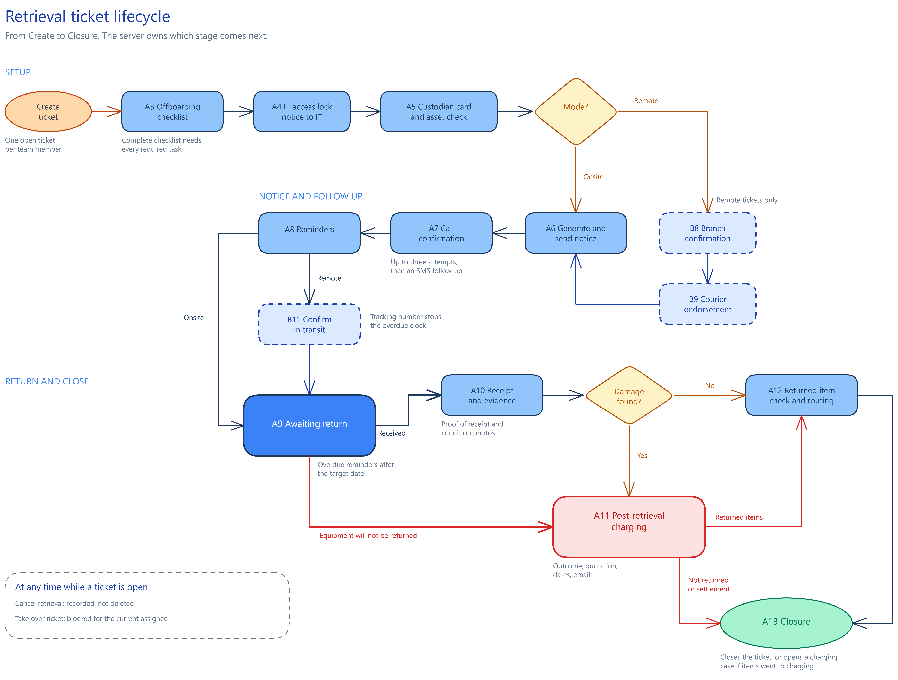

# Dev Documentation — GoTeam AMS Retrieval Module

**Audience:** the developer(s) integrating this prototype into the real GoTeam AMS
codebase (adding a real backend/persistence layer, auth, and wiring send/submit
to real services).

**Scope of this doc:** the whole retrieval module in one Nuxt app, in four modules:

- **Templates** — the email-template builder and the retrieval-forms (document) builder,
  two independently built Tiptap editors, plus their Outlook-export and print/PDF pipelines.
- **Ticket Tracker** — the retrieval ticket list, the create view and the ticket workspace
  (checklist, notices, courier, charging, closure).
- **Master Data** — the offboarding checklists.
- **Data layer** — `app/api` (a mock server and an http client behind one interface), the
  fixtures in `app/mocks`, and the per-record saving of forms and templates.

Every Known Trap, Out of Scope item and checklist item below is tagged with its module, or
marked **All** when it is cross-cutting, so a module ticket can pull only what applies.

**This file is the index, the traps and the checklist.** The detailed specifications live in two companion files, written from the code:

- [TICKET_WORKFLOW.md](./TICKET_WORKFLOW.md): the Ticket Tracker. Data model, reason by mode rules, every stage (A3 to A13, B8 to B11), the 52 server actions, what the server enforces and what it does not, history strings the UI depends on, list and create view, notifications, SMS.
- [TEMPLATES_SPEC.md](./TEMPLATES_SPEC.md): Templates and Master Data. List page, email and form models, builder behavior, `/form-preview`, the 66 placeholders and how they resolve, the contracts between templates and tickets, the checklist editor.

- [TOKEN_DATA_MAPPING.html](./TOKEN_DATA_MAPPING.html): all 66 placeholders, where the prototype gets each value, and whether production supplies it (Yes, No or Open). It does not claim production field names or types: those are for the developer to fill in. Filterable, opens in any browser.
- [INTEGRATIONS.md](./INTEGRATIONS.md): everything that crosses the boundary to a real system. Email sending in the retrieval flow (readiness gaps and a recommended contract), the SMS decision, the R24 (HRIS) data list, time zones and timestamps, the e-signature recommendations, print to PDF, dark mode status.

## Table of contents

0. [What changed since last round](#what-changed-since-last-round)
1. [What this prototype is](#1-what-this-prototype-is)
2. [Flow diagrams](#2-flow-diagrams)
3. [Known Traps](#3-known-traps)
4. [Out of Scope](#4-out-of-scope)
5. [Edge Cases & Solutions](#5-edge-cases--solutions)
6. [Numbered behavior sections](#6-numbered-behavior-sections)
7. [Technical Scoping / Feasibility — toolkits & packages](#7-technical-scoping--feasibility--toolkits--packages)
8. [Known Limitations](#8-known-limitations)
9. [Responsive spec](#9-responsive-spec)
10. [Implementation checklist](#10-implementation-checklist)
11. [Implementation phases](#11-implementation-phases)
12. [Simulator scaffolding](#12-simulator-scaffolding)
13. [Verification status](#13-verification-status)
14. [Known and accepted](#14-known-and-accepted)
15. [Still open for the dev or the next pass](#15-still-open-for-the-dev-or-the-next-pass)

---

## What changed since last round

**Final pass, 14 to 27 October 2026** (merged to `main` by pull requests 1 and 2 on 27 October; `retrieval` and `templates` are kept as backup branches):

- **Ticket list.** A compact header with three chips (Open, Due soon, Overdue) that filter the table, an "Assigned to me" toggle, a fixed page header with one scroll area below it, a table as tall as its rows, and 10, 15 or 25 rows per page (the Auto size and 50 are gone).
- **Ticket workspace.** The right rail is 388px wide. The IT access lock is a notice to IT and never a gate (`notifyItLock`, `skipItNotice`). The "Show Custodian card" cue on asset confirmation. The contact number can be edited. The button hierarchy is primary solid, secondary outline, tertiary ghost. The closure dropdown defaults an item in a charging case to "In charging case".
- **Sending.** "Mark as sent outside the system" on the notice, overdue and charging steps (a `manual` flag on `emails.send`). Copy and Download EML on the email preview and on the closure modal, through one helper (`downloadEmlFile`, which strips line breaks from the subject).
- **Checklist.** The review concept is gone: the button is "Complete checklist" and the banner "Checklist completed". The data field `checklistReview` and the action `finalizeChecklist` are kept as the completion record.
- **Data.** JRS (391) and LBC (1,399) branch lists, 30 sample team members, Asset Team full names and ids. J&T Express was removed. Saved copies of shipped email templates get the employee id in the subject on load.
- **Behavior added to every page.** Open menus close when the page scrolls (`plugins/closeMenusOnScroll.client.ts`) and a visible keyboard focus ring in both themes.
- **Delivery.** `main` is the source of truth. The dashboard is not in it.
- **Removed, and must not come back:** the IT lock scheduling and execution confirmations, the reviewer note, the Endorsement Recorded Date limit, the Auto page size.

**Earlier round:**
- **Dark mode.** Light, Dark or System (the default) from a toggle in the navbar. Documents that stand for paper stay light (`ams-paper`). Tokens, contrast values and the rules are in `AMS_DESIGN_SYSTEM.md` section 1.5 and `INTEGRATIONS.md` section 7.
- **The Dev Doc now covers the whole module in depth.** Added [TICKET_WORKFLOW.md](./TICKET_WORKFLOW.md) and [TEMPLATES_SPEC.md](./TEMPLATES_SPEC.md), corrected the sections that still described a Templates-only, no-backend prototype (sections 1, 3.2, 5, 6.2, 7, 8, 10), and added the backend rules the prototype does not enforce (Known Trap 9 and section 10.9). The audit behind this was a read of the code, not a browser run.
- **Scope grew from the Templates builder to the whole retrieval module** (tickets, create view, master data), with a data layer that a backend can replace file by file (see [BACKEND_SWAP.md](./BACKEND_SWAP.md) and [DATA_CONTRACT.md](./DATA_CONTRACT.md)).
- **Every read and write of data goes through `app/api`** (`mock` or `http`, chosen by `NUXT_PUBLIC_API_MODE`). Pages read stores and call async actions; the stage rules for the 52 ticket actions live in `api/ticketActions.ts` as the stand-in server.
- **One text standard across all modules**: labels 12px regular `text-default`, values 14px regular `text-highlighted`, helper text `text-helper`, placeholders and empty states `text-placeholder`, a 4px spacing scale, the selected option blue with a blue check in every select and dropdown, and "Optional" as a badge.
- **UI changes**: the create ticket view is grouped into section cards with headings; Take over ticket is disabled for the current assignee; the ready pulse also covers the final review, branch confirmation and the charging email.
- **Removed, and must not come back**: page-side writes of ticket history and notifications (`pushHistory`, `raiseNotification` in pages); the whole-blob `localStorage` mirrors for forms and templates; the `retrieval.vue` layout; uppercase field labels; the text "(optional)".

## 1. What this prototype is

Nuxt 4 + Nuxt UI v4 front-end prototype with **no real server**. Data goes
through `app/api`, which has a mock server (browser storage) and an http client
that has never been run against a real backend. Four modules (section 1.1):

- **Email Templates** (`app/pages/templates/email/[id]/edit.vue`) — a Tiptap
  rich-text body editor for HTML emails, with an "Export to Outlook" / copy
  pipeline that produces email-client-safe HTML (tables, inline styles,
  bulletproof buttons).
- **Retrieval Forms** (`app/pages/templates/forms/[id]/edit.vue`) — a Tiptap
  document canvas (`FormDocumentEditor.vue`) with on-screen pagination, custom
  form-field nodes (short and long text, number, checkbox, file, signature,
  link button, rendered with Nuxt UI inputs), a version history, and a
  print/PDF preview (`app/pages/form-preview.vue`).
- **Ticket Tracker** — list, create view and the ticket workspace (a 7,000 line
  stage engine). It sends the templates above. See TICKET_WORKFLOW.md.
- **Master Data** — offboarding checklists. See TEMPLATES_SPEC.md section 8.

The two Tiptap builders share a toolbar and several extensions, but use
**different** extension sets and different pagination (the email editor has no
pagination; the form editor uses `tiptap-pagination-plus` on screen and `pagedjs`
for print, see §7). They are not the same editor and should not be merged
without re-reading both.

There is no login, role or permission system. The current user is a switchable
persona (`currentUserName()`, the "Viewing as" control in the simulator bar);
the assignee and Asset Team lists come from `app/mocks/users.json`, and the CC
and BCC picker reads the static `app/data/teamMembers.ts` fixture. The ticket
actions perform no authorization.

### 1.1 Module map

| Module | Where it lives | Notes |
|---|---|---|
| Templates | `app/pages/templates/**`, `app/components/email/**`, `app/components/masterData/Form*`, `app/utils/tiptapExtensions.ts`, `emailExportHtml.ts` | Two Tiptap editors, Outlook export, print/PDF |
| Ticket Tracker | `app/pages/ticket-tracker/**`, `app/data/ticketTrackers.ts` | List, create, workspace; wrappers at the bottom of `ticketTrackers.ts` call the api |
| Master Data | `app/pages/master-data/**`, `app/data/checklistTemplates.ts` | Offboarding checklists (reasons and modes to a template) |
| Data layer | `app/api/**`, `app/mocks/**`, `app/data/recordSync.ts`, `app/data/syncedStores.ts`, `app/plugins/00.masterData.ts` | Mock server and http client behind `ApiClient` |

## 2. Flow diagrams

### Email template edit → export

```mermaid
flowchart TD
    A[Open template list] --> B[Open/create email template]
    B --> C[Edit body in Tiptap<br/>BodyField.vue]
    C --> D{Insert node?}
    D -->|Image| E[EmailImageNodeView<br/>role: none/header/footer]
    D -->|Button| F[ButtonLink node<br/>data-href only, no live href]
    D -->|Table/Callout/Banner| G[Other custom nodes]
    E --> C
    F --> C
    G --> C
    C --> H[Toolbar align/format<br/>context-aware: text vs image vs button]
    H --> I[Export / Copy to Outlook]
    I --> J[buildEmailExportHtml() in emailExportHtml.ts]
    J --> K[tableize fills/buttons,<br/>font-tag wrapping, mso-highlight]
    K --> L[Outlook-safe HTML string]
```

### Ticket lifecycle (Ticket Tracker)

Stages are in `STAGES_ONSITE` and `STAGES_REMOTE` (`data/ticketTrackers.ts`); A1, A2 and B11a are skipped in the workspace. Remote tickets add the courier stages. The server owns which stage comes next.



Editable source: [ticket-lifecycle.excalidraw](./diagrams/ticket-lifecycle.excalidraw) (open it at excalidraw.com). Dashed blue boxes are remote tickets only; the red path is the charging branch.

### Retrieval form edit → submit → preview/print

```mermaid
flowchart TD
    A[Open form template] --> B[FormDocumentEditor.vue<br/>Tiptap canvas + pagination]
    B --> C{Insert field?}
    C -->|Text/number/checkbox/file/signature| D[FormFieldNodeView<br/>Nuxt UI input]
    D --> B
    B --> E[Save draft]
    E --> F[reactive() in-memory store]
    F --> G[Saved to the server by recordSync<br/>one record at a time, prototype: browser storage]
    G --> H[Recipient opens /form-preview]
    H --> I{Already submitted?}
    I -->|Yes| J[Read-only submitted view]
    I -->|No| K[Fill fields, e-sign via SignaturePad]
    K --> L[Submit → mark submitted<br/>+ simulated emailed copy]
    L --> M[pagedjs Previewer<br/>window.print → PDF]
```

## 3. Known Traps

Regression-risk behavior — things that broke before, or that look like they
should match but intentionally don't.

### 3.1 Priority traps (read these first)

1. **[All] `npx vue-tsc --noEmit -p .` checks nothing.** The root `tsconfig.json` has `"files": []`. The real check is `npx vue-tsc --noEmit -p .nuxt/tsconfig.app.json` (run `npx nuxt prepare` first). A "0 errors" from the old command is meaningless.
2. **[Data layer] The stage rules are mock-server code, not front-end code.** `api/ticketActions.ts` (the 52 actions) and `api/mock.ts` stand in for the backend and are deleted at handoff; the server must own those rules. Do not re-add page-side writes of ticket fields, history or notifications.
3. **[Data layer] Ticket actions are not serialized per ticket.** In http mode two quick actions on one ticket can each compute from the row before the other's result and overwrite it. Serialize per ticket on the client or send a version (ETag) and refuse stale writes on the server.
4. **[Ticket Tracker] The `localStorage` ticket mirror is the mock's database only.** `utils/ticketStorage.ts` is switched off when `apiMode` is `http` (`setTicketMirrorEnabled`). Turning it on against a real backend lets a stale browser snapshot overwrite what the server returned.
5. **[Ticket Tracker, Data layer] Date-only strings (`2026-10-13`) parse as UTC.** Use `parseLocalDate` and `localISO`. Two real bugs came from `new Date(createdAt)` (wrong year on 1 January west of UTC) and `new Date().toISOString()` passed to a date-only formatter ("Invalid Date").
6. **[Ticket Tracker] "Take over ticket" for the assignee is `aria-disabled`, not `disabled`, on purpose.** Clicking it shows a toast that explains why. Switching it to a truly disabled item removes that explanation. The server still refuses a self take-over.
7. **[All] Text colors have a rule.** Helper text is `text-helper` (`#67778f`, the lightest slate that passes AA), not `text-muted`; placeholders and empty values are `text-placeholder` (below AA by decision); `text-dimmed` is `#64748b` (darkened for AA). Do not "tidy" these back to Nuxt UI defaults.
8. **[Templates] The email Subject at 16px and the form editor's document labels are intentional overrides** (Outlook parity, and a printed document). Do not normalize them to the app's 14px and 12px styles.
**More ticket and template traps (9 to 13).** Found in the later read of the code. The eight above stay the priority set used in the walkthrough, the QA Doc and the Jira ticket; these five are also real.

9. **[Ticket Tracker, Data layer] The prototype server enforces very little.** No authorization; most of the 52 actions work at any stage; the create rules (unexplained absence must be remote, the endorsement and its date required only on gated paths, recall date, override notes), the 3-call and 2-reminder caps, evidence and tracking validation, and gate order live only in the UI. The full list is in TICKET_WORKFLOW section 6.2. Re-enforce them on the server.
10. **[Ticket Tracker] The workspace reads state back by matching history text** (for example `Courier endorsement sent`, `Overdue reminder sent (T16)`, `Post-Retrieval Charging resolved`). A backend that writes different strings breaks banners, reminder status and closure checks. Keep the formats (TICKET_WORKFLOW section 6.3) or add structured fields. History times are UTC ISO instants now, formatted for the viewer at display time.
11. **[Ticket Tracker] Two client-to-server gaps still lose data.** `confirmAssets` sends no asset data (ticks and remarks are edited on the local ticket only); evidence and quotation files are browser blob URLs that die on reload. (The third gap, sends that carried no template or recipient, is closed: every stage email now goes through one send operation, TICKET_WORKFLOW section 6.4. It does not deliver real email.)
12. **[Ticket Tracker] Known defect: while a shipment is delayed the whole stage card disappears.** In the workspace template the stage card is a `v-else-if` of the "Shipment delayed" banner, so a remote ticket more than 14 days in transit shows only the banner (no Mark Equipment Received, no Back or Forward). Found by reading the template; not reproduced in a browser.
13. **[Templates] Delete, retire and edit have no usage check or lock.** A ticket path, reminder or charging outcome can point at a template or form that is deleted or retired. The ticket also picks its form from the ticket mode, not from the template's attachment (TEMPLATES_SPEC section 7).

### 3.2 Templates builder traps in detail

1. **A `//` or `/* */` comment inside `<script setup>` that contains the
   literal substring `<template` (e.g. mentioning "the template has 5 rows")
   breaks the Vite build** with a cryptic "Invalid end tag" error at a bogus
   line number. Some part of the toolchain regex-scans for that substring
   even inside plain comments. Describe markup in prose in comments, never
   with a literal `<template`/`<tag>` fragment.
2. **`stopEvent` on a Tiptap NodeView must be scoped, not blanket.** An
   unconditional `stopEvent: () => true` on `EmailImage`'s NodeView silently
   killed ProseMirror's own click-to-select — it's now scoped to only
   swallow events from `[data-email-image-chrome]` (the gear popover). Don't
   revert to a blanket `true`.
3. **`ButtonLink` intentionally has no live `href`/`target` on its editor DOM
   anchor** — only `data-href`. This is not a bug; it's the fix for the
   button navigating away when clicked inside the editor. The **exported**
   HTML (`tableizeButtons()` in `emailExportHtml.ts`) reads `data-href` and
   re-adds a real `<a href>` — don't "fix" the editor-side anchor by adding
   `href` back without also re-solving the navigation issue.
4. **Image/button auto-move-to-edge logic inserts the image into the doc
   *before* stripping adjacent empty paragraphs**, not after. Reordering
   this (strip-then-insert) reintroduces an infinite loop: ProseMirror
   auto-refills an empty paragraph the instant a transaction would leave the
   doc with zero block children, and the old cleanup loop saw that refill as
   "still empty" forever, hanging the tab. See `moveToEdge()` in
   `EmailImageNodeView.vue`.
5. **`EmailTrailingNode` replaces StarterKit's built-in `TrailingNode` on
   purpose** — trailing-node behavior is disabled *except* when the doc ends
   in a footer image. Don't re-enable StarterKit's default `trailingNode` or
   you'll reintroduce a permanent trailing gap.
6. **`renderHTML({ node, HTMLAttributes })`'s `HTMLAttributes` param is the
   already-merged output of each attribute's own `renderHTML`, not raw node
   attrs.** If an attribute's `renderHTML` intentionally returns `{}` (e.g.
   `align`, which is meant to style a wrapper, not itself), that value will
   never appear in `HTMLAttributes` — read `node.attrs.<name>` directly. This
   caused a real bug (button align silently not exporting) once already.
7. **Image sizing must be a real canvas pixel crop
   (`cropImageToAspect()`), never CSS `object-fit`.** Outlook's Word
   rendering engine ignores `object-fit` entirely — a CSS-cropped image
   renders distorted/stretched in real Outlook even though it looks correct
   in the browser preview.
8. **A native `<input type="file">` always renders its own native
   chosen-filename text**, independent of any custom file-list UI layered on
   top — this caused an "overlapping text" bug. The current file-upload UI
   (outline button + image preview) exists specifically to route around
   this; don't reintroduce a bare native file input with a custom label next
   to it.
9. **`definePageMeta({ ssr: false })` does not stop the first/direct request
   to `/form-preview` from being server-rendered** — only client-side
   navigations. The real fix is the `routeRules: { '/form-preview': { ssr:
   false } } ` entry in `nuxt.config.ts`. Removing that entry reintroduces a
   hydration mismatch (stale boxed/plain section styling) on first load of a
   real shared link.
10. **`vuedraggable`, `jspdf`, `html2canvas`, `@iconify-json/simple-icons`
    were removed from `package.json`** during a pre-handoff cleanup pass —
    they were dead weight (unused imports / superseded by `pagedjs`). If you
    see a reference to `html2canvas` in a code comment, it's describing
    **historical** behavior (an old PDF-export approach), not something
    currently wired up. (The ticket workspace's checklist drag uses
    `vue-draggable-plus`, which is a current dependency.)
11. **Placeholders resolve in three different places** (sample values in the
    editors and EML export, `ticketRealValues` in the ticket workspace, and
    `resolveTokensForPrint` in `/form-preview`). A change to a token must be
    checked in all three (TEMPLATES_SPEC section 6).
12. **A form field's `id` must stay unique and stable inside its form.**
    Duplicating a form copies the content HTML with the inner field ids
    unchanged, so ids repeat across forms (fine per form; check any global
    registry before adding one).
13. **The signature field stays locked until every other required field is
    filled.** Changing which fields are required changes when the signature
    unlocks. The tooltip lists the unfilled fields.

## 4. Out of Scope

**Deferred / boundary** (may ship later, genuinely not built):
- Any real backend, database, or persistence beyond `localStorage`.
- Authentication, roles/permissions, real team-member directory.
- **[Templates]** Delivery is not part of the **Templates builders**. The
  "recipients" UI in the email editor (`RecipientsSection.vue`) and the "already
  submitted"/"emailed copy" notice in the forms flow are mocked **on purpose**,
  to demonstrate the authoring and preview UX. What the builders hand to
  delivery is the finished content (the Outlook-safe HTML, the form).
- **Real email sending in the Ticket Tracker and the retrieval flow is IN
  scope for the dev.** Every send button in the workspace (notice, branch
  request, courier endorsement, reminders, overdue, charging notice, closure
  copy) must send a real email from the server. Today they only write a history
  line. The prototype is *partly* ready: the per-stage actions and template keys
  are in place, but the requests carry no template, recipients or rendered
  content, there is no send status, and the placeholder check is client-only.
  The gaps and a recommended contract are in
  [INTEGRATIONS.md](./INTEGRATIONS.md) section 1.
- **SMS stays copy and confirm** (Google Messages for web, then "Mark SMS sent")
  by decision; sending SMS from AMS is exploration only and is not built or
  scoped now. Recommendation and options: INTEGRATIONS.md section 2.
- **E-signature legal strength and audit trail are not built**, and the
  recommended set of features to add is in INTEGRATIONS.md section 5 (a link
  sent to the signer, server-side time and IP, consent, pinned form version,
  document hash, freeze after signing, audit log, signed PDF copy). It needs
  legal review.
- **Print to PDF:** the print dialog shows the Paged.js layout, which should
  match the output, but nobody has compared it with a physical printout or in
  browsers other than Chromium. Signed and archived PDFs should be produced on
  the server (INTEGRATIONS.md section 6).

- **[Ticket Tracker, Data layer]** Real notification delivery and the morning digest: the prototype raises notifications and shows "sent" records only. They belong to the server (email delivery itself: see above).
- **[Ticket Tracker]** A live employee-record (HRIS) connection. The directory, couriers and Asset Team members are fixtures in `app/mocks`; `simulateHrisLwdUpdate` and the simulator bar exist only to show the update flow.
- **[Ticket Tracker, Data layer]** Timed jobs. `scanTicketAlerts` (every 60 seconds) and the digest run in the browser because there is no server; production runs them server-side and the browser only reloads `GET /notifications`.
- **[Ticket Tracker]** Evidence and quotation file upload. Files are browser object URLs; production needs multipart upload (DATA_CONTRACT 8.5).
- **[Master Data]** Roles and permissions for who may edit checklists. Any Asset Team member may act on any ticket by default (DATA_CONTRACT section 10).

**Anticipated, not wanted** (a dev might reasonably add these unprompted —
don't):
- Don't merge the email-body Tiptap instance and the forms-document Tiptap
  instance into one shared editor/extension set. They intentionally use
  different pagination strategies and different node schemas.
- Don't add `object-fit`/CSS-based image scaling back into the email export
  path "for simplicity" — it will visibly break in real Outlook (see Known
  Trap #7).
- Don't restore a real `href` on the in-editor `ButtonLink` anchor to "make
  it feel more real" — it will reintroduce click-navigation inside the
  editor (Known Trap #3).
- Don't add FormKit Pro inputs (autocomplete, datepicker, etc.) without
  first confirming a Pro license/key — this prototype intentionally uses
  only free/core FormKit inputs (see §7).

- **[Data layer]** Don't move the stage rules into the pages or the http client "so the front end can work offline". The server owns them (Known Trap 2).
- **[Ticket Tracker]** Don't restore a browser-side counter for ticket numbers, references or gate pass numbers. The server assigns them; the mock derives them from existing tickets.
- **[All]** Don't write the text "(optional)" or uppercase field labels. Optional is the outlined neutral badge; section labels are the only uppercase text.
- **[Ticket Tracker]** Don't make the IT access lock (stage A4) a gate, and don't add a scheduling or execution confirmation. Locking access is IT's job. The stage is a notice to IT, with "Continue without notifying IT" as an equal way on.
- **[Master Data, Ticket Tracker]** Don't bring back a reviewer step, a reviewer note or the word "review" on the offboarding checklist. The button is "Complete checklist". The `noteText` argument on `finalizeChecklist` is an unused leftover; the real server should not accept or store a reviewer note.
- **[Ticket Tracker]** Don't restore a date limit on the Endorsement Recorded Date. It was removed on purpose.
- **[Ticket Tracker]** Don't add J&T Express. JRS and LBC are the couriers.
- **[All]** Don't add the dashboard to the retrieval module's branches. It lives on its own branch and is not part of this handoff.

## 5. Edge Cases & Solutions

| Edge case | Expected behavior |
|---|---|
| Doc would be left with zero block children mid-transaction (e.g. deleting the only image) | ProseMirror auto-refills an empty paragraph; image insert/cleanup logic is ordered insert-then-strip specifically to never cross this boundary mid-loop (Known Trap #4) |
| User inserts an image/button then immediately clicks it | Click selects the node (NodeSelection) via ProseMirror's default behavior; toolbar align buttons switch to reflect the selected node's `align` attr |
| Doc ends in a non-footer atom node (e.g. a table) | A trailing empty paragraph IS re-added (default text-input affordance) |
| Doc ends in a footer-role image | No trailing paragraph is added — footer stays flush to the bottom |
| Recipient re-opens a form they already submitted | Form renders read-only with "already submitted" state + simulated "emailed copy" notice, fields are not editable |
| A field's type is changed after answers were entered | Answers are not stored anywhere in the prototype (they live in the field's component only), so there is nothing to migrate. `formContentMigration.ts` only converts legacy `sections` into document HTML once. A backend that stores answers must define what happens to a value when the field type changes |
| Outlook "Merge Formatting" paste mode | Documented as a **client-side user setting outside the app's control** — not something `emailExportHtml.ts` can force-fix; character-run `<font>`/`mso-highlight` tags are the best available mitigation |
| Very long/unbroken text in a table cell in the Outlook export | `tableizeMarks()`/`tableizeFillBlocks()` wrap cell content in real `<table>`/`<td>` structure precisely because plain flow layout doesn't reliably contain overflow in Outlook |

| **[Ticket Tracker]** Creating a ticket for someone who already has an open ticket | Create is blocked with a banner naming the open ticket and a link to it; the server enforces the same rule |
| **[Ticket Tracker]** Endorsement Recorded Date on or after the Separation Date | Allowed. The date has no minimum or maximum (the old before the Separation Date rule was removed on purpose); only a gated path requires the endorsement and its date to be filled in |
| **[Ticket Tracker]** The viewer is already the assignee and opens Take over | Item is dimmed with a tooltip; clicking shows "Already your ticket"; no form opens |
| **[Ticket Tracker]** An action is refused by the server | The page shows the server's message (a toast, or inline in the modal); it never shows a stale success |
| **[Ticket Tracker]** Reload after creating or editing a ticket | The data persists (mock database); in http mode it comes from the server. The demo seed tickets are re-created in order after a reset |
| **[Data layer]** A record save returns `{ ok: false }` | The record is not marked saved, so it is retried on the next change; the message is logged |
| **[Master Data]** Deleting the last checklist template | Refused ("Keep at least one template"); deleting any other moves its paths to the first remaining template |

## 6. Numbered behavior sections

### 6.1 Email Templates builder
- Body editor: Tiptap `StarterKit` + custom extensions (`EmailImage`,
  `ButtonLink`, `Callout`, `MessageBanner`, `QuoteCommand`,
  `TableHeaderStyled`, `FontSize`, `EmailTrailingNode`) — all in
  `app/utils/tiptapExtensions.ts`.
- Toolbar (`BlockToolbar.vue`) is **context-aware**: align/format buttons
  detect whether an image, a button-link, or plain text is selected and
  route to the right `updateAttributes`/`setTextAlign` call. There is no
  separate "align image" button — this was an explicit user correction; do
  not add one.
- Insert-image popover shows recommended sizes (Header 640×140, Footer
  640×100) and crops via `cropImageToAspect()` to that exact aspect ratio.
- Export pipeline (`app/utils/emailExportHtml.ts`) is the single source of
  truth for "what does the final email look like" — always test changes
  against this, not just the live editor DOM.

### 6.2 Retrieval Forms builder
- Document canvas (`FormDocumentEditor.vue`) uses `tiptap-pagination-plus`
  for **on-screen editing pagination only** (an approximate, CSS-driven
  "what page am I on" — not print-accurate, see §8).
- Print/PDF output (`/form-preview.vue`) uses `pagedjs` (`Previewer`)
  independently — a separate, more print-accurate pagination engine, wired
  up specifically because `tiptap-pagination-plus` was found to have no real
  per-page document structure (see `docs/archive/PAGINATION_TOOLKIT_STUDY.md` for
  the full evaluation).
- Custom form-field nodes (`FormFieldNode`, `app/utils/formFieldNode.ts` +
  `FormFieldNodeView.vue`) render Nuxt UI inputs inline in the document
  (FormKit does not render inside a Tiptap node view). Each field's settings
  are an inline gear popover in the node view; `FormFieldPropertiesPanel.vue`
  is legacy and unused.
- Version history (`FormHistoryTab.vue`, `versionDiff.ts` using
  `microdiff`) diffs saved versions into labels such as "a field" or "form
  content". The View modal renders only legacy `sections`, so it cannot show
  a past version's content.
- Background/theme: `FormBackgroundPicker.vue` (via `vue3-colorpicker`),
  `formBackground.ts`, `formLetterhead.ts`.
- Everything else about the forms builder (field types, locking, versions,
  preview and submit states, print) is in TEMPLATES_SPEC sections 4 and 5.

### 6.3 Ticket Tracker
The full specification is [TICKET_WORKFLOW.md](./TICKET_WORKFLOW.md): data model (section 2), reason by mode matrix (3), derived values (4), stage by stage behavior (5), the 52 actions and what the server must enforce (6), list, create and workspace chrome (7), notifications and jobs (8), SMS (9). The bullets below are the short version.

- **List** (`ticket-tracker/index.vue`): a compact header with Open, Due soon and Overdue chips that filter the table, an Assigned to me toggle, search and filters, row selection with export, and page sizes 10, 15 or 25 (default 10); creates go through the same api as everything else.
- **Create** (`ticket-tracker/create.vue`): five section cards: Team member, Case details, Dates, Assignment, Summary. The form stays inert until a team member is picked. Reason and Mode are pre-filled from the offboarding case and need an override note if changed. The Summary card shows the deadline rule the server will apply.
- **Workspace** (`ticket-tracker/[id].vue`): a stage engine (setup, branch and endorsement, notice and confirmation, transit, return and evidence, closure). Each stage's primary button is guarded: a blocked click explains why with a toast. The ready pulse fires once, when the operator completes the step, never at page load and never on steps that only ask to continue.
- **Actions**: 52 named actions, each one request to `api().tickets.act(ticketNumber, name, args)`. `ACTIONS` at the bottom of `api/ticketActions.ts` is the endpoint specification; the typed wrappers are at the bottom of `data/ticketTrackers.ts`.

### 6.4 Master Data
Details and the checklist server rules are in TEMPLATES_SPEC section 8. Only Offboarding Checklists is live; Courier Providers, Policy Library and Asset Team Contact Block are placeholder cards, and couriers, HRIS and Asset Team users are read-only fixtures.
- **Offboarding checklists** (`master-data/offboarding-checklists.vue`): templates of tasks, each task required or optional (a badge toggles it); each template can start tickets for chosen reasons and modes; one template per path; the last template cannot be deleted.

### 6.5 Data layer
- **Reading**: pages read reactive stores synchronously; `plugins/00.masterData.ts` fills them before the first page renders.
- **Writing**: ticket actions and checklist templates are explicit calls; forms and email templates are saved per record by `data/recordSync.ts` (a `PUT` for a changed record, a `DELETE` for a removed one).
- **Swapping the backend**: follow [BACKEND_SWAP.md](./BACKEND_SWAP.md). The proposed tables, endpoints and shapes are in [DATA_CONTRACT.md](./DATA_CONTRACT.md); ten default assumptions in its section 10 are for the developer to confirm.

### 6.6 Text and spacing standard (All)
- Value 14px regular `text-highlighted`; label 12px regular `text-default`; helper `text-xs text-helper`; placeholder and empty `text-placeholder`; section labels 12px semibold uppercase; card titles 14px semibold.
- 4px spacing scale: label to control 8px, label to plain value 4px, value to detail 4px, control to helper 4px, group to group 24px.
- The selected option in every select and dropdown is `text-primary` medium with a primary check, set once in `app.config.ts`.
- Secondary (override) styles: email Subject 16px semibold; form editor document labels; printed documents.

## 7. Technical Scoping / Feasibility — toolkits & packages

This is the section to read before estimating any new work against this
codebase — it tells you what's a config change vs. what's a real
integration effort.

| Package | Version | Role | Feasibility notes |
|---|---|---|---|
| `nuxt` | ^4.5.2 | App framework | Nuxt 4 file-based routing (`app/pages`), auto-imports. No server routes/`server/` dir exist yet — adding a real API means starting that from scratch. |
| `@nuxt/ui` | ^4.11.0 | Component library (Reka UI + Tailwind v4 under the hood) | Theming is via `app/app.config.ts` (`ui.colors`) — Light and dark through Nuxt UI color mode (`colorMode` in `nuxt.config.ts`: default System, remembered under `ams:color-mode`). Tokens live in `main.css`; see `INTEGRATIONS.md` section 7. |
| `tailwindcss` | ^4.3.3 | Styling | v4 CSS-first config (`app/assets/css/main.css`), not a `tailwind.config.js`. Nuxt UI's default tokens compile to `oklch()` — this project pins several to hex equivalents specifically because `html2canvas`-style DOM-cloning tools (and print capture generally) can't parse `oklch()`. Any new custom color token should follow the same hex-pinning pattern if it needs to survive a capture/print path. |
| `@tiptap/*` (core, vue-3, starter-kit, extension-color/highlight/image/table*/text-align/text-style, `extensions`) | 3.31.2 (pinned) | Rich-text editor engine for both builders | Two **separate** Tiptap instances/extension sets (email body vs. form document) — do not assume shared config. Pinned exact versions (not `^`) on most Tiptap packages, but `@tiptap/extension-image` is `^3.31.2` (not pinned), and `@tiptap/pm` is imported (`BodyField.vue`) without being a direct dependency. A Tiptap minor bump should be tested deliberately, not auto-upgraded. |
| `tiptap-pagination-plus` | ^3.1.0 | On-screen pagination for the forms document canvas | Community package, MIT. **CSS-illusion pagination** — no real per-page DOM structure (see §8). Fine for "what page am I roughly on" while editing; not the source of truth for print output. |
| `pagedjs` | ^0.4.3 | Print/PDF-accurate pagination for `/form-preview` | Genuinely computes real page boundaries against print CSS (`@page`, margins). This is the one to extend if print fidelity work is scoped — not `tiptap-pagination-plus`. |
| `@formkit/nuxt` + `@formkit/addons` | ^2.1.2 | Installed and configured (`formkit.config.ts`), but **not used by the live form fields** | The live field node view uses Nuxt UI inputs because FormKit does not render inside a Tiptap node view. `<FormKit>` appears only in the legacy `FormDocumentField.vue`, which only the version View modal renders (legacy `sections`, always empty). Treat the package as removable unless you adopt FormKit for something new. **Core/free FormKit only**; no `@formkit/pro` dependency exists. If a future round asks for FormKit Pro inputs (autocomplete, datepicker, mask, rating, repeater, slider, toggle, transfer-list, etc.), that requires adding `@formkit/pro` **and** a Pro key from pro.formkit.com — scope that as new work, don't assume it's already licensed. Only `createAutoAnimatePlugin` from `@formkit/addons` is wired in (`formkit.config.ts`); `createFloatingLabelsPlugin`/`createMultiStepPlugin` are available but not currently used. |
| `vue3-colorpicker` | ^2.3.0 | Background/theme color pickers | Third-party Vue 3 component, listed in `vite.optimizeDeps` for dev-server perf (see `nuxt.config.ts` comment) — if it's ever replaced, remove it from that list too. |
| `vue-draggable-plus` | ^0.6.1 | Drag reordering of checklist items in the ticket workspace | Wraps SortableJS. The move up and move down menu is the keyboard path; keep it when porting. |
| `microdiff` | ^1.6.0 | Structural diffing for version history | Small, dependency-free diff lib — used to compute what changed between saved form/template versions. |
| `@playwright/test` (dev) | ^1.63.0 | E2E tests | `tests/e2e/` — run before/after any structural change to the forms builder; `form-duplicate` is meant to guard duplicate-form content carryover but is one of the stale specs (see section 15) until it is pointed at a seeded form. Only `ticket-smoke` and `ticket-send-and-time` pass today. |
| `@iconify-json/lucide` | ^1.2.127 | Icon set | The only icon set actually used (`i-lucide-*` classes throughout). `@iconify-json/simple-icons` was removed — it was never referenced. |

**Overall integration feasibility:** the front end is a complete, internally
consistent prototype. The single largest scoping item for a real
implementation is **the backend**. The seam exists (`app/api`: an `ApiClient`
interface with a mock and an http implementation, see BACKEND_SWAP.md), but
there is no server, the http client has never been run, the stage rules live
in mock-server code (`api/ticketActions.ts`) that must be rewritten as real
server logic, and the auth and permissions layer doesn't exist at all yet.
Tooling not listed above: `eslint`, `@nuxt/eslint`, `typescript`, `vue-tsc`,
and `pnpm` as the package manager.

## 8. Known Limitations

Call these out explicitly to whoever is scoping/estimating — they are not
bugs to "just fix," they're architectural boundaries of this prototype.

1. **No backend, no real persistence.** The reactive stores
   (`app/data/retrievalForms.ts`, `templateRuntime.ts`, `templates.ts`,
   `ticketTrackers.ts`) start empty and are filled from `app/api`. In `mock`
   mode the "server" is `api/mock.ts` plus `api/ticketActions.ts`, and its
   database is the browser's `localStorage` (keys under `ams:`).
   **`localStorage` is per-origin** — different dev ports or deployed domains
   have completely separate, unrelated saved state. The mock server must be
   replaced with a real API and database before this can be a production
   feature (BACKEND_SWAP.md).
2. **No auth, no roles, no real recipient/team directory.** The current user
   is a persona switch; `teamMembers.ts` and `mocks/users.json` are static
   fixtures. Assignee, "taken over by" and "done by" are names, not accounts.
3. **No email or SMS is actually sent.** There is no SMTP or API
   integration in this repo. In the **Templates builders** the "send" and
   "submit" affordances are mocked on purpose (an "emailed copy" notice). In
   the **Ticket Tracker** every send button only writes a history line, and
   sending for real is **in scope for the dev** (see INTEGRATIONS.md section
   1). SMS is copy and confirm by decision (section 2 there).
4. **Outlook export fidelity has real, permanent ceilings**, not just bugs
   to keep fixing:
   - Outlook's "Merge Formatting" paste mode is a **client-side user
     setting** the app cannot detect or override — some formatting loss on
     paste is unavoidable regardless of export HTML quality.
   - Outlook's Word-based rendering engine does not support `object-fit`,
     shorthand `background`, or modern CSS layout generally — the export
     pipeline works around this with tables/inline styles/legacy `<font>`
     tags, but any *new* visual feature must be designed with these same
     constraints in mind from the start, not bolted on after.
5. **Pagination is two separate, non-interchangeable systems**:
   `tiptap-pagination-plus` (on-screen, approximate, no real per-page DOM)
   and `pagedjs` (print/PDF, more accurate). Neither has been proven
   pixel-accurate against a real physical printed page — only against the
   in-browser print preview. Treat "does it paginate correctly" as an open
   verification item for anything beyond the cases already tested.
6. **E-signature is a drawn image, not a certified/legally-binding
   signature.** No timestamp, IP, or identity verification is captured
   alongside it. Recommended additions: INTEGRATIONS.md section 5.
7. **Dark mode exists, with limits.** The navbar toggle switches Light, Dark
   and System. `/form-preview`, the gate pass, the closure record attachment and
   every printed or exported document stay light on purpose. A text or
   highlight color a user picks inside an email or a form is inline and does
   not follow the theme, so a dark navy picked in light is hard to read in dark.
8. **No FormKit Pro inputs, no Pro license.** Anything beyond core FormKit
   inputs (autocomplete, datepicker, slider, rating, repeater, mask,
   currency, toggle, transfer-list, etc.) requires adding `@formkit/pro`
   plus a Pro key — this is new dependency + cost scope, not already
   available.
9. **This is a single-tenant, unauthenticated prototype directory** — it was
   never load-tested, never security-reviewed for multi-user concurrent
   editing (there's no concept of "someone else is editing this right now"),
   and has no rate limiting, input sanitization boundary, or CSRF/XSS
   hardening beyond what Vue/Nuxt provide by default. Treat all of that as
   required work for production, not "probably already handled."

## 9. Responsive spec

This is an **internal, desktop-first AMS tool**. Page-level horizontal scroll was measured at 375, 768 and 1302 px on the ticket list, the create view, the ticket workspace, the templates list, the email editor and the offboarding checklists page.

| Component | Behavior | Breakpoint |
|---|---|---|
| Create ticket section cards | Full width of the page column, 24px apart | all |
| Create ticket Dates cards (endorsement pair, Last Working Day and Separation Date) | One column, then two columns | switches at 640px (`sm`) |
| Page header, filters, tables | No page-level horizontal scroll at 375, 768 or 1302 | all |
| Ticket workspace | No page-level horizontal scroll at 375, 768 or 1302 | all |
| Ticket workspace right rail | Stacked full width below 1024px; 388px wide, collapsible and sticky from 1024px | `lg` |
| Ticket list | A fixed page header (about 500 of 812px on a phone, see section 15); the table scrolls sideways inside its card with four sticky columns; filters stack below 640px; the paging footer stacks below 768px | `sm`, `md` |
| **Known gap** Email template editor header | Overflows the page by about 166px at 375px (the action buttons do not wrap) | below ~640px |
| Forms and email editors (multi-pane toolbars, side-by-side preview) | Desktop-oriented; not designed for phones | scope separately if needed |

Touch targets on phones were not measured (buttons are Nuxt UI `sm` and `md`, about 32 to 36px high, below the 44px guidance); see Still open.

## 10. Implementation checklist

**Read this before starting.** This repo is a **front-end design
reference** — it was built by/with a UI/UX designer (not a full-stack
engineer) to nail down interaction patterns, visual behavior, and export
fidelity. Nothing here persists real data on a server, nothing here is
authenticated, and nothing here talks to a real server. The `app/api` seam
and the proposed contract (DATA_CONTRACT.md, BACKEND_SWAP.md) make the swap
mechanical, but building the real feature still means standing up the
backend, data and integration layer and porting this front end onto it.
Sections 10.1 to 10.8 were written for the Templates builders and are still
correct as a list of work; section 10.9 adds the tickets, master data and
data layer. The checklist below is grouped by layer so it can be scoped and
assigned as real engineering work.

### 10.1 Backend & API (build from scratch — none exists today)
- [ ] Choose and stand up a backend framework/runtime (this repo has no
      `server/` directory, no API routes, no server code at all)
- [ ] Design the API surface this front end needs, at minimum:
      list/create/read/update/delete for email templates, retrieval forms,
      form submissions, and form version history
- [ ] Design and implement the versioning/history API that
      `FormHistoryTab.vue` / `versionDiff.ts` currently fake with in-memory
      diffing — decide whether full-document snapshots or field-level diffs
      are stored server-side
- [ ] Implement server-side validation for every form-field type mirrored
      from `app/utils/formFieldRegistry.ts` / `formFieldValues.ts` — the
      client-side FormKit validation in this prototype must not be the only
      validation layer in production
- [ ] Implement input sanitization for all rich-text/HTML content coming
      from the Tiptap editors before it is stored or re-rendered anywhere
      (XSS boundary does not exist yet — see §8.9)
- [ ] Add rate limiting and standard API hardening (this prototype has none)

### 10.2 Database & persistence (replaces `app/data/*.ts` + `localStorage`)
- [ ] Design a real schema for: email templates, retrieval form templates,
      form field definitions, form submissions/responses, form version
      history, team members/users
- [ ] Migrate the **shape** of `app/data/retrievalForms.ts`,
      `app/data/templateRuntime.ts`, and `app/data/templates.ts` into that
      schema — these files are the authoritative reference for what fields
      currently exist, even though they must not survive as the actual store
- [ ] Reads and writes of those stores already go through `app/api`; what
      remains is the real server behind it (see 10.9)
- [ ] Form and template saves already go through `app/data/recordSync.ts`
      to the api layer (see `BACKEND_SWAP.md`); implement the `PUT` and
      `DELETE` endpoints and remove the prototype's browser storage
      (`api/mock.ts`) entirely
- [ ] Decide on and implement file storage (uploaded files in the
      file-upload field, captured signature images) — currently these live
      as in-memory/data-URL values only, with nowhere real to go

### 10.3 Authentication & authorization (none exists today)
- [ ] Add real authentication (no login flow exists anywhere in this repo)
- [ ] Replace the static `app/data/teamMembers.ts` fixture with a real
      user/team directory
- [ ] Design and implement roles/permissions — who can create/edit/send a
      template, who can view/fill/submit a form, who can view submission
      history
- [ ] Add session/ownership checks to every API endpoint above (an
      authenticated user editing someone else's template/form should be an
      explicit, deliberate decision, not an accident of a missing check)

### 10.4 Email sending
**Ticket Tracker and the retrieval flow: build it (in scope).** Details,
gaps and the recommended contract are in INTEGRATIONS.md section 1.
- [ ] **[Ticket Tracker]** The front end and mock already call one send operation per ticket (`api().emails.send`, DATA_CONTRACT 7.4; template key, form id, recipients, idempotency key). Implement it on the server: render from the ticket, refuse on missing placeholders, send, store a snapshot and a status, and write the history entry; keep the per-stage actions as bookkeeping
- [x] **[Ticket Tracker]** Pending, sent and failed states with Retry are built in the UI (the Sending button, the "Email not sent" banner). Keep them when porting; never show a failed send as sent
- [ ] **[Ticket Tracker]** Port the token rendering rules (`app/utils/ticketMessage.ts`, one pure module the page and the mock both use) to the server and test them against fixed cases (TEMPLATES_SPEC section 6; the cases still need writing)
- [ ] **[Ticket Tracker]** Decide the sender mailbox (recommended: the Asset
      Team's shared mailbox) and whether to detect replies (INTEGRATIONS.md 1.4)
- [ ] **[Ticket Tracker]** SMS stays copy and confirm (INTEGRATIONS.md section 2)

**Templates builders: do not wire delivery into them.**
- [ ] Do **not** wire `RecipientsSection.vue` or the forms "already
      submitted"/"emailed copy" notice to a real email service; the sends
      happen from the ticket flow
- [ ] Re-verify Outlook export **HTML** fidelity against real Outlook
      clients (desktop + web) — this is about the exported markup being
      correct, independent of and before whichever feature actually
      transmits it

### 10.5 E-signature & compliance (legal/compliance input required)
- [ ] Get a legal/compliance decision on what "signed" needs to mean for
      this business (timestamp? identity verification? audit trail?) before
      treating `SignaturePad.vue`'s drawn-image capture as sufficient
- [ ] Implement the recommended set in INTEGRATIONS.md section 5 (unique
      expiring link, server-side time and IP, consent, pinned form version,
      document hash, freeze after signing, audit log, signed PDF copy), adjusted
      by the legal decision; none of it exists in this prototype
- [ ] Define the submission model (field id to value, signature and files); the
      prototype stores no answers

### 10.6 Print/PDF pipeline
- [ ] Independently spot-check real OS print-to-PDF output for forms against
      the `pagedjs` preview in `/form-preview.vue` — only the in-browser
      preview has been verified so far, not a physical/real PDF output
- [ ] Decide whether PDF generation should also be produced **server-side**
      (e.g. for emailing a copy, or archiving a submitted form) — today PDF
      only ever exists as a client-side `window.print()` browser action

### 10.7 Front-end porting work (this repo → the real codebase)
- [ ] Port the Tiptap email-body editor and its extensions
      (`app/utils/tiptapExtensions.ts`) into the real app's front end
- [ ] Port the Tiptap retrieval-forms document editor
      (`FormDocumentEditor.vue`), its custom field-node system
      (`formFieldNode.ts`, `FormFieldNodeView.vue`), and the FormKit wiring
- [ ] Port the Outlook export pipeline (`emailExportHtml.ts`) as-is where
      possible — it encodes real, hard-won Outlook-compatibility knowledge
      (see §8.4); don't rewrite it from scratch without reading it first
- [ ] Port the print/PDF preview page and pagedjs wiring
- [ ] Decide how this front end's Nuxt UI/Tailwind v4 theming
      (`app/app.config.ts`, `app/assets/css/main.css`) maps onto the real
      app's existing design system, if one already exists there — this repo
      assumes it owns the whole page, the real app may not
- [ ] Scope `@formkit/pro` + license cost if any Pro input is requested
      beyond what this prototype uses (core FormKit only)
- [ ] Scope phone support for the two editors as separate design
      work if ever required, the email and form
      editors are desktop-oriented (the ticket tracker and templates list are
      responsive, see §9)

### 10.8 Testing & rollout
- [ ] Run `tests/e2e/` (Playwright) and `npx vue-tsc --noEmit -p .nuxt/tsconfig.app.json` clean
      before and after any structural change made while porting
- [ ] Add real backend/API tests (none exist today — this prototype's tests
      only cover front-end behavior against mock data)
- [ ] Load-test and security-review before production rollout — this
      prototype has never been load-tested or security-reviewed (see §8.9)

### 10.9 Ticket tracker, master data and data layer
- [ ] **[Data layer]** Replace `api/mock.ts` and `api/ticketActions.ts` with the real backend; keep `api/types.ts`, `keys.ts` and `mappers.ts` (BACKEND_SWAP.md)
- [ ] **[Data layer]** Run `app/api/http.ts` against the real server and correct its paths and envelopes (it has never been run)
- [ ] **[Data layer]** Serialize ticket actions per ticket, or add a version check (Known Trap 3)
- [ ] **[Data layer]** Confirm the ten default assumptions in DATA_CONTRACT section 10
- [ ] **[Ticket Tracker, Data layer]** Implement the stage rules on the server, including everything the prototype leaves to the UI: authorization, stage and status checks on each action, the create rules, call and reminder caps, evidence and tracking validation, gate order (TICKET_WORKFLOW section 6.2)
- [ ] **[Ticket Tracker]** Replace history-text matching with structured fields (sent flags, timestamps, template keys), or keep the exact strings in TICKET_WORKFLOW section 6.3; store ISO instants
- [ ] **[Ticket Tracker]** Make `confirmAssets` carry `checked` and `remarks` per asset; add file upload for evidence and the quotation. (Sends now carry template, recipients and a key; the server must render, send and store, see 10.4.)
- [ ] **[Ticket Tracker]** Fix the stage card hiding while a shipment is delayed (Known Trap 12)
- [ ] **[Ticket Tracker]** Decide: `changeReasonAndMode` should update `gateCount`, the checklist and the stage mapping (TICKET_WORKFLOW section 5); allocate gate pass numbers and ticket references atomically on the server
- [ ] **[Ticket Tracker]** Send real email and SMS from the server (in the prototype every send goes through `api().emails.send`, which renders the message, stores a `SentEmail` snapshot and writes the history line, and no mail leaves the browser; SMS is copy and paste), and keep the server-side placeholder check the mock already runs
- [ ] **[Templates]** Add a usage check (or a refusal) to delete and retire, a lock or warning when editing an attached or used form, and decide the single source of truth for which form a send attaches (TEMPLATES_SPEC section 7)
- [ ] **[Templates]** Define the form submission model (field id to value, files, signature), the recipient-facing form URL and token, and replace the `ams:formSubmissions:v1` and `ams:formPreviewValues:*` browser handoffs
- [ ] **[Templates]** Let the server own timestamps, authors and version ids for templates and forms; consider version-append endpoints instead of whole-record `PUT`
- [ ] **[Ticket Tracker]** Move `scanTicketAlerts` and the digest to the server; the browser reloads `GET /notifications`
- [ ] **[Ticket Tracker]** Replace browser object-URL files with multipart upload
- [ ] **[Ticket Tracker]** Delete the demo-only code listed in section 12
- [ ] **[Ticket Tracker, Master Data]** Keep the text and spacing standard (6.6) when porting; do not restore Nuxt UI default helper or placeholder colors
- [ ] **[All]** Run `npx vue-tsc --noEmit -p .nuxt/tsconfig.app.json`, `npx nuxt build` and `tests/e2e/ticket-smoke.spec.ts` clean

---

## 11. Implementation phases

The checklist above (§10) is organized by technical layer. For the recommended
**execution order** — which layers to build first, what can run in parallel,
and what depends on what — see
[Implementation Phases](./IMPLEMENTATION_PHASES.md).

Summary: Phase 0 (backend/database/auth) → Phase 1 (templates builder) ∥
Phase 2 (master data) → Phase 3 (ticket tracker) → Phase 4 (integration,
testing, rollout). Full dependency map, exit criteria, known traps per phase,
and key decisions are in that document.

## 12. Simulator scaffolding

Scenario now has a **High volume** option (about 35 tickets, for paging) next to Standard data and First-timer. The flask menu also holds Push Simulated Reply, Notification types, Morning digest, Run Alert Check, Act as, Allow sending with unresolved placeholders, Fail the next email send, Show the prototype controls bar and Clear All Tickets. The end user guide (`AMS Retrieval User Guide.html`) explains each one.

The strip at the top of the app (State, Viewing as, Scenario, Situation), the flask popover in the navbar ("Simulate an employee record update"), the persona switch and the "Clear all tickets" action are **verification scaffolding, not production features**. Use them to reach every state, role and scenario, then leave them out of production.

Demo-only code that goes with them: `simulateHrisLwdUpdate`, `simulateBranchReply`, `pushDemoNotification`, `pushDemoNotificationSet`, `clearAllTickets`, `repairRestoredTicket`, and `utils/ticketStorage.ts` (the mock's ticket database), `components/shared/SimulatorBar.vue`, `utils/demoSettings.ts` (`simState`, `simScenario`, `simSituation`, `allowUnresolvedSends`, `failNextSend`), the flask popover in `components/email/TopNavbar.vue`, the High volume builder (`buildHighVolumeRows`, the `demo-hv-*` rows) in `ticket-tracker/index.vue`, and the `failNextSend` and `allowUnresolvedSends` branches in `api/mock.ts`. The `ams:demo:*` storage keys belong to the same group.

## 13. Verification status

### 13.1 Final pass, 27 October 2026

Run on `retrieval-ui-polish`, then on the two pull-request branches (`retrieval-sync`, `templates-sync`) that were merged into `main`.

| Check | Result |
|---|---|
| Type check (`npx vue-tsc --noEmit -p .nuxt/tsconfig.app.json`) | 0 errors on `retrieval-ui-polish`, `retrieval-sync` and `templates-sync`, each run on its own |
| Simplify | Four review angles (reuse, simplification, efficiency, altitude) on the final commits. Applied: one shared `downloadEmlFile` (the template editor now uses it too), `useCopyFlash` instead of two hand written copy timers, a shared `flashElement`, an `employeeIdNumber` helper, and the old Auto page size code removed. Skipped, listed in section 15 |
| Code review (high) | 9 findings. Fixed: the closure no longer lists a skipped IT notice as outstanding, the list page stays in range when rows shrink, a misplaced doc comment. The other six are in section 15 |
| Security (by hand; the packaged skill cannot read `origin/HEAD`) | The only new `v-html` lines add a `ref` to bindings that already existed (the preview text is escaped by `highlightForTicket`). The diff adds no storage keys, no `console.log` and no `any`. The new links are an internal URL helper and the EML file download. The closure email escapes the name and address |
| Merge safety | One new global plugin (`closeMenusOnScroll.client.ts`) and a global focus ring rule in `main.css`; both are in section 15 and 14. No generic global class names |
| Tests (Playwright, on `retrieval-sync`) | `ticket-smoke` and `ticket-send-and-time` pass, 5 of 5: create a ticket and keep it across a reload, then cancel with a confirm; a refused send changes nothing and the same button retries it; stored times show correctly in Asia/Manila, UTC and America/Los_Angeles. The seven form specs fail because they open the form `aof-commitment`, which is no longer seeded (stale, the base branch has the same note) |
| Dates in more than one time zone | The diff adds no new date code. The three zones above are covered by `ticket-send-and-time`. The date only logic still uses `parseLocalDate` and `localISO` |
| Widths | Ticket list and workspace at 375, 768 and 1366px: no horizontal scroll, no console errors. On a phone the fixed page header takes about 500 of 812px (section 15) |
| Accessibility | axe-core 4.10.2 (WCAG 2.0, 2.1 and 2.2, A and AA, light and dark): 0 violations on the ticket list, create view and email editor. Ticket detail: five unlabeled checkboxes and two unlabeled selects fixed; three structural items remain (section 15). The `wcag-accessibility-audit` skill was not run as a separate audit |
| Performance (production build, Chrome DevTools trace) | Ticket list desktop LCP about 1.0 s, CLS 0. Ticket detail on throttled mobile about 3.55 s, over budget. Not re-measured on the merged `main` |
| Production build | The static demo (`AMS_STATIC_DEMO=1 nuxt generate`) built from `main` (`9d906ed`), deployed and opened: ticket list, a ticket and Templates load with no console errors. `nuxt build` (server) was not re-run on `main` after the merge |
| Documentation cross-check | Every document in this package was compared claim by claim with the code on 27 October 2026 by read-only passes (TICKET_WORKFLOW, TEMPLATES_SPEC, DEV_HANDOFF, DATA_CONTRACT, INTEGRATIONS, BACKEND_SWAP, QA_HANDOFF, PRD, IMPLEMENTATION_PHASES, README, HANDOFF_TICKET, HANDOFF_WALKTHROUGH, WCAG_DARK_AUDIT, DATA_EXPORT_GUIDE, TOKEN_DATA_MAPPING and the user guide), and the contradictions were corrected. This was a read of the code, not a browser run. Not fixed: three smaller DATA_CONTRACT items (the example ticket JSON is abbreviated, audit_trail_id has no column, the email template resource shape), and most of the WCAG_DARK_AUDIT per finding statuses |
| Not exercised in a browser | The closure flow (Close Ticket defaults, Copy and Download EML, Reopen), the A5 "Show Custodian card" click, "Mark as sent outside the system" on notice, overdue and charging, and "Continue without notifying IT". A scripted click on Close Ticket opened no dialog; that was not investigated |

### 13.2 Earlier pass (as of `fbf0eb3` on `checkpoint`)

What was checked, and what was not, as of the last commit (`fbf0eb3` on `checkpoint`):

| Check | Result |
|---|---|
| Type check (`npx vue-tsc --noEmit -p .nuxt/tsconfig.app.json`) | 0 errors |
| Production build (`npx nuxt build`) | Passes; 11.6 MB total, 2.63 MB gzip |
| Simplify | Four review angles on the data layer, fixes applied. The later UI commits got the code review's reuse, simplification and efficiency angles only, not a separate four-agent pass |
| Code review (high) | Data layer: 10 findings, 3 fixed, 7 deferred. UI commits: 7 findings, 2 fixed, 5 listed in section 15 |
| Security (by hand; the packaged skill cannot read `origin/HEAD`) | `v-html` sinks are author content or escaped strings; links allow http, https, mailto, tel and relative; every storage key is namespaced `ams:`; one non-namespaced constant is a template key, not storage |
| Merge safety | No `console.log`; few `any` casts (tiptap extensions, `Select.vue`); module-level state is listed in section 14; no generic global CSS class names |
| Dark mode, contrast (own scanner, see below) | Every text node on 13 routes at 375, 768 and 1302 px in dark, plus 19 opened menus, popovers, drawers and modals at 1302 px and a walk of all six stages of tickets 422 to 426 at 1302 px: no failure except disabled controls (exempt) and the create view's dimmed sections (open item) |
| Dark mode, light regression | Computed color, background, border, outline, shadow and opacity of every element on 14 routes at 1302 px, light, compared with `HEAD` (2f0791e) served from a separate worktree: 0 differences. The two inserted elements (theme toggle, second logo) shift the order by one, and one adjacent pair of spans was matched out of order by the comparison and ignored |
| Dark mode, focus ring | 40 keyboard tab stops on each of 6 pages in dark: every ring at least 3:1 after the fix (before it was 1.6:1) |
| Dark mode, production build (superseded by 13.1 for the final tree) | `nuxt build` of a copy of the tree (before the two selector fixes and the editor change) finished with exit 0. Two later builds of the final tree bundled the client and server and prerendered, then stalled in the last Nitro packaging step on this machine and were stopped, so **the final tree has no completed production build**. Re-run `npx nuxt build` before merging |
| Dark mode, tests | `ticket-smoke` and `ticket-send-and-time` pass in light and with `colorScheme: dark` (5 of 5 each) |
| Accessibility | Lighthouse on the production build (ticket list, desktop): 88. Three real failures fixed (invalid `aria-expanded` on a wrapper div, three unnamed filter selects, one low-contrast email text) and re-checked in the DOM, not re-scored. The full WCAG 2.2 audit skill was **not** run; screen readers and the editors were **not** tested |
| Performance (production build, Chrome DevTools trace) | Ticket list desktop: LCP ~1.0 s, CLS 0.00. Ticket detail on throttled mobile (4x CPU, Slow 4G): LCP ~3.55 s (over the 2.5 s budget), CLS 0.00 — see section 15 for the cause and the fix. Client JS over the 300 KB budget on the detail route (framework vendor ~421 KB gz plus the page's own ~207 KB gz) |
| Smoke test (`tests/e2e/ticket-smoke.spec.ts`) | Passes: create, reload, Take over disabled, Cancel retrieval dismissed and confirmed |
| Older Playwright specs | 7 fail. They open the form `aof-commitment`, which no longer exists at `HEAD` or in the commit before this work (stale, not a regression) |
| Widths | No page-level horizontal scroll at 375, 768 and 1302 px, except the email editor header at 375 (about 166px) |
| Dates across timezones | Superseded by 13.1: `ticket-send-and-time` covers Asia/Manila, UTC and America/Los_Angeles. The date code uses `parseLocalDate` and `localISO` |
| Companion specs (TICKET_WORKFLOW.md, TEMPLATES_SPEC.md) | Written from a read of the code by four parallel read-only passes (workspace first half, workspace second half, ticket rules and actions, templates module), then spot-checked against the source for the Shipment delayed card, the `Inspection routed` lookup, the `Deduction initiated` string, `colorMode` and FormKit usage. **Not run in a browser.** Statements marked UNVERIFIED in those files are inferred. About 12 workspace script ranges (template and placeholder helpers, rail scroll code) were not read |
| Not exercised in a browser | gate release, target date rebaseline, address override, shipment details, in transit, branch request and reply, change reason and mode (success), take over (success), quotation, referred to payroll, the email editor's Save and version flow |

## 14. Known and accepted

- **Console 404 for `/_payload.json`** on the node production build (Lighthouse "errors in console"). The static demo is unaffected; decide payload extraction for your deploy target.
- **Hydration mismatch warnings** (breadcrumb children, an `is-overflowing` class from the scroll-fade plugin) exist at `HEAD` too and are cosmetic.
- **Module-level state**, all mock or demo: `ticketStorage.ts` (`lastKnown`, `mirrorEnabled`, `saveTimer`), `api/index.ts` (`client`), `api/mock.ts` (`checklistCache`), `ticketTrackers.ts` (`demoCursor`).
- **`any` casts** in `tiptapExtensions.ts` (Tiptap command typings), `components/shared/Select.vue`, `ticket-tracker/create.vue` (`employeeQuery`) and `ticket-tracker/[id].vue` (the checklist input ref and the drag event).
- **Global behavior:** `plugins/closeMenusOnScroll.client.ts` (a document level scroll listener and a body MutationObserver, module level state) and the `:root ... :focus-visible` rule in `assets/css/main.css` (both themes). The demo refs in `utils/demoSettings.ts` are module level too.
- **Dependencies used but not declared:** `@tiptap/pm` (imported in `BodyField.vue`, `tiptapExtensions.ts` and `EmailImageNodeView.vue`) and `@internationalized/date` (`DatePicker.vue`) arrive through other packages. Add them to `package.json` when porting.
- **Seed tickets renumber** after a created ticket is reloaded in the mock (numbers come from the database in production).
- **Placeholder and empty-state color is below AA (3.5:1) in the light theme by decision.** Dark passes AA (5.9:1).

## 15. Still open for the dev or the next pass

Real findings that are larger than a cleanup, with the cost of leaving them:

| Item | Cost of leaving it |
|---|---|
| Per-ticket action serialization (Known Trap 3) | Lost updates in http mode on quick successive actions |
| `updateTicketFields` shows an edit before the server accepts it and never rolls back; text typed in the last 400 ms is lost on tab close | A refused edit stays on screen |
| `plugins/00.masterData.ts` loads five things one after another with no error path | Slow first render and a blank app if one request fails |
| The `beforeunload` record flush cannot finish an async request | Last edits before closing the tab can be lost in http mode (use `fetch` with `keepalive`) |
| Seed arithmetic (417, 421) in `api/mock.ts` | Mock numbers could collide if the fixtures change |
| Create view Summary values are semibold, against the "values are regular" rule | Visual inconsistency |
| Per-instance selected-option styles now duplicate the global config | Two places to change one color |
| Email editor header overflows at 375px; touch targets below 44px | Not phone-ready |
| Seven stale tests in two specs, `form-document-nested` and `form-duplicate` (form `aof-commitment`) | They fail for everyone until rewritten |
| Email Subject edit input is 14px while its read view is 16px | Mode changes the Subject's size |
| **Ticket-detail LCP on throttled mobile: ~3.55 s** (4x CPU, Slow 4G, production build; desktop is fine at ~1.0 s, CLS 0 everywhere). Cause is the client-only render of the 7,200-line `pages/ticket-tracker/[id].vue` — its `<script setup>` (≈100 computeds/refs/watchers) runs on mount before first paint; not Tiptap (that route does not load it) and not network. Already applied: the drag library and the email-preview modal are lazy-loaded out of the initial chunk. **Real fix (a dedicated refactor):** lift the page's state into a `useTicketWorkspace(id)` composable, then extract the right rail, the stage blocks and the Activity Log into components rendered with `hydrate-on-visible` / `hydrate-on-idle` so their setup+render leave the critical path. Do it section by section with re-testing — the rail alone touches ~40 refs/handlers and the DOM-measurement/collapse logic is fragile to move. The skeleton→content swap defeats the trace tool's LCP detection, so measure with a manual mark or field RUM | Slow first load on a throttled phone; fine on desktop |
| Real email delivery behind the send operation, failed-attempt storage and the recipient form link (INTEGRATIONS.md section 1). The front end and mock side are built | The ticket flow shows "sent" only from the mock until the dev builds the server |
| The 08:00 digest, `scanTicketAlerts` and `createdAt` still use the browser's local day; no per-user time zone is stored (INTEGRATIONS.md section 4). Stored instants are UTC and display in the viewer's zone now | A server job needs a time zone per Asset Team member |
| Serial numbers and asset tags are generated in the mock; the real ones are in the AMS asset records (INTEGRATIONS.md section 3.3) | Printed documents would show invented ids |
| The mock embeds one full employee record in every ticket, mixing AMS data and R24 data; the decision is AMS first, R24 only for what the AMS lacks, not stored (INTEGRATIONS.md section 3) | The data layer must be split into two sources |
| Light theme contrast failures found by the dark audit's scanner: avatar initials `#386be6` on `#ebf0fc` (4.2:1), white on the red `Send Overdue Reminder` button (3.8:1), `text-placeholder` 3.5:1 by decision | Known light failures, untouched |
| Create view dims every section with `opacity` (0.3 to 0.5) until a team member is picked, and the primary button is dimmed without `aria-disabled` | Headings and labels in the dimmed sections fail 4.5:1 in both themes, and a screen reader is not told the button is unavailable |
| A text color a user picks inside a form or email document is inline and does not follow the theme | Dark navy text chosen in light reads poorly on the dark page |
| Dark mode: not checked | Screen reader testing, forced colors mode, Lighthouse (the DevTools browser was in use by another session), the toast and the Close Ticket, Rows per page, Confirm Evidence Complete and Background popovers (could not be opened by the script), the walk of ticket stages at 375 and 768 px, and a second human look at every screen |
| Stage card hidden while a shipment is delayed (Known Trap 12) | A delayed remote ticket cannot be advanced from the page |
| About 590 KB of mock JSON (the branch lists) is imported and re-keyed in `loadMasterData`, which the master data plugin awaits before first render on every page | Slower first paint everywhere for data one stage needs. Load the branches when the branch stage opens |
| `plugins/closeMenusOnScroll.client.ts` sends a synthetic Escape on any page scroll while a `role=menu` or `role=listbox` exists, and watches the whole body | Covers a stacking problem (the menu painting over the sticky header) with behavior; fix the layering instead (z-index or the Nuxt UI popper content). It could close a modal if a menu role stays mounted |
| `manual` is a flag on `emails.send` that skips the placeholder guard and the failure simulation | Two behaviors behind one boolean; a real server should have its own operation (for example `recordExternalSend`) that never mails and always sets `sentExternally` |
| The list tiles read day counts by matching a regex on the countdown label (`daysIn`), and `summary`, `summaryTiles` and `subline` derive the same sets | A wording change to the label turns the stats into 0. Return a numeric `days` from `deadlineInfo` and derive once |
| The High volume scenario (35 names, clones, fake ids) sits in `ticket-tracker/index.vue` and re-clones on every recompute | Fixture logic in a production page; move it to the mock layer |
| Reviewer note plumbing is dead (`finalizeChecklist` `noteText`, `checklistReview.note`) | Code the real backend must still port for nothing |
| The Create Ticket menu order changed (Onboarding before Replacement) | Confirm it was intended |
| On a phone the fixed page header of the ticket list takes about 500 of 812px | Little room for the list. Let the whole page scroll below the `md` width |
| Courier branches are a one time snapshot (JRS 391 from the JRS feed, LBC 1,399 from LBC's store locator, used once with permission). The LBC data has no pickup flags and the JRS flags are all false; the nearest suggestion matches city text, not distance | Needs a real branch feed or upload |
| Structural accessibility items on ticket detail: nested interactive rail headers and asset rows, 16px checkboxes, `#386be6` small text at 4.16:1 | Known WCAG 2.2 failures, untouched |
| "Notify IT" records a notice only. No message reaches IT | Wire `notifyItLock` to whatever IT uses (email or a ticket queue) |
| Not exercised in a browser at handoff: the closure flow (Close Ticket defaults, Copy and Download EML, Reopen), the A5 "Show Custodian card" click, "Mark as sent outside the system" on notice, overdue and charging, and "Continue without notifying IT". A scripted click on Close Ticket opened no dialog and was not investigated. The server `nuxt build` and the full `wcag-accessibility-audit` were also not run on merged `main` | A bug in these paths would first show in QA. QA cases 68 to 76 cover them |
| Shared files on `main` carry both modules (the api layer, ticket data and the navbar are needed by the Templates editors too) | Reviewing the Templates pull request shows retrieval files it needs to compile |
| Retired template banner says it can't be edited, but editing is not blocked | The copy misleads authors |
| Form version View modal renders only legacy sections | No content preview of a past form version |
| `changeReasonAndMode` leaves `gateCount`, the checklist and the stage index unchanged | A path change can land on the wrong stage or keep the wrong gate count |
| `nearestBranchFor` ignores the team member address correction | The suggested branch can disagree with the corrected address |
| Seed ticket ids are employee ids, created ones are UUIDs | Inconsistent identifiers in the mock |
| Dark mode WCAG 2.2 audit findings (docs/WCAG_DARK_AUDIT.md): 2 dark-specific (form preview caption 3.69:1, weak focus ring on breadcrumb and sidebar controls), 9 present in both themes (unnamed select buttons, nested controls, popover `aria-expanded` on a span, low control borders, small targets) | Not conformant until fixed and a manual pass is done |
| Screen reader testing, forced colors and a full manual WCAG 2.2 pass | Automated contrast and focus checks do not cover reading order, names, error handling or zoom |
