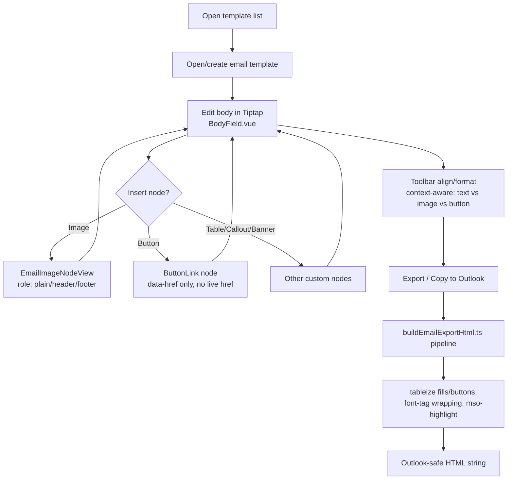

# Dev Documentation — GoTeam AMS Templates Builder

**Audience:** the developer(s) integrating this prototype into the real GoTeam AMS
codebase (adding a real backend/persistence layer, auth, and wiring send/submit
to real services).

**Scope of this doc:** the email-template builder and the retrieval-forms
(document) builder — two related but independently built Tiptap editors living
in one Nuxt app, plus their Outlook-export and print/PDF pipelines.

## Table of contents

1. [What this prototype is](#1-what-this-prototype-is)
2. [Flow diagrams](#2-flow-diagrams)
3. [Known Traps](#3-known-traps)
4. [Out of Scope](#4-out-of-scope)
5. [Edge Cases & Solutions](#5-edge-cases--solutions)
6. [Numbered behavior sections](#6-numbered-behavior-sections)
7. [Technical Scoping / Feasibility — toolkits & packages](#7-technical-scoping--feasibility--toolkits--packages)
8. [Known Limitations](#8-known-limitations)
9. [Responsive spec](#9-responsive-spec)
10. [Implementation checklist](#10-implementation-checklist)

---

## 1. What this prototype is

Nuxt 4 + Nuxt UI v4 front-end-only prototype, **no backend**. Two builders:

- **Email Templates** (`app/pages/templates/email/[id]/edit.vue`) — a Tiptap
  rich-text body editor for HTML emails, with an "Export to Outlook" / copy
  pipeline that produces email-client-safe HTML (tables, inline styles,
  bulletproof buttons).
- **Retrieval Forms** (`app/pages/templates/forms/[id]/edit.vue`) — a Tiptap
  document canvas (`FormDocumentEditor.vue`) with live pagination, custom
  form-field nodes (text/number/checkbox/file/signature/etc., FormKit-backed),
  a version-history/diff system, and a print/PDF preview
  (`app/pages/form-preview.vue`).

Both builders share the base Tiptap setup pattern but use **separate**
extension sets and **separate** pagination libraries (see §7) — they are not
the same editor instance and should not be merged into one without re-reading
both.

There is no login/roles/permissions in this prototype — anything referencing
"submitted by", "recipients", or team members reads from a static
`app/data/teamMembers.ts` fixture, not a real directory/auth system.

## 2. Flow diagrams

### Email template edit → export



### Retrieval form edit → submit → preview/print

```mermaid
flowchart TD
    A[Open form template] --> B[FormDocumentEditor.vue<br/>Tiptap canvas + pagination]
    B --> C{Insert field?}
    C -->|Text/number/checkbox/file/signature| D[FormFieldNodeView<br/>FormKit-backed input]
    D --> B
    B --> E[Save draft]
    E --> F[reactive() in-memory store]
    F --> G[localStorage mirror<br/>via formStorage plugin]
    G --> H[Recipient opens /form-preview]
    H --> I{Already submitted?}
    I -->|Yes| J[Read-only submitted view]
    I -->|No| K[Fill fields, e-sign via SignaturePad]
    K --> L[Submit → mark submitted<br/>+ simulated emailed copy]
    L --> M[pagedjs Previewer<br/>window.print → PDF]
```

## 3. Known Traps

Regression-risk behavior — things that broke before, or that look like they
should match but intentionally don't.

1. **A `//` or `/* */` comment inside `<script setup>` that contains the
   literal substring `<template` (e.g. mentioning "the template has 5 rows")
   breaks the Vite build** with a cryptic "Invalid end tag" error at a bogus
   line number. Some part of the toolchain regex-scans for that substring
   even inside plain comments. Describe markup in prose in comments, never
   with a literal `<template`/`<tag>` fragment.
2. **`stopEvent` on a Tiptap NodeView must be scoped, not blanket.** An
   unconditional `stopEvent: () => true` on `EmailImage`'s NodeView silently
   killed ProseMirror's own click-to-select — it's now scoped to only
   swallow events from `[data-email-image-chrome]` (the gear popover). Don't
   revert to a blanket `true`.
3. **`ButtonLink` intentionally has no live `href`/`target` on its editor DOM
   anchor** — only `data-href`. This is not a bug; it's the fix for the
   button navigating away when clicked inside the editor. The **exported**
   HTML (`tableizeButtons()` in `emailExportHtml.ts`) reads `data-href` and
   re-adds a real `<a href>` — don't "fix" the editor-side anchor by adding
   `href` back without also re-solving the navigation issue.
4. **Image/button auto-move-to-edge logic inserts the image into the doc
   *before* stripping adjacent empty paragraphs**, not after. Reordering
   this (strip-then-insert) reintroduces an infinite loop: ProseMirror
   auto-refills an empty paragraph the instant a transaction would leave the
   doc with zero block children, and the old cleanup loop saw that refill as
   "still empty" forever, hanging the tab. See `moveToEdge()` in
   `EmailImageNodeView.vue`.
5. **`EmailTrailingNode` replaces StarterKit's built-in `TrailingNode` on
   purpose** — trailing-node behavior is disabled *except* when the doc ends
   in a footer image. Don't re-enable StarterKit's default `trailingNode` or
   you'll reintroduce a permanent trailing gap.
6. **`renderHTML({ node, HTMLAttributes })`'s `HTMLAttributes` param is the
   already-merged output of each attribute's own `renderHTML`, not raw node
   attrs.** If an attribute's `renderHTML` intentionally returns `{}` (e.g.
   `align`, which is meant to style a wrapper, not itself), that value will
   never appear in `HTMLAttributes` — read `node.attrs.<name>` directly. This
   caused a real bug (button align silently not exporting) once already.
7. **Image sizing must be a real canvas pixel crop
   (`cropImageToAspect()`), never CSS `object-fit`.** Outlook's Word
   rendering engine ignores `object-fit` entirely — a CSS-cropped image
   renders distorted/stretched in real Outlook even though it looks correct
   in the browser preview.
8. **A native `<input type="file">` always renders its own native
   chosen-filename text**, independent of any custom file-list UI layered on
   top — this caused an "overlapping text" bug. The current file-upload UI
   (outline button + image preview) exists specifically to route around
   this; don't reintroduce a bare native file input with a custom label next
   to it.
9. **`definePageMeta({ ssr: false })` does not stop the first/direct request
   to `/form-preview` from being server-rendered** — only client-side
   navigations. The real fix is the `routeRules: { '/form-preview': { ssr:
   false } } ` entry in `nuxt.config.ts`. Removing that entry reintroduces a
   hydration mismatch (stale boxed/plain section styling) on first load of a
   real shared link.
10. **`vuedraggable`, `jspdf`, `html2canvas`, `@iconify-json/simple-icons`
    were removed from `package.json`** during a pre-handoff cleanup pass —
    they were dead weight (unused imports / superseded by `pagedjs`). If you
    see a reference to `html2canvas` in a code comment, it's describing
    **historical** behavior (an old PDF-export approach), not something
    currently wired up.

## 4. Out of Scope

**Deferred / boundary** (may ship later, genuinely not built):
- Any real backend, database, or persistence beyond `localStorage`.
- Authentication, roles/permissions, real team-member directory.
- **Actually sending email or notifying a submitted form is explicitly not
  part of this feature at all** — it belongs to a separate "Send"/delivery
  feature that will live on its own tab elsewhere in the real app. The
  "recipients"/"send" UI here (`RecipientsSection.vue`) and the "already
  submitted"/"emailed copy" notice in the forms flow are both mocked
  **on purpose**, purely to demonstrate the authoring/preview UX — they are
  not a stand-in for work this handoff expects the dev to build. The only
  thing this builder needs to hand off cleanly to that other feature is the
  finished, exported content (the Outlook-safe HTML / the filled form data)
  — not the sending mechanism itself.
- Actual e-signature legal binding/audit trail — `SignaturePad.vue` captures
  a drawn signature image only, no timestamp/identity certification.
- Real OS-level print-to-PDF has **not** been independently spot-checked by
  the user beyond the in-browser `pagedjs` preview — treat print output as
  "verified in Chromium preview," not "verified as a physical printed
  document."

**Anticipated, not wanted** (a dev might reasonably add these unprompted —
don't):
- Don't merge the email-body Tiptap instance and the forms-document Tiptap
  instance into one shared editor/extension set. They intentionally use
  different pagination strategies and different node schemas.
- Don't add `object-fit`/CSS-based image scaling back into the email export
  path "for simplicity" — it will visibly break in real Outlook (see Known
  Trap #7).
- Don't restore a real `href` on the in-editor `ButtonLink` anchor to "make
  it feel more real" — it will reintroduce click-navigation inside the
  editor (Known Trap #3).
- Don't add FormKit Pro inputs (autocomplete, datepicker, etc.) without
  first confirming a Pro license/key — this prototype intentionally uses
  only free/core FormKit inputs (see §7).

## 5. Edge Cases & Solutions

| Edge case | Expected behavior |
|---|---|
| Doc would be left with zero block children mid-transaction (e.g. deleting the only image) | ProseMirror auto-refills an empty paragraph; image insert/cleanup logic is ordered insert-then-strip specifically to never cross this boundary mid-loop (Known Trap #4) |
| User inserts an image/button then immediately clicks it | Click selects the node (NodeSelection) via ProseMirror's default behavior; toolbar align buttons switch to reflect the selected node's `align` attr |
| Doc ends in a non-footer atom node (e.g. a table) | A trailing empty paragraph IS re-added (default text-input affordance) |
| Doc ends in a footer-role image | No trailing paragraph is added — footer stays flush to the bottom |
| Recipient re-opens a form they already submitted | Form renders read-only with "already submitted" state + simulated "emailed copy" notice, fields are not editable |
| A field's stored value doesn't match its current field-type (e.g. type changed after data was entered) | `formContentMigration.ts` handles shape migration; a value that doesn't validate against the new type is not silently coerced — check this file before assuming input shape |
| Outlook "Merge Formatting" paste mode | Documented as a **client-side user setting outside the app's control** — not something `emailExportHtml.ts` can force-fix; character-run `<font>`/`mso-highlight` tags are the best available mitigation |
| Very long/unbroken text in a table cell in the Outlook export | `tableizeMarks()`/`tableizeFillBlocks()` wrap cell content in real `<table>`/`<td>` structure precisely because plain flow layout doesn't reliably contain overflow in Outlook |

## 6. Numbered behavior sections

### 6.1 Email Templates builder
- Body editor: Tiptap `StarterKit` + custom extensions (`EmailImage`,
  `ButtonLink`, `Callout`, `MessageBanner`, `QuoteCommand`,
  `TableHeaderStyled`, `FontSize`, `EmailTrailingNode`) — all in
  `app/utils/tiptapExtensions.ts`.
- Toolbar (`BlockToolbar.vue`) is **context-aware**: align/format buttons
  detect whether an image, a button-link, or plain text is selected and
  route to the right `updateAttributes`/`setTextAlign` call. There is no
  separate "align image" button — this was an explicit user correction; do
  not add one.
- Insert-image popover shows recommended sizes (Header 640×140, Footer
  640×100) and crops via `cropImageToAspect()` to that exact aspect ratio.
- Export pipeline (`app/utils/emailExportHtml.ts`) is the single source of
  truth for "what does the final email look like" — always test changes
  against this, not just the live editor DOM.

### 6.2 Retrieval Forms builder
- Document canvas (`FormDocumentEditor.vue`) uses `tiptap-pagination-plus`
  for **on-screen editing pagination only** (an approximate, CSS-driven
  "what page am I on" — not print-accurate, see §8).
- Print/PDF output (`/form-preview.vue`) uses `pagedjs` (`Previewer`)
  independently — a separate, more print-accurate pagination engine, wired
  up specifically because `tiptap-pagination-plus` was found to have no real
  per-page document structure (see `docs/archive/PAGINATION_TOOLKIT_STUDY.md` for
  the full evaluation).
- Custom form-field nodes (`FormFieldNode`, `app/utils/formFieldNode.ts` +
  `FormFieldNodeView.vue`) render real FormKit inputs inline in the
  document, with a properties panel (`FormFieldPropertiesPanel.vue`) for
  configuring required/type/label per field.
- Version history (`FormHistoryTab.vue`, `versionDiff.ts` using
  `microdiff`) diffs form structure between saved versions.
- Background/theme: `FormBackgroundPicker.vue` (via `vue3-colorpicker`),
  `ThemeColorPicker.vue`, `formBackground.ts`, `formLetterhead.ts`.

## 7. Technical Scoping / Feasibility — toolkits & packages

This is the section to read before estimating any new work against this
codebase — it tells you what's a config change vs. what's a real
integration effort.

| Package | Version | Role | Feasibility notes |
|---|---|---|---|
| `nuxt` | ^4.5.2 | App framework | Nuxt 4 file-based routing (`app/pages`), auto-imports. No server routes/`server/` dir exist yet — adding a real API means starting that from scratch. |
| `@nuxt/ui` | ^4.11.0 | Component library (Reka UI + Tailwind v4 under the hood) | Theming is via `app/app.config.ts` (`ui.colors`) — light-mode-only is **forced** (`colorMode.forced: true` in `nuxt.config.ts`) to match the original AMS design; re-enabling dark mode is a real scoping item, not a toggle. |
| `tailwindcss` | ^4.3.3 | Styling | v4 CSS-first config (`app/assets/css/main.css`), not a `tailwind.config.js`. Nuxt UI's default tokens compile to `oklch()` — this project pins several to hex equivalents specifically because `html2canvas`-style DOM-cloning tools (and print capture generally) can't parse `oklch()`. Any new custom color token should follow the same hex-pinning pattern if it needs to survive a capture/print path. |
| `@tiptap/*` (core, vue-3, starter-kit, extension-color/highlight/image/table*/text-align/text-style, `extensions`) | 3.31.2 (pinned) | Rich-text editor engine for both builders | Two **separate** Tiptap instances/extension sets (email body vs. form document) — do not assume shared config. Pinned exact versions (not `^`) on most Tiptap packages — a Tiptap minor bump should be tested deliberately, not auto-upgraded. |
| `tiptap-pagination-plus` | ^3.1.0 | On-screen pagination for the forms document canvas | Community package, MIT. **CSS-illusion pagination** — no real per-page DOM structure (see §8). Fine for "what page am I roughly on" while editing; not the source of truth for print output. |
| `pagedjs` | ^0.4.3 | Print/PDF-accurate pagination for `/form-preview` | Genuinely computes real page boundaries against print CSS (`@page`, margins). This is the one to extend if print fidelity work is scoped — not `tiptap-pagination-plus`. |
| `@formkit/nuxt` + `@formkit/addons` | ^2.1.2 | Powers all interactive form-field inputs in the Retrieval Forms builder | **Core/free FormKit inputs only** — text, number, checkbox, file, and a custom signature pad. No `@formkit/pro` dependency exists in this project. If a future round asks for FormKit Pro inputs (autocomplete, datepicker, mask, rating, repeater, slider, toggle, transfer-list, etc.), that requires adding `@formkit/pro` **and** a Pro key from pro.formkit.com — scope that as new work, don't assume it's already licensed. Only `createAutoAnimatePlugin` from `@formkit/addons` is wired in (`formkit.config.ts`); `createFloatingLabelsPlugin`/`createMultiStepPlugin` are available but not currently used. |
| `vue3-colorpicker` | ^2.3.0 | Background/theme color pickers | Third-party Vue 3 component, listed in `vite.optimizeDeps` for dev-server perf (see `nuxt.config.ts` comment) — if it's ever replaced, remove it from that list too. |
| `microdiff` | ^1.6.0 | Structural diffing for version history | Small, dependency-free diff lib — used to compute what changed between saved form/template versions. |
| `@playwright/test` (dev) | ^1.63.0 | E2E tests | `tests/e2e/` — run before/after any structural change to the forms builder; one existing test (`form-duplicate...`) specifically guards duplicate-form content-carryover behavior. |
| `@iconify-json/lucide` | ^1.2.127 | Icon set | The only icon set actually used (`i-lucide-*` classes throughout). `@iconify-json/simple-icons` was removed — it was never referenced. |

**Overall integration feasibility:** the front end is a complete, internally
consistent prototype. The single largest scoping item for a real
implementation is **the backend** — there is currently zero persistence
beyond `localStorage`/in-memory `reactive()` stores, so "add a real
database" touches almost every page (`app/data/*.ts` are the seams to
replace with real API calls) and the auth/permissions layer doesn't exist at
all yet.

## 8. Known Limitations

Call these out explicitly to whoever is scoping/estimating — they are not
bugs to "just fix," they're architectural boundaries of this prototype.

1. **No backend, no real persistence.** All "saved" data lives in
   module-level `reactive({})` stores (`app/data/retrievalForms.ts`,
   `app/data/templateRuntime.ts`, `app/data/templates.ts`) mirrored to
   `localStorage`. **`localStorage` is per-origin** — different dev ports or
   deployed domains have completely separate, unrelated saved state. This is
   the #1 thing that must be replaced (with a real API + database) before
   this can be a production feature, not extended.
2. **No auth, no roles, no real recipient/team directory.** `teamMembers.ts`
   is a static fixture. Anything that looks like "assigned to" or
   "recipients" is cosmetic in this prototype.
3. **Email sending is out of scope for this feature entirely, not just
   unbuilt.** There is no SMTP/API integration in this repo, and there is
   not meant to be — "send"/"submit" actions here only update local state
   and show a mock "emailed copy" notice so the authoring/preview UX can be
   evaluated. Actual delivery is a **separate feature on a separate tab** in
   the real app. Don't scope or build sending as part of integrating this
   builder — only make sure this builder exposes whatever finished
   content/data that other feature will need to consume (exported HTML,
   submitted form values).
4. **Outlook export fidelity has real, permanent ceilings**, not just bugs
   to keep fixing:
   - Outlook's "Merge Formatting" paste mode is a **client-side user
     setting** the app cannot detect or override — some formatting loss on
     paste is unavoidable regardless of export HTML quality.
   - Outlook's Word-based rendering engine does not support `object-fit`,
     shorthand `background`, or modern CSS layout generally — the export
     pipeline works around this with tables/inline styles/legacy `<font>`
     tags, but any *new* visual feature must be designed with these same
     constraints in mind from the start, not bolted on after.
5. **Pagination is two separate, non-interchangeable systems**:
   `tiptap-pagination-plus` (on-screen, approximate, no real per-page DOM)
   and `pagedjs` (print/PDF, more accurate). Neither has been proven
   pixel-accurate against a real physical printed page — only against the
   in-browser print preview. Treat "does it paginate correctly" as an open
   verification item for anything beyond the cases already tested.
6. **E-signature is a drawn image, not a certified/legally-binding
   signature.** No timestamp, IP, or identity verification is captured
   alongside it.
7. **No dark mode.** Explicitly forced to light mode
   (`colorMode.forced: true`) to match the original AMS design reference —
   re-enabling it is unscoped work, not a flag flip.
8. **No FormKit Pro inputs, no Pro license.** Anything beyond core FormKit
   inputs (autocomplete, datepicker, slider, rating, repeater, mask,
   currency, toggle, transfer-list, etc.) requires adding `@formkit/pro`
   plus a Pro key — this is new dependency + cost scope, not already
   available.
9. **This is a single-tenant, unauthenticated prototype directory** — it was
   never load-tested, never security-reviewed for multi-user concurrent
   editing (there's no concept of "someone else is editing this right now"),
   and has no rate limiting, input sanitization boundary, or CSRF/XSS
   hardening beyond what Vue/Nuxt provide by default. Treat all of that as
   required work for production, not "probably already handled."

## 9. Responsive spec

This is an **internal, desktop-oriented AMS tool** (template/form authoring
by internal Asset-team staff), not a public-facing responsive product. It has
**not** been designed or tested for mobile/tablet breakpoints — the builder
UI (multi-pane toolbars, side-by-side editor/preview) assumes a desktop
viewport. If a mobile-responsive requirement emerges, scope it as new design
+ build work, not a gap in an existing responsive spec.

## 10. Implementation checklist

**Read this before starting.** This repo is a **front-end-only design
reference** — it was built by/with a UI/UX designer (not a full-stack
engineer) to nail down interaction patterns, visual behavior, and export
fidelity. Nothing here persists real data, nothing here is authenticated, and
nothing here talks to a real server. Building the real feature means standing
up the entire backend, data, and integration layer from zero and porting this
front end onto it — not "connecting" this prototype to something that
already exists. The checklist below is grouped by layer so it can be scoped
and assigned as real engineering work.

### 10.1 Backend & API (build from scratch — none exists today)
- [ ] Choose and stand up a backend framework/runtime (this repo has no
      `server/` directory, no API routes, no server code at all)
- [ ] Design the API surface this front end needs, at minimum:
      list/create/read/update/delete for email templates, retrieval forms,
      form submissions, and form version history
- [ ] Design and implement the versioning/history API that
      `FormHistoryTab.vue` / `versionDiff.ts` currently fake with in-memory
      diffing — decide whether full-document snapshots or field-level diffs
      are stored server-side
- [ ] Implement server-side validation for every form-field type mirrored
      from `app/utils/formFieldRegistry.ts` / `formFieldValues.ts` — the
      client-side FormKit validation in this prototype must not be the only
      validation layer in production
- [ ] Implement input sanitization for all rich-text/HTML content coming
      from the Tiptap editors before it is stored or re-rendered anywhere
      (XSS boundary does not exist yet — see §8.9)
- [ ] Add rate limiting and standard API hardening (this prototype has none)

### 10.2 Database & persistence (replaces `app/data/*.ts` + `localStorage`)
- [ ] Design a real schema for: email templates, retrieval form templates,
      form field definitions, form submissions/responses, form version
      history, team members/users
- [ ] Migrate the **shape** of `app/data/retrievalForms.ts`,
      `app/data/templateRuntime.ts`, and `app/data/templates.ts` into that
      schema — these files are the authoritative reference for what fields
      currently exist, even though they must not survive as the actual store
- [ ] Replace every read/write to those reactive stores with real API calls
- [ ] Replace `formStorage.ts` / `formStorage.client.ts`
      (`localStorage` mirror) with server-persisted state; remove the
      per-origin `localStorage` reliance entirely
- [ ] Decide on and implement file storage (uploaded files in the
      file-upload field, captured signature images) — currently these live
      as in-memory/data-URL values only, with nowhere real to go

### 10.3 Authentication & authorization (none exists today)
- [ ] Add real authentication (no login flow exists anywhere in this repo)
- [ ] Replace the static `app/data/teamMembers.ts` fixture with a real
      user/team directory
- [ ] Design and implement roles/permissions — who can create/edit/send a
      template, who can view/fill/submit a form, who can view submission
      history
- [ ] Add session/ownership checks to every API endpoint above (an
      authenticated user editing someone else's template/form should be an
      explicit, deliberate decision, not an accident of a missing check)

### 10.4 Email sending — OUT OF SCOPE, do not build here
Actual email delivery is a **separate feature living on its own tab** in the
real app — it is not part of integrating this builder, and nothing below
should be read as asking for an SMTP/API integration. The only relevant work
here is the **hand-off boundary** to that other feature:
- [ ] Confirm/define the data contract this builder needs to hand off to the
      real "Send" feature: the exported Outlook-safe HTML
      (`emailExportHtml.ts`'s output) for email templates, and the
      submitted/filled form values for retrieval forms
- [ ] Do **not** wire `RecipientsSection.vue` or the forms "already
      submitted"/"emailed copy" notice to a real email service as part of
      this work — leave them as the authoring/preview affordances they are,
      or replace them with a hand-off action (e.g. "send to the Send tab")
      once that other feature exists
- [ ] Re-verify Outlook export **HTML** fidelity against real Outlook
      clients (desktop + web) — this is about the exported markup being
      correct, independent of and before whichever feature actually
      transmits it

### 10.5 E-signature & compliance (legal/compliance input required)
- [ ] Get a legal/compliance decision on what "signed" needs to mean for
      this business (timestamp? identity verification? audit trail?) before
      treating `SignaturePad.vue`'s drawn-image capture as sufficient
- [ ] Implement whatever certification/audit-trail requirement comes out of
      that decision — it does not exist in this prototype at all

### 10.6 Print/PDF pipeline
- [ ] Independently spot-check real OS print-to-PDF output for forms against
      the `pagedjs` preview in `/form-preview.vue` — only the in-browser
      preview has been verified so far, not a physical/real PDF output
- [ ] Decide whether PDF generation should also be produced **server-side**
      (e.g. for emailing a copy, or archiving a submitted form) — today PDF
      only ever exists as a client-side `window.print()` browser action

### 10.7 Front-end porting work (this repo → the real codebase)
- [ ] Port the Tiptap email-body editor and its extensions
      (`app/utils/tiptapExtensions.ts`) into the real app's front end
- [ ] Port the Tiptap retrieval-forms document editor
      (`FormDocumentEditor.vue`), its custom field-node system
      (`formFieldNode.ts`, `FormFieldNodeView.vue`), and the FormKit wiring
- [ ] Port the Outlook export pipeline (`emailExportHtml.ts`) as-is where
      possible — it encodes real, hard-won Outlook-compatibility knowledge
      (see §8.4); don't rewrite it from scratch without reading it first
- [ ] Port the print/PDF preview page and pagedjs wiring
- [ ] Decide how this front end's Nuxt UI/Tailwind v4 theming
      (`app/app.config.ts`, `app/assets/css/main.css`) maps onto the real
      app's existing design system, if one already exists there — this repo
      assumes it owns the whole page, the real app may not
- [ ] Scope `@formkit/pro` + license cost if any Pro input is requested
      beyond what this prototype uses (core FormKit only)
- [ ] Scope dark mode and mobile/responsive support as separate design work
      if ever required — this prototype is desktop-only, light-mode-only by
      design

### 10.8 Testing & rollout
- [ ] Run `tests/e2e/` (Playwright) and `npx vue-tsc --noEmit -p .` clean
      before and after any structural change made while porting
- [ ] Add real backend/API tests (none exist today — this prototype's tests
      only cover front-end behavior against mock data)
- [ ] Load-test and security-review before production rollout — this
      prototype has never been load-tested or security-reviewed (see §8.9)
