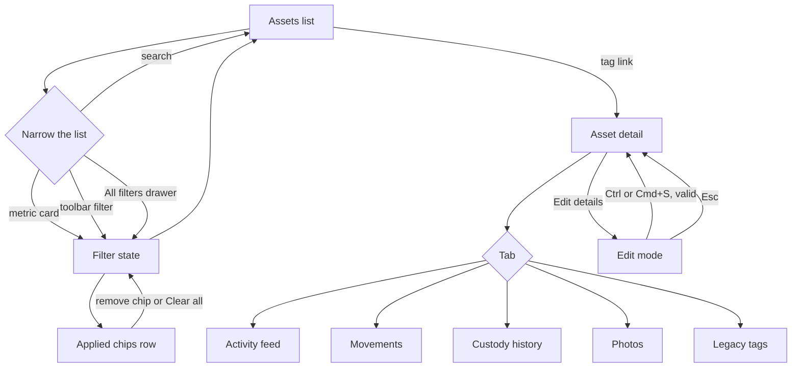

# Dev Doc: Assets list and asset detail UI/UX enhancements

**Audience:** developers porting the Assets list and the Asset detail view into the R24 code base (`it/app/pages/app/assets`).
**Source:** branch `wt-assets`. Front end only, mock data. Nuxt 4, Nuxt UI 4, Tailwind 4, Vue 3.
**Scope of this doc:** the UI/UX redesign of the Assets list and detail. The Supplier Return and Client Pull-Out exit flow (Move Asset form, confirm step, exit panel, exit documents) is covered in `DEV_DOC_supplier-return-client-pull-out.md`. The two exit statuses do appear in the views below (status badge, filter list, metric card, location), and only that is covered here.
**Round:** 1 as its own handoff (the work was built over three rounds, summarised under What changed). Design and layout are final.

**Contents:** Verification status · What changed · Modules · Flow diagram · Known Traps · Easy to miss (small behaviours) · Out of Scope · Edge Cases & Solutions · Responsive Spec · Simulator Scaffolding · Porting map · 1 to 8 behaviour sections · Implementation checklist · Known and accepted · Still open · Code inconsistencies to know about · Feature coverage matrix

**How to use this doc so nothing is skipped:** read sections 1 to 8 for the behaviour, tick the Implementation checklist (every item has an id such as U3.2), then go down the Feature coverage matrix at the very end: every row is one feature, with the file that implements it, the section, the checklist id and the QA case that proves it. If a row is not done, the port is not done.

---

## Verification status (Step 6.0), 2 Nov 2026 pass

| Check | Result |
|---|---|
| Typecheck | 0 errors in the feature files. 10 pre-existing errors elsewhere (tiptap, DatePicker, ticket tracker) are not from this work. Command: `node node_modules/vue-tsc/bin/vue-tsc.js --noEmit -p .nuxt/tsconfig.app.json` (plain `vue-tsc -p .` checks nothing here). |
| Production build | Passes (`node node_modules/nuxt/bin/nuxt.mjs build`). |
| Code review | One independent read only review of the whole feature. Findings fixed: Reset sample data did not restore the database units (the seed is now cloned); a selection kept rows a filter had removed (it is pruned against the visible list); the header and the metric cards counted the full list under the Empty list scenario (they read the same list as the table); "Warranty ending in 90 days" was always 0 (four demo units added); `setMonth` overflowed on day 31 (new `addMonths` helper); the Warranty card and the list used different warranty maths (they now agree); an `Infinity` cost passed validation (`Number.isFinite`); stale stored snapshots hid new fixtures (storage key bumped to `ams:assets:v4`); CSV export had no formula guard (cells starting `= + - @` get a leading quote); hydration did not check every history field (now strict, ids checked); custody selection survived a state switch and the Activity feed and Movements pages did not clamp (both fixed). |
| Security | No `v-html`, no `innerHTML`. The QR print page and the sample documents escape their output. `window.open` uses blob URLs with `noopener`. Comment uploads exclude HTML and SVG. Lookups use own-property checks. The storage key is namespaced. |
| Merge safety | Global CSS is only `.assets-shell #main-content ...` (namespaced). The only module level mutable state is the mock store (`ASSETS`, the comment and legacy tag stores, the simulator refs). That is safe only because `nuxt.config.ts` sets `ssr: false` through `routeRules` for `/assets/**` and `/move-asset/**`. If that rule is lost in a merge the state would leak across requests. `app/data/assets.ts` has imports after an `export type` (an `import/first` lint warning, noted). No `console.*`, no `any` casts in the feature files. |
| Accessibility | axe-core with the WCAG 2.2 AA rule set over 28 page states (7 screens, light and dark, desktop and phone). Only inherited failures remain: placeholder text at 3.5:1 (set on purpose by the design system) and `text-muted` at 4.47:1 on a tinted panel. Keyboard order and visible focus ring checked by hand, including the filter menus and the drawer. |
| Timezones | Pacific/Pago_Pago, America/Los_Angeles, UTC, Asia/Manila and Pacific/Kiritimati: every stored date, day pill and badge date renders identically. Dates are `YYYY-MM-DD` strings parsed at local midnight. |
| Performance | Lighthouse on the production build, headless, with the Nitro preview server (no compression). Desktop 35 to 54, mobile 57 to 85, accessibility 96 to 97, best practices 96 to 100, CLS 0, LCP 2.3 s warm with occasional 14 s cold first loads. Page weight about 2.3 MB uncompressed, JS 1.4 to 1.7 MB, of which the feature is a small share: the rest is the shared app shell (framework, Nuxt UI, the Templates editor and shared data). |
| End to end | Playwright, 10 of 10 pass on the production build (`tests/e2e/assets-smoke.spec.ts`), including the filters test (quick filter, drawer, chip removal). Run: `PLAYWRIGHT_BASE_URL=http://localhost:3200 npx playwright test tests/e2e/assets-smoke.spec.ts`. |
| Widths | No sideways page overflow at 320, 375, 768 and 1440 on the list, the detail tabs and the Move Asset pages. The All filters drawer fits at every width (296 px at 320). |

## What changed since last round

First handoff of this work.

Removed and must not come back: the three lane pills (they duplicated the Status filter), the Legacy status group (left out for now), the Currency filter (switched off in the live code), the old three chip header (In use, Ready to deploy, Returned or pulled out), a description line that only repeated the status counts.

## Modules

| # | Module | Files |
|---|---|---|
| U1 | Data and seed | `app/data/assets.ts`, `assetsActivity.ts`, `assetsDetail.ts`, `assetsDbSeed.ts` |
| U2 | List header and metric cards | `app/pages/assets/index.vue` (header) |
| U3 | List table | `app/pages/assets/index.vue` (table, paging, selection, CSV) |
| U4 | List filters | `app/pages/assets/index.vue` (toolbar, chips, drawer), `components/assets/FilterMenu.vue`, `Truncate.vue` |
| U5 | Detail header and details card | `app/pages/assets/[tag].vue` |
| U6 | Detail right rail | `app/pages/assets/[tag].vue` (rail) |
| U7 | Detail tabs | `[tag]/activity-feed.vue`, `movements.vue`, `custody-history.vue`, `photos.vue`, `legacy-tags.vue`, `components/assets/SummaryCard.vue`, `SummaryCell.vue`, `FilterChips.vue`, `MovementComments.vue` |
| U8 | Shell and simulator | `layouts/assets.vue`, `email/AmsSidebar.vue`, `email/TopNavbar.vue`, `nuxt.config.ts`, `components/assets/SimulatorBar.vue` |

## Flow diagram

Filter rule: every filter is a multi select. Within one filter the values are OR. Between filters the result is AND. Search is AND with all of them. A count beside an option is how many units that option would match given every other filter, search included, but not its own.

## Known Traps

1. **(U3) The frozen Actions column drifted by a fraction of a pixel** with auto table layout. Keep `table-fixed`, a `<colgroup>` of whole pixel widths (table min width 3726 px), and `w-[88px]` on the Actions cells. Tag is 250 px, Serial 260 px (so long serials show in full).
2. **(U7) Tab content must render with `<NuxtPage :transition="false" />`.** The global page transition pulled the leaving tab out of flow and it jumped over the page.
3. **(U5, U6) One answer for "is a PO linked":** `effectivePo` feeds both the Purchase Order field and the Warranty card. Do not read `asset.po` separately in either place. The warranty end date is the PO order date plus the model's warranty months, through one helper (`warrantyDaysLeft` and `addMonths`), so the card and the Warranty Status filter agree.
4. **(U4) The facet counts must skip only their own filter.** If a filter counts itself, choosing a value makes every other option read 0 and nothing can be added to the selection.
5. **(U4) Asset Name stays disabled until an Asset Type is picked,** lists only the names of the picked types, and drops picked names when their type is unpicked. Do not make it independent.
6. **(U1) Month counting follows the live page:** days divided by 30, rounded down, per custody row and for the age. Total used age is the sum of the rows' months, so it can be a month more than the whole span. Do not "fix" this to an average month.
7. **(U1) The seed objects are cloned** (`structuredClone`) every time `seed()` runs. Without that, Reset sample data brings back mutated units. Bump `STORAGE_KEY` whenever fixture history changes, or users keep a stale snapshot.
8. **(All) Only an office location is a link.** A team member's address, a supplier and a client are plain text (`locationView().kind === 'location'` is the test). Links are `blue-700` (blue-400 in dark), no underline, pointer cursor.

## Easy to miss (small behaviours)

Each line is a real behaviour in the prototype that is easy to skip. The file that implements it is in brackets.

1. The list search matches only the tag, the serial and the custodian, case insensitive, never the model or the location. [`pages/assets/index.vue`, `matches()`]
2. The "All filters" badge counts filters that are on, not values picked; the pill inside one filter button counts the values picked in that filter. [`pages/assets/index.vue`, `components/assets/FilterMenu.vue`]
3. "Clear" in the toolbar also shows when only a search is typed; the applied chips row never shows the search, but "Clear all" clears it too. [`pages/assets/index.vue`]
4. A metric card first clears the Status and Warranty filters, then applies its own; it shows the ring only when the filter equals its set exactly. [`pages/assets/index.vue`, `toggleMetric()`]
5. Metric cards, the title and the line under it count the scenario list, not the filtered rows, so filters never change them. [`pages/assets/index.vue`]
6. Actions shows the muted minus (not a blank) for an exited unit and for the read only role; the Move icon is a truck with the tooltip "Move asset" and the label "Move TAG". [`pages/assets/index.vue`]
7. Name icons are per name: Laptop, Monitor and Desktop have their own, any other name gets a tag icon; only "Computer Equipment" has a Type icon. [`pages/assets/index.vue`, `data/assets.ts`, `TYPE_ICON`]
8. Status in the table is the solid badge with the lighter date half ("2026, Oct 23") and never a sub-status; the detail header badge does show the sub-status as a grey chip beside it. [`StatusPill.vue`]
9. The Client column shows a value only when the unit is Checked Out and has a client; the Owner column is always filled. [`pages/assets/index.vue`]
10. Acquisition Cost is `CUR 1,234.00` (currency prefix, two decimals, right aligned); a cost of 0 shows the muted minus. The detail field shows the number without the prefix and the currency sits in the label. [`pages/assets/index.vue`, `[tag].vue`]
11. The export CSV has 10 columns that are not the table's 17: Tag, Serial, Model, Type, Status, Sub-status, Tech Pack, Checked out to, Owner, Location; the file is `assets.csv`; the toast says "N asset exported" or "N assets exported". [`pages/assets/index.vue`, `exportSelected()`]
12. The select all checkbox in the header acts on the current page only; the selection count survives paging. [`pages/assets/index.vue`]
13. The page size choices are 10, 15 and 25, default 10; the footer line reads "Show [10] assets per page · 1-10 of 40". The footer is hidden while loading, on the Not found state and when no row matches. [`pages/assets/index.vue`]
14. State = Not found on the list shows "We couldn't load the assets" with a "Try again" button that sets the state back to Populated; the toolbar stays. [`pages/assets/index.vue`]
15. Find by QR, CSV (page button) and Add Asset have no action in the prototype. Do not hunt for a handler. [`pages/assets/index.vue`]
16. Warranty Status buckets: below 0 days Already Expired; 0 to 30 days; 31 to 60; 61 to 90; a unit with no warranty is in none. The Warranty metric card is the three "Expiring" buckets together. [`pages/assets/index.vue`, `warrantyBucket()`]
17. Location Type: Supplier Return is "Supplier", Client Pull-Out is in none, any unit with a custodian is "User Address", otherwise "Office Location". [`pages/assets/index.vue`, `locationTypeOf()`]
18. Only Status, Brand and Checked Out To have a search box in their menu; its placeholder is "Search statuses", "Search brands", "Search people". [`FilterMenu.vue`]
19. Inside the drawer a filter is a full width field with a 12 px label, the placeholder "All {noun}", the single picked value, or "N selected"; Asset Name carries the hint "Pick an asset type first" while disabled. [`FilterMenu.vue`]
20. The drawer footer "Clear all" is disabled when nothing is applied; the primary button reads "Show 1 asset" or "Show N assets". [`pages/assets/index.vue`]
21. A tooltip appears on a truncated value only while it is truncated (measured with a ResizeObserver), including the search placeholder. [`Truncate.vue`, `pages/assets/index.vue`]
22. The detail header badge row is separated by "·" dots and shows, in order: status badge (with sub-status chip), movement state, type, name, holder. The name icon in the header and details card is always the laptop. [`[tag].vue`]
23. The holder text depends on the Custody simulator: with "From the data" it is the custodian, "At the supplier", "Pulled out by {client}" or "In stock"; with any forced Custody state it is "Currently with {member}", "Last held by {member}" or "No custodian". [`[tag].vue`]
24. Read only role: no Edit details, no Move asset, no Link PO; the overflow menu (Delete asset) and Back still show. Move asset is also hidden for an exited unit. [`[tag].vue`]
25. Name and Tag are never editable. Edit mode edits Serial, Model, Location, Owner, Acquisition Cost, Purchase Order, Tech pack Type and Currency (PHP or USD radio); the cost label shows the currency being picked. [`[tag].vue`, `data/assetsDetail.ts`]
26. Validation texts: "Enter the serial number", "Pick the model", "Pick where the asset lives", "Pick the owner", "Enter the cost, 0 if there is none". They show only after the first save attempt; a blocked save scrolls the first error to the centre. [`data/assetsDetail.ts`, `[tag].vue`]
27. Helper texts under the fields in edit mode: "Manufacturer's serial number", "Pick the exact model this unit is", "Where this asset currently lives", "Legal owner entity of this asset", "Enter 0 if there was no cost", "Currency the acquisition cost is in". [`[tag].vue`]
28. The edit banner reads "Editing asset details. Press Esc to cancel, Cmd+S or Ctrl+S to save."; the footer has Cancel and "Save changes"; the toasts are "Asset details saved" and "Changes discarded". Esc is ignored while a listbox or dialog is open. [`[tag].vue`]
29. Moving to another tag resets edit mode (the page is keyed by the tag and a watcher ends editing). [`[tag].vue`]
30. Purchase Order in edit mode lists "Not linked" first plus the PO list, and has an X button (tooltip "Clear selection") disabled when nothing is chosen. "Use GoTeam (default)" sets the Owner to GoTeam. [`[tag].vue`]
31. The Owner link toast says it opens the client page; the PO, Model and Location toasts say they open their own pages. Every toast says it is an existing view, out of scope. [`[tag].vue`]
32. Timestamps is collapsed by default (button with `aria-expanded`); Created is the first record, Updated the status date; the time of day is derived from the record id. [`[tag].vue`, `data/assetsDetail.ts`]
33. The rail is sticky only from `xl` (top 7.5 rem); the header is sticky only from `sm`. [`[tag].vue`]
34. The QR is a 21 by 21 placeholder grid, the same for the same tag; Download writes `{tag}-qr.svg` (unsafe characters become `_`) and toasts "QR code downloaded"; Print opens the print dialog of a hidden iframe titled with the tag. [`[tag].vue`]
35. Warranty card dates read "March 05, 2027" (long month, two digit day). Time remaining: past expiry "Expired N mo ago" (at least 1), 30 days or fewer "N days remaining" (amber), otherwise "N mo remaining" (green); expired is red. [`[tag].vue`]
36. Current movement card: label is "Checked out to" with a member, otherwise "Checked in by"; the Transit simulator adds a "Receipt open" (amber) or "Receipt confirmed" (green) chip; no movement says "No movement recorded yet." [`[tag].vue`]
37. The tab strip highlights the active tab only on an exact path match; the arrows and edge fades show only when the row overflows; the bare `/assets/{tag}` redirects to the Activity feed. [`[tag].vue`, `[tag]/index.vue`]
38. Every tab root has `stage-enter`; the tab outlet has `:transition="false"`. [`[tag].vue`, `[tag]/*.vue`]
39. Activity feed: the "Status changes" count includes created and replacement-link events, not only status changes; movement events never carry a note, so they always show "No note recorded". [`activity-feed.vue`, `data/assetsDetail.ts`]
40. Activity feed day labels are "Today", "Yesterday", otherwise the badge date; the chip row hides when there are no events; the pager shows only above 10 events. [`activity-feed.vue`]
41. A movement number is `#` plus four digits derived from the record id; a time of day is derived the same way. Real data replaces both. [`data/assetsDetail.ts`]
42. Movement card: "Recorded by" shows only for a check out to a member recorded by someone else; the "Historical" badge exists in the markup but the prototype never sets it. [`movements.vue`]
43. The amber "Waiting for the custodian to confirm receipt." note shows only on the newest card of the first day, with the filter on All and Transit = "In transit, receipt open". [`movements.vue`]
44. "Add historical movement" is always visible (not role gated) and only toasts; the empty Movements state offers "Move this asset" only to an officer on a unit that has not exited. [`movements.vue`]
45. Comments: two shown inline (two lines each), "View all N comments" when more; with none the card says "No comments yet." and "Add comment" opens the composer, with some it opens the drawer. The inline and drawer composers share one draft. [`MovementComments.vue`]
46. Comment rules: Send is disabled until there is text or a file; Cmd or Ctrl+Enter sends; 10 MB limit with "X is over 10 MB."; unsupported type message "X is not a supported file type. Attach an image, PDF, Office file, text or zip."; the inline emoji menu closes after a pick, the drawer one stays open. [`MovementComments.vue`]
47. Comment delete (trash) shows only on your own comments in the drawer, on hover or keyboard focus; your comments are tagged "You". [`MovementComments.vue`]
48. Custody history: "Select all" ticks every row that matches the search across all pages; typing in the search clears the selection; Copy with nothing ticked toasts "Select at least one row to copy." (warning). [`custody-history.vue`]
49. Custody Used Age shows "< 1 mo" under one month, "N mo", and "—" when unknown; the first custodian is "Brand New", later ones "Refurbished"; Received Date shows an "Open" badge only while Transit = "In transit, receipt open". [`custody-history.vue`, `data/assetsActivity.ts`]
50. Custody Location is the custodian's home address; a custodian name with `_` or `;` has them replaced by a space in the copied text. [`custody-history.vue`, `data/assets.ts`]
51. Legacy tags: new tags are added at the top; duplicates are checked case insensitive; Enter in the modal saves; page size 10 with first, previous, next, last buttons and "Page X of Y"; the footer count reads "N tag(s)". Only the seeded unit `GT-CE-LTP-1233-0926-0013` has legacy tags. [`legacy-tags.vue`, `data/assetsDetail.ts`]
52. Comments and legacy tags live in memory only: a reload loses them. Only the assets themselves are saved to `localStorage`. Reset sample data restores all of it. [`data/assetsDetail.ts`, `data/assets.ts`]
53. Loading state: the list shows 6 skeleton rows; Activity feed and Movements show 3 skeleton rows; Custody history shows a single "Loading custody history..." row; Photos and Legacy tags ignore it. [`pages/assets/index.vue`, `[tag]/*.vue`]
54. Links are `blue-700` (dark `blue-400`), never underlined, and every clickable element has a pointer cursor through the layout's own CSS. [`layouts/assets.vue`]
55. The layout has a skip link and `#main-content` is focusable (`tabindex="-1"`). [`layouts/assets.vue`]
56. Page titles: list "Assets - GoTeam Assets"; detail "{TAG} - GoTeam Assets". [`pages/assets/index.vue`, `[tag].vue`]
57. Documents (activity chip, movement card) open a blob in a new tab with `noopener`; the chip ends with an arrow-up-right icon. [`data/assets.ts`, `openDoc()`]
58. Breadcrumb on the detail page is Home > Assets > TAG. It does not add the tab name (the earlier version of this doc said it did). [`email/TopNavbar.vue`]

## Out of Scope

**Deferred / boundary**
- Backend, API, auth and role permissions (the prototype's "Viewing as" control stands in). *(all)*
- The Supplier Return and Client Pull-Out flow itself: Move Asset form, confirm step, exit documents. It is covered in `DEV_DOC_supplier-return-client-pull-out.md`. *(all)*
- The pages the prototype only links to: asset model, location, owner, purchase order. Each shows an "existing view" toast. *(U3, U5, U6)*
- Add Asset, Find by QR and the CSV page button beyond the buttons; Add historical movement, Delete asset, photo upload, legacy tag server rules. *(U2, U5, U7)*
- A real QR encoder and a camera scanner. *(U6)*
- Server side counts: the metric cards count what the prototype holds. *(U2)*
- Tech Pack Currency filter (switched off in the live code) and the Legacy status group (the 5 units on retired statuses are left out of the seed for now). *(U4)*

**Anticipated, not wanted**
- Status group pills by lane in the header. They duplicate the Status filter. *(U2)*
- A labelled filter card or a tall filter panel above the table. *(U4)*
- Per category colours in the Activity feed. One blue, like the retrieval log. *(U7)*
- A title on the second Custody summary card, or tinted avatars in Custody. *(U7)*
- Ellipsis in table cells. Table cells show their full content; only filter values, option labels, applied chips and the search placeholder are cut. *(U3, U4)*
- Links for a team member's address, a supplier or a client. *(U3, U5)*

## Edge Cases & Solutions

| Edge case | Expected behaviour |
|---|---|
| Unknown tag in the URL (`/assets/foo`, `/assets/constructor`, `/assets/__proto__`) | "We couldn't find that asset" with a link back |
| Scenario = Empty list | Table says "No assets yet"; the title and the cards say 0 and the line says "Assets you add will show here." |
| Filters leave no rows | "No assets match" with "Clear search and filters"; the chips row stays |
| A picked filter value that no unit has any more | Stays listed with a 0 pill so it can be unpicked |
| Asset Type changes after a name was picked | Names that do not belong to the picked types are dropped |
| Filter, search or page size changes | Page returns to 1; the selection keeps only rows still in the list |
| Very long filter value, chip or placeholder | Cut with an ellipsis; the full text shows in a tooltip, only while it is cut |
| Very long address, serial or name in the table | Full text, columns sized to fit; wraps on cards |
| No warranty (months missing) | Warranty card says no manufacturer warranty; the unit is in no Warranty Status bucket |
| Warranty already ended | Warranty Status "Already Expired"; the card shows "Expired N mo ago" in red |
| No PO linked | PO field says "Not linked"; Warranty card says it cannot be calculated; Link PO opens edit and flashes the field |
| Unit never "Available" | Custody history Actual age is "—" with "No \"Available\" record yet" |
| Unit never deployed | Total used age "—", "Across 0 custodians", "No usage yet", "Not currently deployed", "No deployments yet" |
| Several events on one day | Grouped under one day pill; order is by date, then the order they were made |
| Event with no note or document | The note box and the document line stay, saying "No note recorded" and "No document attached" |
| Stored `ams:assets:v4` data tampered or malformed | Invalid entries ignored, valid ones applied, nothing thrown; `__proto__` ids rejected |
| Esc pressed while a select is open in edit mode | Closes the select only; the draft is kept |
| Phone width | Header stacks, toolbar wraps, table scrolls sideways with Tag frozen, drawer fits, no page overflow |

## Responsive Spec

| Surface | Below `sm` (640) | `sm` to `xl` (1280) | `xl` and up |
|---|---|---|---|
| List header | Title, line and buttons stack; metric cards wrap | Side by side | Side by side |
| Toolbar | Search full width; filters and All filters wrap onto rows | Search 240 px, filters on one row, wraps if narrow | One row |
| List table | Horizontal scroll, Tag and Serial frozen left, Actions frozen right (3726 px wide) | Same | Same |
| All filters drawer | Full width minus 24 px | 440 px inset card | 440 px inset card |
| Detail header | Stacked, not sticky | Sticky, title and actions side by side | Same |
| Detail grid | One column; right rail below the content | One column | Content plus 313 px sticky rail |
| Details card fields | One column | Two columns | Two columns |
| Summary cards (Custody, Movements) | Stacked | Two cards, 1.4fr and 1fr, equal height | Same |
| Tabs row | Scrolls sideways with arrows and edge fades | Same | Same |

Decision reasons: the table is wide data compared across rows, so sideways scroll with frozen identity columns, not cards; the filters live behind one button and a chips row so the toolbar costs one row instead of a tall panel; only the detail header is sticky, so a phone does not lose a fifth of its height to it.

## Simulator Scaffolding

The dark strip at the top (State, Viewing as, Scenario, plus Custody history, Warranty and Transit on an asset detail page, and Reset sample data) is **verification scaffolding, not a production feature**. Use it to check each state, then leave it out: delete `components/assets/SimulatorBar.vue` and its line in `layouts/assets.vue`, and replace the `assetsSim*` refs in `data/assets.ts`.

## Porting map: what stands in for the backend

| Prototype | Replace with |
|---|---|
| `ASSETS`, `allAssets()`, `findAsset()` | `GET /assets/assets` (paginated), `GET /assets/assets/{tag}` |
| `FILTERS`, `facets`, `matches()` in the list page | `GET /assets/assets/filters` for options and counts (`statuses`, `types`, `names`, `ownerships`, `warranty_expiry_count`, `tech_pack_types`, `location_types`, `checked_out_to`, and so on) and the matching query parameters on the list call |
| Metric card counts (`metrics`) | Server counts (they must not depend on the page loaded) |
| `movementsOf()`, `custodyOf()`, `custodyRowsFor()`, `custodyViewFor()` | `GET /assets/assets/{tag}/asset-movements` and `/assignment-history` (its `summary` has the age fields) |
| `feedOf()` | `GET /assets/assets/{id}/activities` (paginated) |
| `MOVEMENT_COMMENTS`, `LEGACY_TAGS` | Comment and legacy tag endpoints |
| `saveAssetDetails()` | Asset update endpoint |
| `warrantyDaysLeft()`, `addMonths()` | The server's warranty expiry (order date plus model warranty months) |
| `openDoc()` and `sampleDocBlob()` | Signed document URLs from the API |
| `qrSvg()` and the QR grid | A real QR encoder |
| `app/data/assetsDbSeed.ts`, `watchAssetsToStorage()`, `plugins/assetsStorage.client.ts`, `resetAssets()` | Remove (mock data and persistence) |
| `CURRENT_OFFICER`, `CURRENT_USER`, `assetsSimRole` | The signed in user and real permissions |

Generic export names to rename or namespace when porting: `initialsOf`, `openDoc`, `fileSize`, `localToday`, `locationView`, `avatarTint`, `addMonths`, `isoOf`. Two bare `catch` blocks in `assets.ts` swallow storage errors on purpose; log them in real code. Attached files are not stored in the prototype (name, type and size only).

---

## 1. Data and seed (U1)

- **Seed.** `app/data/assetsDbSeed.ts` holds 30 units taken from a local copy of the R24 database, with every movement (106). It is generated fixture data. Beside it sit 10 hand made units that show Supplier Return, Client Pull-Out and BYOD; four of those carry a warranty that ends in 20, 55 and 85 days or ended 40 days ago (counted from today), so the warranty card and filter have something to show. 5 database units on retired statuses are left out for now. The list holds 40 units.
- **Movements become history.** A check out keeps its team member on the history entry; a later check in keeps the location. `movementsOf()` turns history into movement rows (newest first).
- **Statuses.** 27 statuses in 6 lifecycle lanes (Intake & Ready Pool, Active Use, Return & Triage, Review & Investigation, Decommissioning, Terminal). Status fills are the live `StatusBadge.vue` colours; the date half is a light tint of the fill. Do not change existing colours.
- **Asset types.** CE Computer Equipment, FF Furniture and Fixtures, OE Office Equipment, each with its list of asset names (`ASSET_TYPES`, `ASSET_NAMES`).
- **Location rule** (`locationView`): a team member's address (house icon), a supplier (truck), a client (building), otherwise the GoTeam location (building). `kind` is `member`, `supplier`, `client` or `location`.
- **Warranty.** The end date is the order date plus the model's warranty months; with no order date, a year from the first record. `warrantyDaysLeft` returns days left, negative once ended, `null` with no warranty. Buckets for the filter: Already Expired (below 0), Expiring in 30 Days (0 to 30), 60 Days (31 to 60), 90 Days (61 to 90).
- **Storage.** `ams:assets:v4`, validated on read: only known fields with the right shape are applied; history entries are checked field by field; ids must match `^[\w-]+$` and may not be `__proto__`.
- **Custody maths** (`custodyViewFor`): months are days / 30 rounded down; Actual age counts from the first "Available" record; Total used age is the sum of the rows; the maiden custodian is the first row; the current one has no end date.
- **Date formats (four, do not mix them).** Status badge date half and Legacy "Added on": `2026, Oct 23` (`badgeDate`). Activity feed, Timestamps and custody summary: `17 Mar 2026, 1:49 PM` (`stampLabel`, the custody summary drops the comma). Custody table dates: `14 Oct 2026` (`dmy`). Warranty card dates: `March 05, 2027`. Comment time: `Nov 2, 2026 2:14 PM`. Day pills: `Today`, `Yesterday` or the badge date. "ago" labels: `today`, `1 day ago`, `N days ago`, `N months ago`, `N years ago`.
- **Derived demo values to replace with real data:** the time of day of a record (hash of its id, 8:00 to 17:59), the movement number (`#` + 4 digits), the employee number fallback, custody Condition (first row "Brand New", the rest "Refurbished"), custody Location (the custodian's home address), and the tech pack tier of ten named units.
- **Persistence.** Only `ASSETS` is saved to `localStorage` (and hydrated after mount). Comments, legacy tags and the simulator selections are memory only and reset on reload. Attached files are never stored (name, type, size only); a document attached in this session opens from its object URL, every other document opens a generated sample PDF or image.
- **Status badge styles** are in `STATUS_BG` and `STATUS_LIGHT` (nine colours). Tech pack styles are in `TECH_PACK_STYLE` and `TIER_STYLE`: Monthly Rental blue with a repeat icon ("Rental"), Outright Purchase orange with badge-check ("Purchase"), BYOD teal with a laptop icon ("BYOD", no tier); tiers Standard (slate), High (green), Ultra (violet) as outline badges.
- **Type icon:** only "Computer Equipment" has one (`i-lucide-monitor-speaker`); other types show their text with no icon. Name icons: Laptop, Monitor, Desktop have their own, any other name uses a tag icon.

## 2. List header and metric cards (U2)

- Title is the live status line: "N assets tracked", N being the units in the list. The line under it says where they are: "X with team members, Y at GoTeam locations, Z at a supplier or client." Zero parts are left out. Buttons: Find by QR, CSV, Add Asset.
- Six one line metric cards under the title, each a colour dot, a muted label and a semibold value: Total assets, In use, Ready to deploy, Overdue returns, Warranty ending in 90 days, Returned or pulled out. They count the whole list. A card that maps to a filter applies it on click (it clears the Status and Warranty filters first) and shows the primary ring while active; Total assets is display only. Each has a tooltip saying what it counts and how (Returned or pulled out also gives the Supplier Return and Client Pull-Out split).
- The metric cards deliberately do not group by lifecycle lane: the Status filter already does that.
- **The card values:** Total assets (grey dot, display only, a plain `div`); In use (blue, Status = In Use); Ready to deploy (green, Status = Available); Overdue returns (red, Status = Overdue Return); Warranty ending in 90 days (orange, Warranty Status = the 30, 60 and 90 day buckets together); Returned or pulled out (grey, Status = Supplier Return and Client Pull-Out). Dot colours: `#4A5565`, `#155DFC`, `#008236`, `#E7000B`, `#F54900`.
- **Click rule:** the card clears the Status and Warranty filters, then applies its own set; clicking the active card clears both. A card is "active" (primary border, faint primary fill, 1 px ring, `aria-pressed`) only while the filter holds exactly its set. The six sit in a wrapping row with `role="group"` and the label "Asset metrics". Tooltip delay 200 ms.
- **Tooltip copy:** In use "Units in the active custody of a team member (status In Use). Click to filter."; Ready to deploy "Units in the pool and free to assign (status Available). Click to filter."; Overdue returns "Returns not completed within the window (status Overdue Return). Click to filter."; Warranty "Warranties that end within 30, 60 or 90 days, counted from the purchase order date and the model warranty. Click to filter."; Returned or pulled out "Units that left the company: N Supplier Return and N Client Pull-Out. Click to filter."; Total assets "Every unit in the system, whatever its status."
- **Title line parts** (`locationTypeOf`): "with team members" (a unit with a custodian), "at GoTeam locations" (no custodian, not an exit), "at a supplier or client" (the rest); zero parts are left out and the sentence ends with a full stop; with no units it reads "Assets you add will show here."
- **Header buttons:** Find by QR (QR icon, outline), CSV (download icon, outline), Add Asset (plus icon, primary). The prototype gives them no action. The header stacks on a phone (`flex-col`) and the buttons wrap.

## 3. List table (U3)

- One white card: the toolbar, the applied chips row (only while filters are on), the table, then "Show N per page" and pagination. Markup, spacing and the frozen header strip match the ticket tracker.
- **17 columns in the live order:** Tag, Serial, Model, Name, Type, Status, Tech Pack, Ownership, Movement Status, Checked in by / Checked out to, Checked out to (Client), Owner, Location, Purchase Order, Supplier, Acquisition Cost, Actions. Checkbox column first. Table cells never truncate.
- Tag opens the detail page. Model and Purchase Order are links that show a toast for the existing pages. Location is a link only for an office location, plain text with its icon otherwise. Ownership reads "GoTeam-Owned" or "Client-Owned". Actions is a single Move icon; for an exited unit and for the read only role the cell shows the muted minus instead.
- Selection survives paging but never holds rows a filter has removed. Export selected writes a CSV of the chosen rows; a cell starting with `= + - @` gets a leading quote.
- Skeleton rows have the same 18 cells as the real rows (6 rows, each cell shaped like its real content: avatar circle, badge pill, link bar). Empty states: "No assets yet" with "Assets you add will show here." and "No assets match" with "Try removing a filter or changing the search." and a "Clear search and filters" button.
- **Column by column** (width in px, the column order is the `<colgroup>` order; checkbox 48, then):

| Column (width) | Cell rule |
|---|---|
| Checkbox (48, frozen) | Header checkbox "Select all on page"; row checkbox labelled "Select asset" |
| Tag (250, frozen) | Blue link (`blue-700`, medium) to `/assets/{tag}` |
| Serial (260, frozen, right border) | Plain muted text, full width |
| Model (220) | Blue button link, toasts the "asset model detail" note |
| Name (150) | Icon (Laptop, Monitor, Desktop have their own, else a tag icon) plus text |
| Type (200) | Icon only for Computer Equipment (`monitor-speaker`), then the text |
| Status (300) | Solid badge plus lighter date half (`2026, Oct 23`); no sub-status |
| Tech Pack (180) | Plan badge (Rental, Purchase, BYOD) plus a tier badge (Standard, High, Ultra); BYOD has no tier |
| Ownership (170) | "GoTeam-Owned" when the owner is GoTeam, otherwise "Client-Owned" |
| Movement Status (170) | Icon plus text: log-in blue for Checked In, log-out purple for Checked Out |
| Checked in by / Checked out to (240) | Tinted round avatar (`avatarTint`, two initials) plus the custodian, or the muted minus |
| Checked out to (Client) (220) | Square initials avatar plus the client, only when the unit is Checked Out and has a client; else the muted minus |
| Owner (200) | Square initials avatar plus the owner name, always |
| Location (470) | Icon plus text with a tooltip explaining the rule; an office is a blue button link, anything else plain text |
| Purchase Order (150) | Blue button link (toast) or the muted minus |
| Supplier (230) | Square initials avatar plus the supplier, or the muted minus |
| Acquisition Cost (180, right) | `PHP 1,234.00` style (currency, thousands separator, two decimals), tabular figures; the muted minus when the cost is 0 |
| Actions (88, frozen right, centred) | Truck icon button to `/move-asset/{tag}/move`, tooltip "Move asset", label "Move {tag}"; the muted minus for an exited unit or the read only role |

- **Frozen offsets:** Tag sticks at 48 px, Serial at 298 px, Actions at 0 from the right. Header cells are `z-20`, body cells `z-10`; the header is `bg-slate-50` (`dark:bg-gray-800`); a body cell hover colour is applied to every cell of the row (`group-hover`) including the frozen ones. The header's top left and top right corners are rounded, and a radial gradient `::after` on Actions paints the outside of the corner in the card colour so nothing shows through.
- **Selection bar:** once a row is ticked the toolbar's right side shows "N selected" (primary), "Export selected" (ghost, download icon) and "Clear" (ghost). Selection is a set of tags: it survives paging, and any tag that a filter, the search or the scenario removes is dropped.
- **Export:** the rows come in list order (not tick order). The columns are Tag, Serial, Model, Type, Status, Sub-status, Tech Pack, Checked out to, Owner, Location. A cell that starts with `= + - @`, a tab or a carriage return gets a leading `'`; a cell with a comma, quote or newline is quoted. File `assets.csv`; toast "N asset(s) exported".
- **Paging:** sizes 10, 15, 25 (default 10). Footer: "Show", the size select, "assets per page · 1-10 of 40", then the pager. Hidden while loading, on Not found and when nothing matches. A change of search, filter or size returns to page 1; a shrinking result clamps the page.
- **Not found state (list):** "We couldn't load the assets", "Check your connection and try again.", and a "Try again" button.

## 4. List filters (U4)

- **Toolbar (one row, wraps on a phone):** search (placeholder "Search tag, serial or custodian", cut with an ellipsis and a tooltip when narrow), the five promoted filters as small outline select menus (Status, Asset Type, Asset Name, Ownership, Warranty Status) with a primary count pill once something is picked, "All filters" with a count badge, and "Clear" when anything is applied.
- **The 11 filters and their options** (the same list as the live page, no others):

| Filter | Options |
|---|---|
| Status | Grouped under lane headings, every status listed (27), A to Z inside a lane, with a search box |
| Asset Type | "CE - Computer Equipment", "FF - Furniture and Fixtures", "OE - Office Equipment" (all three, even at 0) |
| Asset Name | The names of the picked types; disabled with "Pick an asset type first" until then |
| Ownership | GoTeam-Owned, Client-Owned (in that order) |
| Warranty Status | Already Expired, Expiring in 30 / 60 / 90 Days |
| Brand | The first word of the model (the database brand list is empty); searchable |
| Tech Pack Type | BYOD, Monthly Rental, Outright Purchase |
| Owner | The owners in the data |
| Movement Type | Checked In, Checked Out |
| Location Type | Office Location, Supplier, User Address (a unit at a client is in none) |
| Checked Out To | People currently holding a unit, "Name — Company"; searchable |

- Each option shows its count in a `neutral subtle` pill. The selected row uses the dropdown's check on the right.
- **Applied chips:** a row under the toolbar, only while a filter is on: `Name: values` with a remove button, plus "Clear all". Long values are cut with a tooltip.
- **All filters drawer** (styled like the Placeholder Library drawer: `USlideover inset`, max 440 px, header with a close button): a pinned strip ("N of M assets", "N applied"), a scrolling body with the promoted filters first and then section strips for Hardware, Commercial and Lifecycle, and a pinned footer with Clear all and "Show N assets". The drawer and the toolbar edit the same state.
- **How each filter reads a unit:** Status = status name; Asset Type = the second segment of the tag (`GT-CE-...` is CE); Asset Name = the name; Ownership = GoTeam-Owned or Client-Owned from the owner; Warranty Status = the bucket (see Easy to miss 16); Brand = first word of the model; Tech Pack Type = the tech pack; Owner = the owner; Movement Type = Checked In or Checked Out; Location Type = see Easy to miss 17; Checked Out To = the custodian, labelled "Name — Company" when the company is known.
- **Option order:** Status by lane then A to Z; Ownership and Warranty in the fixed order given; every other filter A to Z by its label (so Tech Pack Type lists BYOD, Monthly Rental, Outright Purchase). Asset Type, Ownership, Warranty Status, Tech Pack Type, Movement Type and Location Type always list every fixed value even at 0; Brand, Owner and Checked Out To list only values that exist.
- **Toolbar look:** each promoted filter is a small outline select menu (`aria-label` "Filter by {name}") whose text is the filter name plus a solid primary pill with the number of values picked; the menu is at least 16 rem wide and opens left aligned; a selected row's text turns primary and medium weight; each row's right side holds the count pill (neutral subtle, tabular figures). "All filters" is outline when nothing is on and subtle when something is, with a sliders icon and a solid primary count badge (number of filters on, not values). "Clear" is a ghost button shown when a filter or a search is on.
- **Search:** 15 rem wide from `sm`, full width on a phone; placeholder "Search tag, serial or custodian", `aria-label` "Search assets".
- **Applied chip:** `Name:` in medium weight then the comma joined values (cut with a tooltip), then an X button labelled "Remove {Name} filter"; the row is a `role="group"` labelled "Applied filters"; chips are `max-w-sm` from `sm`. The search is not a chip.
- **Drawer text:** title "All filters", helper "Results update as you choose. Counts show how many assets each value would match."; strip "N of M assets" (M is the whole list) and a subtle primary "N applied" pill when a filter is on; each section strip shows a solid count of filters that are on in that section; footer "Clear all" (ghost, disabled when nothing is applied or searched) and "Show N asset(s)" (primary, closes the drawer). The drawer is `inset`, `max-w-[440px]`, `w-[calc(100%-1.5rem)]`, and its body scrolls with the fade mask.

## 5. Detail header and details card (U5)

- **Header:** back, tag with copy, status badge with date, movement state, type, name, holder ("Currently with", "At the supplier", "Pulled out by", "In stock"). Actions: Edit details, Move asset, overflow menu (Delete asset only).
- **Details card** sections: Identity, Location, Ownership & finance, Tech pack, Timestamps (collapsed, `14 Oct 2026, 1:34 PM`). Serial and Model have copy buttons; Model, Location (office only), Owner and Purchase Order are blue links that show the "existing view" toast.
- **Edit details:** scrolls the card to the top, card gets a primary border and ring, banner shows. Esc cancels, Cmd or Ctrl+S saves. Required fields marked; Owner has "Use GoTeam (default)"; PO has Clear. A BYOD unit saves with cost 0.
- Copy buttons use `useCopyFlash` (check icon, green, "Copied" tooltip, no toast). There are four: tag (in the title), serial, model (in the details card); the flash lasts 1.5 s, each button has its own key, and a failed clipboard write still flashes.
- **Header row order:** back arrow (tooltip "Back to Assets"), the tag in a 24 px heading (long tags break anywhere) with its copy button, then the badge row separated by "·": status badge with date and the sub-status chip, movement state (log-in blue or log-out purple icon, from the newest movement), type with icon, name (laptop icon), holder (users icon). Actions on the right: "Edit details" (pencil, hidden while editing and for the read only role), "Move asset" (truck, hidden for an exited unit and the read only role), overflow ("More actions", ellipsis, one item: Delete asset in red, toast "Delete Asset"). The header is sticky from `sm` with the border below it.
- **Details card, view mode, in order.** Identity: Tag (tag icon), Serial (hash icon, copy), Name (laptop icon), Model (cpu icon, blue link, copy). Location: icon from the location rule plus the text with a tooltip, a link only for an office. Ownership & finance: Owner (square initials avatar, blue link, toast says it opens the client page), Acquisition Cost (`Acquisition Cost (PHP)`, number with no prefix or the muted minus), Purchase Order (file icon, blue link or "Not linked" in placeholder colour). Tech pack: Type (badge), Currency (banknote icon). Timestamps (collapsed): Created and Updated with a calendar icon. Labels are 12 px `text-muted`; values are 14 px `text-highlighted`; section labels are 12 px semibold uppercase `text-dimmed`.
- **Edit mode fields:** Serial (text, placeholder "e.g. 5CD5281W0J", id `serial-field`), Model (select of 11 models), Location (select of 8 locations), Owner (select of 4 owners plus "Use GoTeam (default)"), Acquisition Cost (number, step 0.01, min 0, placeholder 0.00), Purchase Order (select, "Not linked" plus 9 POs, with a Clear X), Tech pack Type (select: Monthly Rental, Outright Purchase, BYOD), Currency (horizontal radio: PHP, USD). Required (red asterisk): Serial, Model, Location, Owner, Acquisition Cost, Type, Currency. Tag, Name and the timestamps are not editable.
- **Edit behaviour:** the draft starts from the saved unit (PO from the same `effectivePo` the card uses). Cost passes when it is a finite number of 0 or more (`1e999`, negative and blank fail). Save writes serial (trimmed), model, location, owner, cost, PO, tech pack and currency to the store and persists them. A blocked save marks the failing fields (`color="error"` plus the message under it, red 12 px) and scrolls the first one to the centre. Cmd or Ctrl+S is captured on the whole window while editing (browser Save is blocked).
- **Scroll and highlight:** Edit details scrolls the details card to just under the sticky header (header height plus 16 px, smooth), the card gets a primary border and a 3 px primary ring, and the banner appears. Link PO scrolls the PO field to the centre after 350 ms, pulses it with `flashElement` and focuses its select.
- **Not found:** an unknown tag, or State = Not found, shows "We couldn't find that asset", "The tag may be wrong or the unit may have been removed." and a "Back to Assets" button. Tag lookup uses own-property checks.

## 6. Detail right rail (U6)

Three cards in the retrieval side card style (slate strip header, `text-xs` labels, `text-sm` values), each value with a 16 px icon:
- **Current movement:** status (check in or out icon, receipt chips when Transit is on), date (calendar), location (location icon), who (avatar).
- **QR code:** the code, Print (hidden iframe) and Download (SVG), and a scan hint with a scan icon.
- **Warranty:** Asset model (its own field: chip icon and the blue model link), Warranty period (shield, "N months from the purchase date", N is the model's warranty months, 12 when none is stored), Purchase date, Expiration date, Time remaining (hourglass and a tone badge: green, amber, red). States: calculated, needs a PO (with Link PO), no manufacturer warranty.
- **Card chrome:** each card has a slate header strip (12 px semibold uppercase `text-default`), a 16 px body, labels 12 px `text-default`, values 14 px `text-highlighted`, and 24 px between fields. The rail is 313 px from `xl` (sticky at 7.5 rem), below the content under `xl`, 16 px between cards.
- **Current movement:** Status (log-in blue or log-out purple icon, "Checked In" or "Checked Out", plus a right aligned "Receipt open" amber or "Receipt confirmed" green chip when the Transit simulator is on), Date (calendar, badge date), Location (the movement's location icon and text, wraps), then "Checked out to" with a member or "Checked in by" (blue round avatar with initials, name). No movement: "No movement recorded yet."
- **QR code:** a 142 px white tile with a 21 by 21 module grid (same tag gives the same pattern), Print and Download stacked at its right (block outline buttons), the scan line "Scan this QR code to quickly access this asset." with a scan icon. The tile has `role="img"` and the label "QR code for {tag}". Download is an SVG 320 by 320 with a 2 module quiet zone; the toast is "QR code downloaded".
- **Warranty maths on this card:** purchase date is the PO order date (else the first record, else the status date); for an expired database unit with no order date the start moves back 2 years; the term is the model's warranty months when the unit has an order date, otherwise 12. The period line is static text, see "Code inconsistencies to know about". States: calculated (six fields and the footnote "Calculated from the purchase order's order date and the asset model's set warranty period."), needs PO ("Coverage can't be calculated yet. It needs a linked purchase order and the asset model's warranty period." plus the blue "Link PO" link button with an arrow, officer only), no warranty ("No manufacturer warranty. This unit is covered by its owner, not by GoTeam.").
- **Badge colours** (AA text colours, not the stock subtle badge): green `green-50`/`green-700`, amber `amber-50`/`amber-800`, red `red-50`/`red-700`, each with a ring, dark variants included.

## 7. Detail tabs (U7)

- **Activity feed:** an ordered log. Day pills on a divider line, white event cards on a rail with the actor's avatar, one sentence with the real status badges, a meta line, the note (or "No note recorded"), the document chip (or "No document attached"), and a chevron for the field by field detail. Filters (All activity, Status changes, Movements) in the shared chip row. Paginates at 10 and clamps when the list shrinks.
- **Movements:** two summary cards (Movement summary: Total movements, Last moved; and an untitled card: Currently, First recorded), the shared chip row, day pills, a card per movement with its comments block (compact until used; composer with files and emoji; drawer for the thread; delete your own).
- **Custody history:** title and Copy Custody History button, a `UAlert` note (neutral, subtle, 12 px, with the Add Historical Movement link), the Age summary card and an untitled card, search, a table (Asset Tag, Seq, Emp No., Custodian with Current or Maiden badge, Condition, Deploy Date, Received Date or Open, Location, Used Age), "N of M row(s) selected" and a pager, newest first, 15 a page. Copy writes `empNo_name_MM-dd-yyyy; ...` for the ticked rows. Empty state wording is in Edge Cases.
- **Shared components:** `AssetsSummaryCard` and `AssetsSummaryCell` build every summary card (spec in `AMS_DESIGN_SYSTEM.md`, Summary cards); `AssetsFilterChips` is the one chip row of Activity feed and Movements; `AssetsTruncate` cuts text with a tooltip.
- **Photos:** empty state. **Legacy tags:** search, add, rename, remove (with a confirm), pager.

**Tab bar.** Five pill links (icons: history, arrows left right, users, image, tags), each its own route: `activity-feed`, `movements`, `custody-history`, `photos`, `legacy-tags`. The active pill is blue text on a card background with an inset ring; others are muted and gain a hover fill. The strip scrolls sideways with the scrollbar hidden; left and right arrow buttons (160 px steps, labelled "Scroll tabs left" and "Scroll tabs right") and 32 px edge fades show only on the side that has hidden content, and refresh on scroll and resize. The tab strip has `aria-label` "Asset sections".

**Activity feed, in full.**
- Heading "Activity feed", line "Everything that has happened to this asset, newest first." Chips: All activity, Status changes (everything that is not a movement, so created and replacement events too), Movements, each with a count; the chip row is hidden when there are no events.
- One event per status change plus one more per movement that change caused. Sentences: "{actor} added this asset as [badge]"; "{actor} changed the status from [badge] to [badge]" (sub-status shown as a grey chip beside its badge); "{actor} linked this unit as the replacement for {tag}"; "{actor} checked this asset out to {member or location} #NNNN" and "{actor} checked this asset in at {location} #NNNN".
- Meta line under the sentence: kind icon (plus, refresh, arrows, link), time, "·", kind label (Added, Status change, Movement, Replacement).
- Note box with a rounded left bar (primary when there is a note, grey when not). Text is the reason, else the note; "No note recorded" in placeholder colour otherwise. Under it the document chip (paperclip, name, arrow icon, opens in a new tab) or "No document attached".
- Chevron at the end of the sentence (hit area extended 8 px, labels "View details" and "Hide details", `aria-expanded`) opens a two column grid of the field by field detail: created (Tag, Serial, Model); status (Asset Status "A → B", Status Date, Reason or Note, Document, Replacement Unit); movement (Movement Type, Movement Number, Location, Checked Out To, Resulting Status); link (Replaces, Linked on).
- Avatar is tinted by the actor (`avatarTint`) with the name as `title`; events of the same day are joined by a 1 px rail between avatars. Day pill: `Today`, `Yesterday` or the date. Pager only above 10 events, resets to page 1 on a filter change and clamps when the list shrinks.
- States: loading (3 skeletons), empty "No activity yet" with "Status changes and movements will show up here as they happen.", no match "Nothing matches this filter" with "Show all activity".

**Movements, in full.**
- Heading "Asset Movements", line "Track the movement history of this asset", button "Add historical movement" (toast only, not role gated).
- Summary cards (hidden while loading or with no movements): "Movement summary" with Total movements (N, "X checked out" over "Y checked in") and Last moved (badge date, time, "ago"); an untitled card with Currently (24 px neutral avatar, member or location, "Checked out" or "Checked in") over First recorded (avatar, badge date, "by {name}"). 1.4fr and 1fr columns from `md`.
- Chips: All, Check ins, Check outs with counts (hidden when none). Card: purple (out) or blue (in) 32 px round icon on a rail; header strip with "Checked out"/"Checked in", the resulting status as a solid chip in the status colour, the movement number, the "Historical" badge (never set in the prototype) and the time on the right; facts grid (two columns from `md`): Location (icon, wraps), Checked out to or Checked in by (blue avatar, name), Recorded by (only a check out to a member recorded by someone else), Note ("No note recorded"), Supporting document (chip or "No document attached"); the amber "Waiting for the custodian to confirm receipt." note (Easy to miss 43); then the comments block.
- States: loading (3 skeletons), empty "No movements recorded yet" with "Check ins and check outs for this asset will appear here." and an officer only "Move this asset" button, no match "No movements match this filter" with "Show all movements". Pager above 10, same clamp rule.

**Comments (`MovementComments`).**
- Header: message icon, "Comments", a count badge, and a ghost "Add comment" button. Up to two comments inline (avatar, author, "You ·" on your own, time, two lines of text, attachment chips with the tooltip "Open file in a new tab"); more than two adds the blue "View all N comments" link. No comments: "No comments yet.".
- Composer: textarea (2 rows, placeholder "Write a comment about this movement…", label "Add a comment about this movement"), pending file chips with remove, an error line, paperclip, emoji (16 emojis: 👍 👌 🙏 🎉 ✅ ❌ ⚠️ 📦 🚚 💻 🔧 🔒 📍 👀 😊 😅), and a Send arrow disabled until there is text or a file. Cmd or Ctrl+Enter sends. After sending the inline composer closes.
- Files: png, jpeg, gif, webp, pdf, doc, docx, xls, xlsx, txt, csv, zip, up to 10 MB each; HTML and SVG are refused. Attached files are not stored; they open from an object URL in this session.
- Drawer (right, `max-w-md`): title "{Checked out|Checked in} #NNNN · Comments", description is the location, the whole thread, a trash button on your own comments (visible on hover or focus, deletes at once with no confirm), the same composer pinned in the footer with the placeholder "Add a comment about this movement…". The author is "Maria Carmel A. Tabada" (`CURRENT_USER`).

**Custody history, in full.**
- Heading "Custody History", line "Every custodian this asset has had, in order.", the button "Copy Custody History" (becomes "Copy N Selected") with the tooltip "Copy this asset's custody history to paste into a spreadsheet". With nothing ticked it toasts a warning "Select at least one row to copy."; with rows ticked it toasts "Copied N row(s). Paste into a single cell." (success) or "Unable to copy to clipboard" (error).
- Info note text: "Rows here are generated automatically from Check-Out and Check-In movements, including historical ones added via Add Historical Movement in the Movements tab." The link goes to the Movements tab.
- Age summary card: Actual age (value, sub "Available since 14 Oct 2026 1:34 PM" or `No "Available" record yet`) and Total used age (sub "Across N custodian(s)" over "First used ..." or "No usage yet"). Right card: Currently with (avatar, name, muted "# empNo", or "Not currently deployed") over First deployed to (or "No deployments yet"). Age label: "< 1 mo" under a month, "N mo", "—" when unknown.
- Search "Search custodian, asset tag or emp no." (360 px from `sm`) matches custodian, employee number or the asset tag (a tag match shows every row). Table 1100 px minimum, region labelled "Custody history table", focusable for keyboard scrolling. Seq is a round badge (blue and white for the current row, grey otherwise). Custodian cell: neutral avatar, name, "Current" (primary outline) or "Maiden" (neutral outline) badge. Condition: "Brand New" primary subtle, "Refurbished" neutral subtle. Received Date: date, or an "Open" badge while the receipt is open. Location min 300 px, Used Age min 110 px. Newest row first, 15 a page, pager with edges and one sibling.
- Footer "N of M row(s) selected." (M counts the rows that match the search). The header checkbox ticks every matching row on all pages; typing in the search clears the ticks; a custody simulator change drops ticks on rows that vanish.
- States: loading row "Loading custody history...", empty "No custodians recorded yet. This fills in automatically from the asset's first Check-Out movement.", no match "No custodian matches your search."

**Legacy tags, in full.** Heading "Legacy Tags", line "View and manage legacy tags for this asset", "Add Legacy Tag" button. Search "Search legacy tags" (15 rem). One card per tag: yellow tag icon, code (breaks anywhere), edit (pencil) and remove (trash, red) icon buttons, "Added on {badge date}". Modal "Add legacy tag" or "Edit legacy tag" with the description "The tag this asset carried before it was retagged.", the label "Legacy tag" with a red asterisk, placeholder "e.g. HP-LTP-0098", autofocus, Enter saves, buttons Cancel and "Add tag" or "Save". Errors (red, `role="alert"`, cleared when typing): "Enter the legacy tag." and "This asset already has that legacy tag." (case insensitive, ignoring the tag being edited). Toasts: "Legacy tag added", "Legacy tag updated", "Legacy tag removed". Remove modal: "Remove this legacy tag?", "{code} will no longer be listed on this asset.", buttons "Keep it" and "Remove tag". Footer "N tag(s)" (matching the search) and first, previous, "Page X of Y", next, last buttons; 10 a page. Empty states: "No legacy tags yet. This asset has kept its original tag." and "No legacy tags match your search." Add, edit and remove are not role gated. Only the seeded unit `GT-CE-LTP-1233-0926-0013` has two (HP-LTP-0098 and GT-LAP-2024-0411).

**Photos.** Heading "Photos", line "Photos taken of this asset.", a dashed card with a camera icon and "No photos uploaded yet." No upload control exists.

## 8. Shell and simulator (U8)

- Layout `assets` reuses the existing sidebar and navbar. `h-dvh`, antialiased. Page transition is the global `ams-page`; every route root uses `stage-enter`.
- Sidebar: Assets is active on `/assets/**`. Breadcrumbs: Home > Assets > tag.
- `nuxt.config.ts`: SSR off for `/assets`, `/assets/**`, `/move-asset`, `/move-asset/**` (localStorage store). With a real API this can go back to SSR.
- Simulator bar: State, Viewing as, Scenario on every Assets page; Custody history, Warranty and Transit on a detail page; Reset sample data.
- **Breadcrumb correction:** Home > Assets > {TAG}. The tab name is not added (an earlier draft of this doc said it was). The Assets crumb links back to `/assets`; on the list the trail is Home > Assets (icon). Move Asset pages have their own trail and are covered in `DEV_DOC_supplier-return-client-pull-out.md`.
- **Sidebar:** Assets is active on `/assets` and `/assets/**`. The Move Asset item now links to `/move-asset` and is active on `/move-asset/**` (shared with the Move Asset pages; do not merge the two back into one active state).
- **Layout CSS (namespaced to `.assets-shell #main-content`):** pointer cursor on links, buttons, `[role=button]`, `summary`, `label[for]` and `select` unless disabled; no underline on links or buttons, hover included. Tailwind 4 leaves buttons on the default cursor, so this rule is needed. The layout also renders a skip link, antialiased text and `h-dvh` with the sidebar toggle bound to the navbar.
- **Page titles:** list "Assets - GoTeam Assets" with the description "Track every unit's status, custody and location."; detail "{TAG} - GoTeam Assets".
- **Route behaviour:** the detail page is keyed by the tag (`definePageMeta key`), so moving between assets rebuilds it; `/assets/{tag}` redirects to `/assets/{tag}/activity-feed`.
- **Simulator controls, every option:**

| Control | Where | Options and effect |
|---|---|---|
| State | all Assets pages | Populated; Loading (skeleton rows on the list, skeletons or a loading row on the tabs); Not found (list: "We couldn't load the assets"; detail: "We couldn't find that asset") |
| Viewing as | all | Asset officer (all actions); Read only (no Move, no Edit details, no Link PO) |
| Scenario | all | Standard data; Empty list (the list reads as empty: title, cards, line and table; the detail pages are unaffected) |
| Custody history | detail only | From the data; No custody history; Single, checked out (Kimberly M. Tolentino from 2026-05-18); Single, returned (to 2026-07-15); Long history (8 custodians). Also changes the header holder text |
| Warranty | detail only | From the data; Needs PO (hides the PO everywhere on the page); Active (bought 5 months ago); Expiring soon (12 days left); Expired (ended about 7 months ago) |
| Transit | detail only | From the data; In transit, receipt open (Receipt open chip, Open badge in Received Date, amber note on the newest movement); In use, receipt confirmed (green chip) |
| Reset sample data | all | Sets Custody, Warranty and Transit back to "From the data", restores units, comments and legacy tags, clears storage, toasts "Sample data reset" |
| Hide | all | Hides the strip until reload. The strip is a real layout row (not an overlay), labelled "Prototype simulator controls", and at `xl` shows "Review tool, not part of the product" |

---

## Implementation checklist

Every item has an id (U3.2 and so on). The Feature coverage matrix at the end uses these ids.

**U1 Data and seed**
- [ ] U1.1 Real list, detail, movements, assignment history and filters endpoints behind the same shapes
- [ ] U1.2 Warranty end = order date + model warranty months, one shared helper; bucket edges (below 0, 0 to 30, 31 to 60, 61 to 90)
- [ ] U1.3 Month counting days / 30 per row; total is the sum of the rows
- [ ] U1.4 Mock seed, storage, hydration plugin and simulator refs removed
- [ ] U1.5 The five date formats used exactly as listed in section 1
- [ ] U1.6 Location rule (`locationView`) with its icon and tooltip text per kind
- [ ] U1.7 Persistence: only the assets are saved; comments and legacy tags come from the real endpoints; hydration after mount
- [ ] U1.8 Derived demo values (time of day, movement number, custody condition and location, employee number) replaced with real fields
- [ ] U1.9 Status badge colours, tech pack badge styles, type and name icons as listed

**U2 List header and metric cards**
- [ ] U2.1 Title "N assets tracked" and the line saying where the units are, zero parts left out, empty wording
- [ ] U2.2 Six metric cards: label, dot colour, value, display only Total assets
- [ ] U2.3 Metric card tooltips with the exact copy (Returned or pulled out has the split)
- [ ] U2.4 Card click: clears Status and Warranty, applies its set, ring and `aria-pressed` only when exact, second click clears
- [ ] U2.5 Server counts that do not depend on the loaded page or on the filters
- [ ] U2.6 Header buttons Find by QR, CSV, Add Asset in place (the prototype has no action)

**U3 List table**
- [ ] U3.1 17 columns in live order plus the checkbox, whole pixel widths from the column table, min width 3726 px, no clipped cells
- [ ] U3.2 Every cell rule in the column table (icons, avatars, badges, links, empty minus)
- [ ] U3.3 Frozen checkbox, Tag, Serial (left) and Actions (right) with the offsets, corners and hover colour
- [ ] U3.4 Selection: header checkbox for the page, per row, pruned to visible rows, "N selected", Export selected, Clear
- [ ] U3.5 CSV: 10 columns, formula guard, quoting, `assets.csv`, toast with singular and plural
- [ ] U3.6 Paging 10, 15, 25 with the footer text; page returns to 1 on a change and clamps
- [ ] U3.7 Skeleton (6 rows, 18 cells), "No assets yet", "No assets match" with its button, Not found with Try again
- [ ] U3.8 Actions cell: Move icon for an officer on a unit that has not exited, the minus otherwise
- [ ] U3.9 Only office locations are links; the tooltip text per kind
- [ ] U3.10 Tag, Model and Purchase Order links styled blue, no underline, pointer; Model and PO toast

**U4 List filters**
- [ ] U4.1 The 11 filters with the live option lists, option order and "how each filter reads a unit"
- [ ] U4.2 Faceted counts in neutral subtle pills; a picked value with no units stays at 0
- [ ] U4.3 Toolbar: search, five promoted filters with count pills, All filters with badge, Clear
- [ ] U4.4 Asset Name depends on Asset Type (disabled, hint, dropped names)
- [ ] U4.5 Search box inside Status, Brand and Checked Out To with their placeholders
- [ ] U4.6 Applied chips row (`Name: values`, remove, Clear all), hidden when nothing is on, search not a chip
- [ ] U4.7 All filters drawer: header and helper, pinned strip with "N applied", section strips with counts, footer Clear all (disabled) and Show N asset(s)
- [ ] U4.8 Truncation with a tooltip only while cut (values, option labels, chips, search placeholder)
- [ ] U4.9 Search scope: tag, serial, custodian; AND with all filters; changes return to page 1
- [ ] U4.10 Toolbar and drawer edit the same state

**U5 Detail header and details card**
- [ ] U5.1 Header row order, badge row with dots, sub-status chip, sticky from `sm`
- [ ] U5.2 Role gating: Edit details, Move asset (also hidden when exited), Link PO; overflow menu with Delete asset only
- [ ] U5.3 Details card sections and fields in order with icons, empty states ("Not linked", muted minus)
- [ ] U5.4 Edit mode fields, required marks, helper texts, Use GoTeam, PO Clear, currency radio
- [ ] U5.5 Validation texts, finite cost check, first error scrolled to the centre
- [ ] U5.6 Keyboard: Esc cancels (ignored with a listbox or dialog open), Cmd or Ctrl+S saves; toasts "Changes discarded" and "Asset details saved"
- [ ] U5.7 Scroll to the card and highlight (border, ring, banner); Link PO scrolls to and pulses the PO field
- [ ] U5.8 Copy buttons (tag, serial, model) with the flash and "Copied" tooltip, no toast
- [ ] U5.9 Links that only toast: Model, Location (office only), Owner (client page), Purchase Order
- [ ] U5.10 Timestamps collapsed section (Created, Updated)
- [ ] U5.11 Not found page for an unknown tag; edit mode ends when the tag changes

**U6 Detail right rail**
- [ ] U6.1 Current movement card: fields, icons, Transit chips, empty text
- [ ] U6.2 QR code card: tile, Print (hidden iframe), Download (SVG, file name, toast), scan hint
- [ ] U6.3 Warranty card: six fields with icons, Model as its own field, footnote
- [ ] U6.4 Warranty states: calculated, needs PO with Link PO, no manufacturer warranty; remaining text and tone rules
- [ ] U6.5 PO field and Warranty card read the same `effectivePo`
- [ ] U6.6 Rail sticky from `xl` at 7.5 rem, 313 px wide, below the content under `xl`

**U7 Detail tabs**
- [ ] U7.1 Tab bar: five tabs, active style, arrows and fades only on overflow, bare URL redirect, `:transition="false"`
- [ ] U7.2 Activity feed: sentences per kind, meta line, note box, document chip, chevron detail, avatars, day pills, pager, chips
- [ ] U7.3 Movements: header, summary cards, chips, card facts, Recorded by, transit note, Add historical movement, pager
- [ ] U7.4 Comments: inline preview, composer, files and limits, emoji, shortcut, drawer, delete own
- [ ] U7.5 Custody history: title, copy button and its three toasts, info alert, summary cards, search, table columns and badges, footer, pager
- [ ] U7.6 Custody copy format and selection rules (select all across pages, search clears ticks)
- [ ] U7.7 Photos empty state
- [ ] U7.8 Legacy tags: search, add, rename, remove with confirm, duplicate rule, toasts, pager, empty states
- [ ] U7.9 Shared summary cards and the shared chip row, placed the same on both tabs
- [ ] U7.10 Every optional field keeps its place with an empty state; documents open in a new tab
- [ ] U7.11 Loading states per tab and empty or no match states with their way out

**U8 Shell**
- [ ] U8.1 Layout (`assets`), skip link, `h-dvh`, antialiased, sidebar toggle
- [ ] U8.2 Sidebar active states (Assets, Move Asset) and breadcrumbs Home > Assets > tag
- [ ] U8.3 Route rules: SSR off for `/assets/**` and `/move-asset/**` while the store is a mock
- [ ] U8.4 Pointer cursor and no underline rule; page titles
- [ ] U8.5 Simulator bar, its refs and the hydration plugin removed from production
- [ ] U8.6 Every page root and tab root uses `stage-enter`

## Known and accepted

| Item | Why it stays |
|---|---|
| Placeholder text 3.5:1 and `text-muted` 4.47:1 on a tinted panel | Inherited from the design system; not changed here |
| Mid file imports in `app/data/assets.ts` | An `import/first` lint warning only |
| Module level mutable state in the mock store | Safe with `ssr: false`; removed with the mock |
| Brand options derived from the model's first word | The database brand list is empty |
| Asset Name lists are static | They come from the type's name list; a real API supplies them |
| Metric card counts cover only the loaded list | The live count is server owned |

## Still open for the dev or the next pass

| Item | Cost of leaving it |
|---|---|
| Route level splitting of the shared shell (667 KB gzip JS on the detail route, 104 files) | Over the 300 KB target for reasons outside this feature; split the shell by route in the real app |
| Re-run Lighthouse on the ported build, warm, with compression on | The prototype numbers above are indicative only |
| The 5 units on retired statuses (Defective, For Inspection, In Transit, Pending Disposal, Under Repair) are left out of the seed | The Legacy status group is not shown; add both back together |
| Two consecutive check outs with no check in between would give two open custody rows | None in today's data; the real assignment history decides |
| Store hydrates after mount (brief flash of seed data) | Cosmetic; vanishes with a real API |
| Open questions for the product owner: the status title wording, whether metric cards count server side, the 30/60/90 day bucket edges | A copy or query change each |

## Code inconsistencies to know about

Found while checking the code line by line for this doc. None blocks the port, but do not copy them blindly.

| # | What the code does | What to do |
|---|---|---|
| 1 | Fixed in the prototype (2 Nov): the Warranty period line prints the model's warranty months (12 when none is stored), so it agrees with the expiry date. Keep it that way when the real endpoint is wired in. | Read the months from the model. QA case C33 |
| 2 | The "Historical" badge on a movement card is in the markup, but the prototype sets `historical` to false for every card, so it never shows. | Set it from the real movement flag |
| 3 | Find by QR, CSV (page button) and Add Asset have no handler. Add historical movement, Delete asset, and the Model, Location, Owner and PO links only toast. | Wire them to the existing views and actions |
| 4 | The Export selected CSV has 10 columns that differ from the 17 table columns, and the page button "CSV" does nothing. | Agree the export columns with the product owner |
| 5 | Custody history: Received Date for a closed row equals the day the unit was returned (the row's end date), and for the current row the deploy date. Condition is "Brand New" for the first row and "Refurbished" for the rest, by position. | Use the assignment history's own received date and condition |
| 6 | Legacy tag add, rename and remove, Add historical movement and the overflow menu are shown to the read only role. Only Edit details, Move asset, Link PO and the list's Move icon are gated. | Decide the real permissions |
| 7 | The warranty tone on the detail card is amber only up to 30 days and green above, while the list filter has 30, 60 and 90 day buckets. | Confirm the tone thresholds |
| 8 | "Time remaining" rounds months (days / 30, rounded to nearest), the custody ages round down (days / 30, floor). | Keep each as is unless the product owner says otherwise |
| 9 | The tab strip's edge fades are `from-gray-50`, so in dark mode they do not match the page. | Use the page background token |
| 10 | The list page has unused values (`countStatus`, `total`, `exitedCount`). Photos and Legacy tags ignore State = Loading; the detail pages ignore Scenario = Empty list. | Delete the unused code; the simulator gaps vanish with the simulator |
| 11 | The detail header and details card always use a laptop icon for the Name; the list uses a per name icon. | Use the per name icon in both |
| 12 | The inline comment emoji menu closes after a pick, the drawer one stays open. The inline and the drawer composer share one draft and one error line. | Decide one behaviour |
| 13 | Comments, their attachments and legacy tags are held in memory only, so a reload loses them (only the assets are saved to `localStorage`). | Real comment, upload and legacy tag endpoints |

## Feature coverage matrix

One row per feature. If a row is unticked in your head, the port is incomplete. Files are under `app/` unless shown otherwise; "list" is `pages/assets/index.vue`, "detail" is `pages/assets/[tag].vue`, "tab" files are in `pages/assets/[tag]/`, "comp" files are in `components/assets/`.

| Feature | Where in the code | Dev Doc section | Checklist item | QA case |
|---|---|---|---|---|
| Title "N assets tracked" | list (`headline`) | 2 | U2.1 | A1, A14 |
| Line under the title (where the units are) | list (`subline`) | 2 | U2.1 | A2, A14 |
| Header buttons Find by QR, CSV, Add Asset | list header | 2, Easy to miss 15 | U2.6 | A30 |
| Metric card values and dots | list (`metrics`) | 2 | U2.2 | A1, A32 |
| Metric card tooltips | list (`metrics.hint`) | 2 | U2.3 | A3 |
| Metric card click, toggle, ring, clears Status and Warranty | list (`toggleMetric`) | 2, Easy to miss 4 | U2.4 | A4, A5, A6, A32 |
| Metric counts ignore filters, follow scenario | list (`rows`) | 2, Easy to miss 5 | U2.5 | A14, A32 |
| 17 column order and pixel widths | list `<colgroup>` | 3, Known Traps 1 | U3.1 | A1, A7 |
| Tag, Serial, Model cells | list | 3 | U3.2 | A12, A16 |
| Name and Type cells with icons | list, `data/assets.ts` (`TYPE_ICON`) | 3, Easy to miss 7 | U3.2 | A17 |
| Status badge with date half, no sub-status | comp `StatusPill.vue` | 3, Easy to miss 8 | U3.2, U1.9 | A18 |
| Tech Pack plan and tier badges | comp `TechPackBadge.vue`, `data/assets.ts` | 1, 3 | U3.2, U1.9 | A19 |
| Ownership and Movement Status cells | list | 3 | U3.2 | A20 |
| Checked in by / out to and Client cells | list | 3, Easy to miss 9 | U3.2 | A21 |
| Owner and Supplier cells | list | 3 | U3.2 | A22 |
| Acquisition Cost cell | list (`money`) | 3, Easy to miss 10 | U3.2 | A23 |
| Empty value mark (muted minus, "None") | comp `EmptyMark.vue` | 3 | U3.2 | A11 |
| Actions cell and Move link | list | 3, Easy to miss 6 | U3.8 | A15, A24 |
| Location icon, text, tooltip, office link only | list, `data/assets.ts` (`locationView`) | 1, 3, Known Traps 8 | U3.9, U1.6 | A13 |
| Frozen columns, corners, hover | list | 3, Known Traps 1 | U3.3 | A7, A25 |
| Skeleton rows | list | 3, Easy to miss 53 | U3.7 | A14, D38 |
| Empty and no match states | list | 3, Edge Cases | U3.7 | A14, B14 |
| List Not found state and Try again | list | 3, Easy to miss 14 | U3.7 | A31 |
| Row checkbox, select all on page | list | 3, Easy to miss 12 | U3.4 | A28 |
| Selection pruning | list | 3, Edge Cases | U3.4 | A10 |
| Selected bar (count, Export, Clear) | list | 3 | U3.4 | A9, A28 |
| CSV columns, guard, file name, toast | list (`exportSelected`) | 3, Easy to miss 11 | U3.5 | A9, A29 |
| Paging sizes and footer text | list | 3, Easy to miss 13 | U3.6 | A27, B17 |
| Tag, Model, PO links style and toasts | list | 3 | U3.10 | A12 |
| Search scope and placeholder | list | 4, Easy to miss 1 | U4.9 | A26, B16 |
| Search placeholder tooltip when cut | list, comp `Truncate.vue` | 4, Easy to miss 21 | U4.8 | B16 |
| Status filter (lanes, A to Z, search) | list, comp `FilterMenu.vue` | 4 | U4.1, U4.5 | B2, B3, B19 |
| Asset Type filter (3 options, labels) | list | 4 | U4.1 | B4 |
| Asset Name filter dependency | list | 4, Known Traps 5 | U4.4 | B5, B6 |
| Ownership filter | list | 4 | U4.1 | B7 |
| Warranty Status filter and bucket edges | list (`warrantyBucket`) | 4, Easy to miss 16 | U4.1, U1.2 | B7, B27, C11 |
| Brand, Owner, Checked Out To lists | list | 4 | U4.1 | B10, B24 |
| Tech Pack Type, Movement Type options | list | 4 | U4.1 | B10 |
| Location Type rule | list (`locationTypeOf`) | 4, Easy to miss 17 | U4.1 | B10, B23 |
| Facet counts skip their own filter | list (`facets`) | 4, Known Traps 4 | U4.2 | B8 |
| Picked value with 0 stays listed | list (`facets`) | 4, Edge Cases | U4.2 | B25 |
| Count pills in options | comp `FilterMenu.vue` | 4 | U4.2 | B2 |
| Toolbar trigger look, count pill | comp `FilterMenu.vue` | 4 | U4.3 | B1, B20 |
| All filters button, badge, Clear | list | 4, Easy to miss 2, 3 | U4.3 | B20 |
| Applied chips and Clear all | list | 4 | U4.6 | B12, B13 |
| Chip truncation and tooltip | comp `Truncate.vue` | 4 | U4.8 | B15 |
| Drawer: header, strip, sections, footer | list (`USlideover`) | 4, Easy to miss 19, 20 | U4.7 | B9, B11, B21, B22 |
| Toolbar and drawer share state | list | 4 | U4.10 | B11 |
| Search with filters, page 1 reset | list | 4 | U4.9 | B17, B26 |
| Keyboard use of the filters | comp `FilterMenu.vue` | Responsive Spec | U4.3 | B18 |
| Detail header row | detail | 5, Easy to miss 22 | U5.1 | C1, C17 |
| Holder text | detail (`holder`) | Easy to miss 23 | U5.1 | C17 |
| Role gating | detail (`canEdit`, `canMove`) | Easy to miss 24 | U5.2 | A15, C18 |
| Overflow menu (Delete asset) | detail (`menuItems`) | 5 | U5.2 | C15 |
| Details card fields, icons, empty values | detail | 5 | U5.3 | C19 |
| Edit mode fields and helper texts | detail, `data/assetsDetail.ts` | 5, Easy to miss 25, 27 | U5.4 | C21 |
| Validation messages | `data/assetsDetail.ts` (`draftProblems`) | 5, Easy to miss 26 | U5.5 | C3, C6, C22 |
| Esc and Cmd or Ctrl+S | detail (`onKey`) | 5, Easy to miss 28 | U5.6 | C3, C4, C7 |
| Edit buttons and toasts | detail | 5 | U5.6 | C23 |
| Scroll to card, ring, banner | detail (`startEdit`) | 5 | U5.7 | C2 |
| Link PO scroll and pulse | detail (`startEdit('po')`) | 5 | U5.7 | C8 |
| Use GoTeam, PO Clear, currency radio | detail | Easy to miss 30 | U5.4 | C24 |
| BYOD saves with cost 0 | `data/assetsDetail.ts` | 5 | U5.5 | C5 |
| Edit ends when the tag changes | detail (`watch(tag)`) | Easy to miss 29 | U5.11 | C25 |
| Copy buttons and flash | detail, `composables/useCopyFlash.ts` | 5 | U5.8 | C13 |
| Links that toast (Model, Location, Owner, PO) | detail | 5, Easy to miss 31 | U5.9 | C26 |
| Timestamps section | detail | 5, Easy to miss 32 | U5.10 | C20 |
| Detail Not found | detail | Edge Cases | U5.11 | C16, C31 |
| Current movement card | detail | 6 | U6.1 | C12, C30 |
| QR tile, Print, Download | detail (`qrModules`, `printQr`, `downloadQr`) | 6, Easy to miss 34 | U6.2 | C14, C27 |
| Warranty card fields and icons | detail | 6 | U6.3 | C9 |
| Warranty states and remaining text | detail (`warranty`) | 6, Easy to miss 35 | U6.4 | C10, C28, C29 |
| Warranty period line (fixed text) | detail | Code inconsistencies 1 | U6.3 | C33 |
| PO and Warranty agree | detail (`effectivePo`) | Known Traps 3 | U6.5 | C8, C11 |
| Rail position and width | detail | 6, Responsive Spec | U6.6 | C1 |
| Tab bar, active style, arrows, fades | detail | 7, Easy to miss 37 | U7.1 | C32 |
| Bare URL redirect | `[tag]/index.vue` | 8 | U7.1 | C32 |
| Tab switch without a flash | detail (`NuxtPage :transition`) | Known Traps 2 | U7.1 | D19 |
| Activity feed sentences and badges | tab `activity-feed.vue` | 7 | U7.2 | D1, D20 |
| Activity meta line, detail chevron | tab `activity-feed.vue` | 7 | U7.2 | D2, D21 |
| Activity day pills | tab `activity-feed.vue` | 7, Easy to miss 40 | U7.2 | D1, D22 |
| Activity filter chips, counts | comp `FilterChips.vue` | 7 | U7.2, U7.9 | D3, D4 |
| Activity pager | tab `activity-feed.vue` | 7 | U7.2 | D23 |
| Note box and document chip | tab `activity-feed.vue` | 7 | U7.10 | D5, D24 |
| Movements header, summary cards | tab `movements.vue`, comp `SummaryCard.vue`, `SummaryCell.vue` | 7 | U7.3, U7.9 | D6, D7, D27 |
| Movement cards and facts | tab `movements.vue` | 7, Easy to miss 42 | U7.3 | D6, D25 |
| Transit note | tab `movements.vue` | Easy to miss 43 | U7.3 | D26 |
| Add historical movement | tab `movements.vue` | Easy to miss 44 | U7.3 | D28 |
| Movements filter chips | comp `FilterChips.vue` | 7 | U7.3, U7.9 | D3 |
| Comments inline | comp `MovementComments.vue` | 7, Easy to miss 45 | U7.4 | D8, D30 |
| Comment composer, files, emoji, shortcut | comp `MovementComments.vue` | 7, Easy to miss 46 | U7.4 | D8, D9, D31 |
| Comments drawer and delete own | comp `MovementComments.vue` | 7, Easy to miss 47 | U7.4 | D8, D32 |
| Custody title, copy button, toasts | tab `custody-history.vue` | 7 | U7.5 | D14, D34 |
| Custody info alert | tab `custody-history.vue` | 7 | U7.5 | D16 |
| Custody summary cards | tab `custody-history.vue` | 7, Known Traps 6 | U7.5, U1.3 | D10, D11, D12, D35 |
| Custody table columns and badges | tab `custody-history.vue` | 7, Easy to miss 49 | U7.5 | D10, D13, D33 |
| Custody search and selection | tab `custody-history.vue` | 7, Easy to miss 48 | U7.6 | D15, D34 |
| Custody copy format | tab `custody-history.vue` | 7, Easy to miss 50 | U7.6 | D14 |
| Photos empty state | tab `photos.vue` | 7 | U7.7 | D18, D37 |
| Legacy tags list, search, pager | tab `legacy-tags.vue` | 7, Easy to miss 51 | U7.8 | D17, D36 |
| Legacy tag add, rename, duplicate rule | tab `legacy-tags.vue` | 7 | U7.8 | D17, D36 |
| Legacy tag remove confirm | tab `legacy-tags.vue` | 7 | U7.8 | D17, D36 |
| Empty and no match states per tab | tabs | 7, Edge Cases | U7.11 | D5, D29 |
| Loading states per tab | tabs, list | Easy to miss 53 | U7.11 | D38 |
| Documents open in a new tab | `data/assets.ts` (`openDoc`) | Easy to miss 57 | U7.10 | D24 |
| Layout, skip link, sizes | `layouts/assets.vue` | 8 | U8.1 | E13 |
| Sidebar active states | `email/AmsSidebar.vue` | 8 | U8.2 | E10 |
| Breadcrumbs | `email/TopNavbar.vue` | 8, Easy to miss 58 | U8.2 | E3 |
| Route rules (SSR off) | `nuxt.config.ts` | 8 | U8.3 | E1 |
| Pointer cursor, no underline | `layouts/assets.vue` | 8, Easy to miss 54 | U8.4 | A12, E13 |
| Page titles | list, detail | 8, Easy to miss 56 | U8.4 | E11 |
| Page entrance animation | every route root, `stage-enter` | 8 | U8.6 | E4 |
| Simulator controls (State, Viewing as, Scenario) | comp `SimulatorBar.vue` | 8 | U8.5 | E8 |
| Simulator detail controls (Custody, Warranty, Transit) | comp `SimulatorBar.vue` | 8 | U8.5 | D13, C10, E8 |
| Reset sample data, Hide | comp `SimulatorBar.vue` | 8 | U8.5 | E2, E9, E12 |
| Persistence and tamper checks | `data/assets.ts`, `plugins/assetsStorage.client.ts` | 1, Easy to miss 52 | U1.7 | E1, E5, E6, E7 |
| Date formats | `data/assets.ts`, `data/assetsDetail.ts` | 1 | U1.5 | D33, D35 |
| Derived demo values | `data/assetsDetail.ts`, `data/assetsActivity.ts` | 1, Easy to miss 41 | U1.8 | D21 |
| Month counting | `data/assetsActivity.ts` | Known Traps 6 | U1.3 | D12 |
| Status colours | `data/assets.ts` | 1 | U1.9 | A18 |
| Metric, filters, endpoints replace mock | Porting map | Porting map | U1.1 | E1 |
