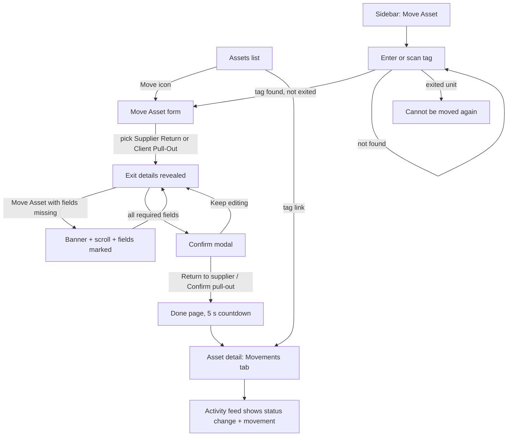

# Dev Doc: Supplier Return and Client Pull-Out

**Audience:** developers porting the Supplier Return and Client Pull-Out work into the R24 code base (`it/app/pages/app/move-asset`, and the status, movement and custody code in `it/app/pages/app/assets`).
**Source:** branch `assets-handoff`. Front end only, mock data. Nuxt 4, Nuxt UI 4, Tailwind 4, Vue 3.
**Verified:** 2 Nov 2026 (see Verification status).
**Scope:** only the two new Terminal-lane statuses and the Move Asset flow that sets them. The UI/UX work on the Assets list and the asset detail view (filters, metric cards, detail layout, right rail, tabs, custody history rebuild, database seed) is covered in `DEV_DOC_assets-ux-enhancements.md`.

**Contents:** Verification status · What changed · Modules · Flow diagram · Known Traps · Out of Scope · Edge Cases & Solutions · Responsive Spec · Simulator Scaffolding · Porting map · Behaviour sections 1, 3, 5 · 6 Exit rules and what a save changes · 7 Move Asset screens, field by field (exact copy) · 8 Persistence, documents and simulator · 9 Easy to miss (small behaviours) · 10 Prototype quirks to decide on · Implementation checklist · Still open · Feature coverage matrix

**How to use this doc.** Sections 1, 3 and 5 are the summary. Sections 6 to 10 are the detail a port usually misses: every rule, exact string and small behaviour. The Feature coverage matrix at the end maps each feature to its code, its section, its checklist item and its QA case (`QA_DOC_supplier-return-client-pull-out.md`). A feature without a ticked checklist item is not done.

---

## Verification status (Step 6.0), 2 Nov 2026 pass

| Check | Result |
|---|---|
| Typecheck | 0 errors in feature files. 10 pre-existing errors elsewhere (tiptap, DatePicker, ticket tracker) are not from this feature. Command: `node node_modules/vue-tsc/bin/vue-tsc.js --noEmit -p .nuxt/tsconfig.app.json` (plain `vue-tsc -p .` checks nothing here). |
| Production build | Passes (`node node_modules/nuxt/bin/nuxt.mjs build`). |
| Cleanup and code review | An independent read-only review of the whole feature. Exit related findings fixed: `exitAsset` now ignores a unit that already left (a double click on Confirm adds one record, not two); hydration validates every history field and the ids; Reset sample data restores the database units because the seed is cloned. Earlier rounds fixed: exited assets could be moved again from a direct URL; a Supplier Return erased earlier check outs; the replacement link showed as a fake status change; a Client Pull-Out created a phantom open custody row. |
| Security | No `v-html`, no `console.*`. Document name escaped in the generated sample SVG and PDF; the QR print page escapes the tag; `window.open` uses blob URLs with `noopener`; done page only redirects to a known asset; stored data is validated and copied by allow-list; the storage key is namespaced and is now `ams:assets:v4`; the CSV export has a formula guard. |
| Accessibility | axe-core with the WCAG 2.2 AA rule set over 28 page states (including Move entry and the Move form with the exit panel), light and dark, desktop and phone. Only inherited failures remain: placeholder text at 3.5:1 (set on purpose by the design system) and one 4.47:1 `text-muted` on a tinted panel. |
| Timezones | Five zones (Pacific/Pago_Pago UTC-11, America/Los_Angeles, UTC, Asia/Manila, Pacific/Kiritimati UTC+14) render every stored date, day pill and badge date identically, and the Move form default date equals the local date in each zone. Dates are `YYYY-MM-DD` strings parsed at local midnight. |
| End-to-end smoke | Playwright, 10 of 10 tests pass against the production build (`tests/e2e/assets-smoke.spec.ts`). The exit tests: Supplier Return with a document, then reload, then Movements, then the document opens in a new tab; the exited unit guard and unknown tag; the blocked save banner marks the missing Client Pull-Out fields. Run: `PLAYWRIGHT_BASE_URL=http://localhost:3200 npx playwright test tests/e2e/assets-smoke.spec.ts`. |
| Widths | No sideways page overflow at 320, 375, 768 and 1440 px. |
| Performance | Measured with the list and detail screens: see `DEV_DOC_assets-ux-enhancements.md`. |

## What changed since last round

**Round 1:** First handoff for the exit work: the two new Terminal-lane statuses (Supplier Return, teal; Client Pull-Out, pink), the Move Asset flow with the exit details, the confirm step and the done page, and how an exit shows in Movements, Custody and the list status. Removed and must not come back: the standalone "left us" wording, "Assets Accounted For", a new lane for exits, sub-status as its own badge colour, Supplier on the details card, the bottom action bar on Move Asset.

**Since then (2 Nov 2026):**
- The Note field on Move Asset has a placeholder: "Add context for this move, such as a ticket number or the reason".
- Move Asset values are clickable and copyable like the asset detail page: the model is a blue link (toast for the existing model page) with a copy button; the serial and the tag (in the page title) have copy buttons; the location is a blue link only when it is an office from the Locations page. A team member's address, a supplier and a client are plain text.
- `exitAsset` ignores a unit that has already left, and the storage key is now `ams:assets:v4`.

## Modules

| # | Module | Files |
|---|---|---|
| M1 | Foundations for the exits: statuses, colours, exit rules, location rule | `app/data/assets.ts`, `assetsActivity.ts`, `app/components/assets/StatusPill.vue` |
| M3 | Move Asset flow (entry, move, done) | `app/pages/move-asset/index.vue`, `[tag]/move.vue`, `[tag]/done.vue`, `components/assets/StatusPicker.vue` |
| M5 (exit parts) | How an exit shows in Movements and Custody history | `app/pages/assets/[tag]/movements.vue`, `custody-history.vue`, `app/data/assetsActivity.ts` |
| M6 (exit parts) | Move Asset sidebar item, breadcrumbs, route rules | `layouts/assets.vue`, `email/AmsSidebar.vue`, `email/TopNavbar.vue`, `nuxt.config.ts`, `assets/SimulatorBar.vue` |

M2 (Assets list), M4 (Asset detail) and the rest of M5 and M6 belong to the UI/UX enhancements task.

## Flow diagram

Status rules: Supplier Return = Check In at the supplier, Client Pull-Out = Check Out to the client (Outright Purchase and BYOD only). Both are Terminal lane. Saving removes the unit from the active count and writes history.

## Known Traps

1. **(M1, M3) A Supplier Return clears `custodian`.** Earlier "In Use" check outs must keep their team member: `exitAsset` stamps `HistoryEntry.member` before clearing. This broke Movements and Custody History before.
2. **(M1, M5) A Client Pull-Out is not a custody row.** It keeps the custodian, so it looks like a check out with a member. `custodyOf` must skip a record whose status is Client Pull-Out, or the custody history shows a second open, still counting row marked "Current".
3. **(M1, M3) `exitAsset` must be idempotent.** A double click on Confirm while the modal closes used to add two history entries and two movements. It now returns nothing for a unit that has already left.
4. **(M1) The status badge date half is a light tint of the status colour** (`STATUS_LIGHT`), not gray-600. Do not change the status fills: they are the live `StatusBadge.vue` colours.
5. **(M3) Links are `blue-700` (blue-400 in dark), no underline, pointer cursor.** The cursor and underline rule is scoped to `.assets-shell`, so it cannot leak into other layouts. On Move Asset only an office location is a link; an address, supplier or client is text.
6. **(M1) Lookups must use own-property checks.** `findAsset('constructor')` once resolved to the prototype chain.
7. **(M3) Move Asset opens for exited units from a direct URL.** The page shows "can't be moved again". Keep that guard on the server too.
8. **(M1) Reset sample data must restore every unit.** The seed is cloned (`structuredClone`) each time; sharing the objects made an exited unit stay exited after a reset.

## Out of Scope

**Deferred / boundary**
- Backend, API, auth and role permissions (the prototype's "Viewing as" control stands in). *(all)*
- Reversing an exit. *(M3)*
- Camera QR scanner on Move Asset. *(M3)*
- The existing pages the prototype only links to from Move Asset: asset model and location. Each shows a toast. *(M3)*

**Anticipated, not wanted**
- A new lane for the two statuses. They sit in the existing Terminal lane. *(M1)*
- A colour for the sub-status (Competitor, Direct Hire). It is the live grey chip. *(M1)*
- A permanent bottom action bar on Move Asset. *(M3)*
- "Left us" or "Assets Accounted For" wording. *(M1)*

## Edge Cases & Solutions

| Edge case | Expected behaviour |
|---|---|
| Unknown tag on Move Asset entry | Inline error and a toast; no navigation |
| Unknown tag in the URL (`/assets/foo`, `/assets/constructor`) | "We couldn't find that asset" with a link back |
| Exited unit opened on `/move-asset/<tag>/move` | "can't be moved again" with a link to the asset |
| Move Asset clicked with no status | Banner "Choose the new status first", picker marked, page scrolls to the banner |
| Exit fields missing | Banner lists them, each field marked red with a one line reason, banner pulses |
| Document over 10 MB or wrong type | Inline error under the attach button; nothing is stored |
| Client Pull-Out on a Monthly Rental unit | Option disabled with an info button; hover and click show the reason |
| Client Pull-Out on an Outright Purchase or BYOD unit | Allowed; the sub-status (Competitor or Direct Hire) is required |
| Double click on Confirm | One history entry, one movement, one toast |
| Sample document with no stored file | Opens a one page stand-in. Replace with a signed URL |
| Tampered or old stored data (`ams:assets:v4`) | Invalid entries ignored, valid ones applied, nothing thrown |
| Phone width on Move Asset | One column; the Status history card sits under the form; no page overflow |

## Responsive Spec

| Surface | Below `md` (768) | `md` to `xl` (1280) | `xl` and up |
|---|---|---|---|
| Move Asset layout | One column; Status history below the form | One column | Form plus a 360 px sticky Status history column |
| Asset summary card | Two columns of fields | Four columns | Four columns |
| Movement card fields | One column | Two columns | Two columns |
| Exit details panel | One column | Two columns | Two columns |

Decision reason: the Move form is a short form with one confirm step, so a single column on a phone keeps every required field and its error in reading order.

## Simulator Scaffolding

The dark strip at the top (State, Viewing as, Scenario, Reset sample data) is **verification scaffolding, not a production feature**. Use it to check each state (for example "Viewing as" the read only role hides the Move action), then leave it out: delete `components/assets/SimulatorBar.vue` and its line in `layouts/assets.vue`, and replace the `assetsSim*` refs in `data/assets.ts`.

## Porting map: what stands in for the backend

| Prototype | Replace with |
|---|---|
| `ASSETS`, `allAssets()`, `findAsset()` | `GET /assets`, `GET /assets/{tag}` |
| `exitAsset()` | The Move Asset save (`POST /assets/move-asset/{tag}`): status, movement, location, document, replacement link |
| `movementsOf()`, `custodyOf()`, `custodyRowsFor()` | Asset movements and custody summary endpoints |
| `openDoc()` and `sampleDocBlob()` | Signed document URLs from the API |
| `watchAssetsToStorage()`, `plugins/assetsStorage.client.ts`, `resetAssets()` | Remove (mock persistence) |
| `CURRENT_OFFICER`, `CURRENT_USER`, `assetsSimRole` | The signed-in user and real permissions |

Generic export names to rename or namespace when porting: `initialsOf`, `openDoc`, `fileSize`, `localToday`, `locationView`. Two bare `catch` blocks in `assets.ts` swallow storage errors on purpose; log them in real code. Attached files are not stored in the prototype (name, type and size only).

---

## 1. Foundations (M1)

- **Statuses.** Supplier Return and Client Pull-Out are two new rows in the existing **Terminal** lane. Competitor and Direct Hire are sub-statuses of Client Pull-Out, stored like Sold's. In pickers Client Pull-Out is one entry; the sub-status is a separate required field.
- **Colours.** Existing statuses keep the live fills (`StatusBadge.vue` map). New: Supplier Return `bg-teal-700`, Client Pull-Out `bg-pink-700` (proposals: no existing status uses them; backend to confirm). The badge has no hover state in the prototype (it is not interactive), so no hover shade exists. The date half is `STATUS_LIGHT[color]`. Full colour table is in `AMS_DESIGN_SYSTEM.md` section 5.3.
- **Sub-status** shows as the live neutral chip beside the badge (`bg-gray-200 text-gray-700`), never in the list table.
- **Rules to save an exit:** date, done by (signed in officer), reason, supporting document (PDF, JPG or PNG, up to 10 MB). Client Pull-Out also needs the sub-status. Supplier Return may link a replacement unit (optional).
- **Derived values.** Supplier Return gives Check In at the supplier address. Client Pull-Out gives Check Out at the client address. Both are real addresses, not labels.
- **Location rule** (`locationView`): In Use by a team member shows that member's address (house icon); at a supplier shows the supplier (truck); pulled out shows the client; otherwise the GoTeam location name (building). Only an office location is a link; the other three are plain text.
- **Empty values** use `EmptyMark` (muted minus, announced "None"). Never a typed dash.

## 3. Move Asset flow (M3)

- **Entry** (`/move-asset`, sidebar item): tag input and sample tag chips. Not found shows an inline error and a toast. Exited units show "already been returned or pulled out".
- **Form** (`/move-asset/{tag}/move`): Asset card, Movement card, Status history timeline.
  - The title carries a copy tag button. The Asset card shows the model (blue link plus copy), serial (copy), type, tech pack, current status and location (a link only for an office). Links and copy buttons follow the asset detail page.
  - New status is a searchable, grouped picker. Every other status is plainly disabled in the prototype only, because this task builds just the two exits; in the real app the existing statuses stay selectable as they are today. Client Pull-Out is disabled with an info button when ineligible.
  - Picking an exit status reveals the exit details inline, with an "All required" badge.
  - The Note field is optional and has the placeholder "Add context for this move, such as a ticket number or the reason".
  - Cancel and Move Asset sit at the end of the Movement card.
  - Blocked save: banner, scroll to it, pulse (`flashElement`), every missing field marked, one line reason under each.
  - A confirm modal names the action ("Return to supplier" or "Confirm pull-out") before saving.
- **Done** (`/move-asset/{tag}/done`): success, 5 second countdown, Move Another Asset or View Asset. Redirects to the asset's Movements tab, or to the entry page for an unknown tag.
- Attached document: file chip with Open (new tab), Replace, Remove.

## 5. How an exit shows elsewhere (M5 exit parts, M6 exit parts)

- **Movements:** the exit is one movement card: Supplier Return is a Check In at the supplier address, Client Pull-Out is a Check Out to the client address. The card shows the status, the reason, and the supporting document chip, which opens in a new tab (`openDoc`). Earlier check outs to team members stay.
- **Custody history:** a Supplier Return closes the open custody row on its date. A Client Pull-Out is not a custody row (Known Trap 2), but it also closes the open row on the pull-out date, so "Currently with" reads "Not currently deployed" and no row is marked "Current". Earlier custodians keep their rows.
- **List and detail status:** the two statuses appear as badges with the live status fills (teal, pink), in the status filter, and the holder text on the detail header reads "At the supplier" or "Pulled out by". The Move icon is hidden for exited units. The rest of those screens is described in `DEV_DOC_assets-ux-enhancements.md`.
- **Shell:** Move Asset is its own active sidebar item on `/move-asset/**`; Assets on `/assets/**`. Breadcrumbs: Home > Move Asset > tag > Done. `nuxt.config.ts` turns SSR off for `/assets`, `/assets/**`, `/move-asset` and `/move-asset/**` (localStorage store); with a real API this can go back to SSR.

---

## 6. Exit rules and what a save changes (M1)

Code: `app/data/assets.ts`. Everything here must also be enforced by the backend; the prototype checks most of it only in the form.

**Which units may exit**
- **From which status:** any status except the two exit statuses. The prototype has no "from status" rule: an Available, In Use, Decommissioned or Missing unit can go to either exit. Which statuses each exit should start from is an open product question. Do not invent a rule.
- **Supplier Return:** any tech pack, including Monthly Rental.
- **Client Pull-Out:** Outright Purchase and BYOD only (`canPullOut`). A Monthly Rental unit is blocked with this exact reason: "Only Outright Purchase and BYOD units can be pulled out by the client. This unit is Monthly Rental." (the tech pack name is filled in).
- **A unit that has already left** (`isExited`: status Supplier Return or Client Pull-Out) cannot exit again. Blocked on the entry page, on the form page, in `exitAsset` (it returns nothing) and in the Move icons.
- **Not checked at all:** whether the unit has a client, a supplier address or a custodian (see section 10).

**Fields and validation** (`missingForExit`, `missingKeys`; the banner and the field marks use the same checks, in this order)

| Field | Supplier Return | Client Pull-Out | Under-field message | Word in the banner list |
|---|---|---|---|---|
| New status | required | required | "Choose the new status." | (banner text is different, see 7.5) |
| Why the client pulled it out | not shown | required: Competitor or Direct Hire | "Choose why the client pulled it out." | "why the client pulled it out" |
| Date | required, default today (local) | same | "Pick the date." | "the date" |
| Document | required | required | "Attach the supplier return agreement." / "Attach the client instruction." | "the supplier return agreement" / "the client instruction" |
| Reason | required, trimmed (spaces only counts as empty) | same | "Say why the unit is leaving." | "the reason" |
| Replacement unit from the supplier | optional | not shown | none | none |
| Note | optional | optional | none | none |

Banner order is date, why the client pulled it out, document, reason. The date has no minimum or maximum: past and future dates are accepted. An empty date (the field returns an empty string) counts as "missing".

**Document rules** (`docProblem`, `DOC_ACCEPT`, `MAX_DOC_BYTES`)
- Type is decided from the browser's MIME type, not the extension: `application/pdf`, `image/jpeg`, `image/png`. The file picker `accept` is `.pdf,.jpg,.jpeg,.png,application/pdf,image/jpeg,image/png`.
- Size limit is 10 MB (10 x 1024 x 1024 bytes). Exactly 10 MB is accepted; one byte more is refused.
- Type is checked first, then size. Messages (the file name is filled in):
  - "{name} can't be attached. Use a PDF or an image (JPG or PNG), for example a printed email or a photo of it."
  - "{name} is over 10 MB. Attach a smaller PDF or image."
- A refused file also clears any file already attached (replacing a good file with a bad one leaves none). The picker value is reset after every pick, so the same file can be chosen again. While an error shows, the "Attach the ..." message is not shown.
- Size label (`fileSize`): at or above 1 MB one decimal and "MB" (for example "1.5 MB"); below that whole "KB", never less than "1 KB".
- Only name, type and size are saved with the history entry. The file itself is not stored by the prototype (section 8).

**Derived movement and location** (`exitMovement`)
- Supplier Return: movement Check In, location = the supplier's registered address.
- Client Pull-Out: movement Check Out, location = the client's registered address.
- Prototype address tables: suppliers Northline IT Supply and Metro Peripherals; clients Fabrikam Logistics, Northwind Health and Contoso Realty. Any other supplier or client falls back to the bare name (an empty client gives an empty location, section 10). Real build: read the address from the supplier and client records.

**What a save writes** (`exitAsset`)
1. Adds one history entry: new id, status, sub-status (Client Pull-Out only), the chosen date, "by" = the signed in officer, note (trimmed), reason (trimmed), the document (name, type, size), the replacement tag (Supplier Return only), the movement and the location.
2. Stamps `member` on every earlier "In Use" history entry that has none, using the current custodian, so Movements and Custody history still know who held the unit (Known Trap 1).
3. Updates the asset: status, sub-status, status date = the chosen date, location = the derived address (the previous office location is overwritten), movement status = Checked In (Supplier Return) or Checked Out (Client Pull-Out).
4. **Supplier Return only:** clears the custodian and the client. **Client Pull-Out** keeps both.
5. If a replacement was chosen: adds an entry to the replacement unit (see below).
6. Returns the asset. When it returns nothing (unit missing, no file, or already exited) the form closes the confirm modal and does nothing else: no toast, no redirect.
7. The save does **not** re-check date, reason, sub-status or the file type and size. The backend must.

**Replacement unit rules** (`replacementCandidates`, Supplier Return only)
- Candidates: every other unit whose status is exactly Available and that has never been linked as a replacement (no history entry with `replacementFor`). The unit being returned is excluded.
- Each option reads "{tag} · {model}"; the stored value is the tag. With more than 7 candidates the list gets a search box (`SharedSelect`). With none the list is empty and there is no message.
- There is no clear control: once one is picked it stays until the status is changed (which resets the form) or the page is left.
- The link adds a history entry on the replacement unit with its own current status, the chosen date, the officer, the note "Linked as the replacement for {tag}" and `replacementFor`. The replacement's status, status date and location do not change. In the Activity feed it is a separate "Replacement" event, not a status change (a past bug).
- The replaced unit's own record keeps `replacement` = the replacement's tag. It shows in the confirm modal ("Replacement unit"), the Status history panel ("Replacement: {tag}") and the Activity feed detail ("Replacement Unit").
- Open question for the product owner: further replacement rules (tech pack, client, supplier match). Not in the prototype.

**Location display rule** (`locationView`, used by the Asset card here and by the list and detail)

| Condition | Text | Icon | Tooltip |
|---|---|---|---|
| Status Supplier Return | the supplier's name (not the address) | truck | "Asset is located at the supplier facility" |
| Status Client Pull-Out | the client's name (not the address) | building-2 | "Asset was pulled out by the client" |
| In Use with a custodian | that team member's address (falls back to the stored location) | house | "Asset is based on the team member's current address" |
| anything else | the stored location | building | "Asset is based on the asset location" |

Only the last row is a link (an office from the Locations page). The Movements card shows the full exit address, not the name.

## 7. Move Asset screens, field by field (M3)

Exact strings are in quotes. Keep them unless the product owner changes them.

### 7.1 Entry page (`app/pages/move-asset/index.vue`, route `/move-asset`)
- Page title "Move Asset - GoTeam Assets". Heading "Move Asset", subtitle "Scan the asset tag or manually enter the tag."
- A dashed placeholder panel "Camera scanner" with "The live app scans the QR code on the asset here. Type the tag below in this prototype." (prototype only; the real page has the camera).
- Label "Manual Asset Tag Input", placeholder "e.g. GT-CE-LTP-1233-0926-0013", focused on load. Enter submits the form. Button "Find Asset" with a loading state.
- Submit: the tag is trimmed, then a fixed 250 ms fake lookup (loading button), then an exact, case sensitive match (`findAsset`).
  - Empty: red field and "Asset tag not found. Please check the tag and try again." No toast, no wait.
  - Unknown tag: the same red message plus an error toast: title "Error", description "Asset not found".
  - Exited unit: "This unit has already been returned or pulled out, so it can't be moved again." No toast and the field is not red.
  - Found and not exited: goes to `/move-asset/{tag}/move`.
  - Typing, or picking a sample chip, clears both messages.
- "Try:" followed by chips of the first four units that have not exited. Clicking a chip fills the field only; it does not submit. Hidden when there are none. (Prototype helper.)
- Read only role (prototype "Viewing as"): the form is replaced by a warning banner "You can't move assets" with "Only an asset officer can move an asset. Switch the role in the prototype controls to try this page." The role is checked only here, on the Move icons, "Move asset" and the Movements empty state. The form page does not check it, so the backend must.

### 7.2 Form page frame (`app/pages/move-asset/[tag]/move.vue`, route `/move-asset/{tag}/move`)
- Title "Move {tag} - GoTeam Assets". The page is keyed on the tag, so going from one tag to another remounts it with a clean form.
- Guards, in this order: unknown tag, or the simulator state "Not found" → "We couldn't find that asset", "The tag may be wrong or the unit may have been removed.", button "Back to Assets" (`/assets`). Exited unit → "{tag} can't be moved again", "It has already been returned to the supplier or pulled out by the client. Its history is on the asset page.", button "View asset". The "Loading" simulator state is not handled on this page.
- Header (fixed, only the body scrolls): icon-only back arrow with the tooltip and label "Back to Assets" (goes to `/assets`, not to the previous page); title "Moving asset {tag}" with a copy-tag button; subtitle "Change this unit's status and record the movement."
- Body: one column; from 1280 px (`xl`) a 360 px sticky column with Status history. The body scrolls inside the page, not the window.

### 7.3 Asset card (read only)
Header "ASSET" (small caps). Fields: Model (cpu icon, blue link and copy button), Serial (hash icon, copy button), Type (monitor-speaker icon, shown only for Computer Equipment), Tech Pack (icon: Monthly Rental repeat, Outright Purchase badge-check, BYOD laptop; plain text, not a badge), Current status (status badge with its date and sub-status chip), Location (icon, tooltip and, for an office, a blue link; see the table in section 6).
- The model link shows an info toast: title = the model, description "This opens the asset model detail page. It is an existing view in the system and out of scope for this task." The location link shows an info toast "Location" with "This opens the location page. It is an existing view in the system and out of scope for this task."
- Copy buttons (tag, model, serial): tooltip "Copy tag" / "Copy model" / "Copy serial", on click the icon becomes a green check and the tooltip "Copied" for 1.5 s, with a small pop. No toast. If the clipboard is blocked the flash still shows.
- Layout: two columns below `md`, four from `md`; Current status and Location span two columns.

### 7.4 Movement card
- **New status** (label has a red asterisk): the grouped picker (7.4.1). Beside it **Movement type** shows "Check In" or "Check Out", or "Set when you pick the status".
- **Checked in by** (Supplier Return) or **Checked out by** (Client Pull-Out): the signed in officer (blue initials circle "KB", name "Karl Bustillo", a small "You" badge). Before a status is picked the label reads "Checked out by" (see section 10).
- **Location**: the derived address, or "Set when you pick the status".
- **Exit details panel** (amber panel), shown only after an exit status is picked: heading "Supplier Return details" or "Client Pull-Out details" with an amber badge "All required". Fields, in order:
  1. Client Pull-Out only: "Why the client pulled it out" with a select, placeholder "Select a reason", options "Competitor", "Direct Hire".
  2. "Date": a date field (typed segments plus a calendar), default today, accessible name "Exit date".
  3. Supplier Return only: "Replacement unit from the supplier" with an "Optional" badge, placeholder "Not linked yet".
  4. Document, label "Supplier return agreement" or "Client instruction" plus "· PDF or image (JPG, PNG), up to 10 MB". Button "Attach document" (paperclip). After attaching: the file chip (7.4.2).
  5. "Reason": two row textarea, not resizable, placeholder "For example: the client moved this team member to their own payroll on 20 Oct." (the same text for both exits).
  Panel grid: one column below `md`, two from `md`; document and reason span both.
- **Note** (always visible, "Optional" badge): two rows, placeholder "Add context for this move, such as a ticket number or the reason". Saved on the history entry, but nothing in the prototype displays it when a reason exists (section 10).
- Banner slot, then the buttons "Cancel" (outline, goes to `/assets`, no confirmation) and "Move Asset" (primary), both right aligned at the end of the card.

**7.4.1 Status picker** (`app/components/assets/StatusPicker.vue`)
- A full width button (placeholder "Select status", or the chosen name) opens a popover as wide as the button (at least 18 rem). A search box "Search status" is focused on open; it filters by name, case insensitive, anywhere in the name.
- Groups in lane order with small caps headings: Intake & Ready Pool, Active Use, Return & Triage, Review & Investigation, Decommissioning, Terminal. Empty groups are hidden. With no match: "No status matches." The list scrolls inside (max height 20 rem) with the fade edge.
- The chosen option is blue with a check. Choosing closes the popover and clears the search; closing without choosing keeps the typed search. There is no way to un-pick a status.
- Every status except the two exits is plainly disabled in the prototype (not focusable, no tooltip, nothing happens on click). Supplier Return is always selectable.
- Client Pull-Out on a Monthly Rental unit: the row is greyed with an info button; hovering the row shows the reason as a tooltip above; clicking the row or the info button closes nothing and raises an info toast: title "Client Pull-Out isn't available for this unit", description = the reason. The info button's accessible name is "Why is Client Pull-Out unavailable". The row stays focusable (`aria-disabled`).

**7.4.2 Document chip** (`app/components/FileAttachChip.vue`)
- A pill with a file icon (PDF text icon, otherwise an image icon), the file name (truncated), and the size as the subtitle.
- Three icon buttons: Open (eye, tooltip "Open file in a new tab"), Replace (tooltip "Replace", opens the file picker), Remove (red x, tooltip "Remove", clears the file and any error).
- Open uses a temporary object URL, `window.open(url, '_blank', 'noopener')`, and revokes the URL after 60 s.

### 7.5 Blocked save
- "Move Asset" with no status, or with something missing, sets the "tried to save" flag. It never disables the button.
- A danger banner (role alert, compact) titled "Something is still needed" appears above the buttons:
  - No status: "Choose the new status first. The details to fill in depend on it."
  - Otherwise: "Can't move the asset yet. Still needed: {list}." with the list joined by ", " (for example "the date, why the client pulled it out, the client instruction, the reason").
- The page scrolls the banner to the centre of the view (smooth, `scroll-mt-6`) and pulses it (`flashElement`, 3.5 s ring).
- Fields are marked: the status picker, date and file button get a red ring or red outline; the sub-status select and the reason get the error colour; each shows the one line message from section 6 under it.
- The marks and the banner are live: each disappears as soon as its field is fixed. The flag stays on, so a field cleared again is marked again at once.
- When nothing is missing the same click opens the confirm modal.

### 7.6 Confirm modal and save
- Title "Return this unit to the supplier?" or "Confirm the client pull-out?". Description "This is a terminal status. The unit leaves the active count, and the change is recorded in its history." (modal at most `max-w-md`.)
- Summary rows, in order: Asset ("{tag} · {model}"), New status ("Supplier Return" or "Client Pull-Out · {sub}"), Movement ("Check In · {address}" or "Check Out · {address}"), Date (`badgeDate`, for example "2026, Oct 20"), Document (file name), Replacement unit (only when chosen, the tag), Reason (trimmed). The Note is not listed.
- Buttons: "Keep editing" (closes; the form keeps its data) and the primary "Return to supplier" or "Confirm pull-out". Esc or the overlay also close it without saving.
- On confirm: success toast, title "{tag} is now Supplier Return" or "{tag} is now Client Pull-Out · {sub}", description "The unit is out of the active count. Its history has the change and the document." Then the page goes to `/move-asset/{tag}/done`.
- A second click on the confirm button after the first save finds the unit already exited, so nothing more happens (Known Trap 3).
- Changing the status resets the whole form: date back to today, sub-status, replacement, file, reason, **Note**, file error and the error flag. There is no unsaved-changes warning on Cancel, the back arrow, the sidebar or a reload; nothing is saved as a draft.

### 7.7 Status history panel
- Card "STATUS HISTORY" listing the unit's history newest first, as a timeline. The newest entry has a blue dot and a blue connector; earlier ones grey. The dot is centred on the badge row.
- Each entry: status badge with date and sub-status chip, "by {name}", the text (reason if there is one, otherwise the note, otherwise "No note recorded" in placeholder colour), the document as a small blue paperclip link with an arrow (opens the file in a new tab), and "Replacement: {tag}" when set.
- A replacement unit's link entry reads as a normal row with its note "Linked as the replacement for {tag}".
- The document link and the "Replacement: {tag}" line can only come from an exit entry, and the form never opens for an exited unit, so in the prototype these two lines are never on screen. Keep them if the panel is ever shown for an exited unit.

### 7.8 Done page (`app/pages/move-asset/[tag]/done.vue`)
- Title "Asset moved - GoTeam Assets". Green check icon, heading "Asset Moved Successfully", the line "{tag} has been moved. You will be redirected in {n} seconds." (announced as a status).
- The count starts at 5 and drops each second. It goes to the asset's Movements tab (`/assets/{tag}/movements`) when it reaches 0, so the screen shows 5, 4, 3, 2, 1. The timer is cleared on any button press and on leaving the page. The text does not switch to "second" at 1.
- Buttons: "Move Another Asset" (ghost, goes to `/move-asset`) and "View Asset" (primary, goes to the Movements tab now).
- An unknown tag in the URL goes to `/move-asset` instead, both for the countdown and for "View Asset" (the page still shows the success text until then). The page does not check that a move just happened: any known tag shows the success page.

## 8. Persistence, documents and simulator (M1, M6)

- **Store:** `ASSETS` (reactive) in `app/data/assets.ts`; saved to `localStorage` key `ams:assets:v4` (bump the version when the shape changes). `plugins/assetsStorage.client.ts` loads it once after the app has mounted (`app:mounted`), then watches deeply and saves on every change. Remove all of this with the real API.
- **Read back with an allow-list:** only these asset fields are restored: serial, model, statusDate, currency, custodian, client, owner, location, po, supplier, status, sub, cost, techPack, movementStatus and history. Only tags that exist in the seed are applied. An entry is skipped when the status is unknown, the history is invalid or the cost is not a number. A history entry must have a safe id (`^[\w-]+$`, not `__proto__`), a known status, a `YYYY-MM-DD` date, string by and note, string optional fields, a valid movement and a valid document shape. Bad JSON is ignored.
- **What is not saved:** the attached files (only name, type and size), the object URLs, movement comments and legacy tags, and the simulator settings.
- **Opening a document** (`openDoc`): uses the object URL made in this session; otherwise opens a generated one page stand-in (a PDF, or an SVG for images, with the document name escaped). So after a reload the real file is gone and the stand-in opens. Production: a signed URL for the stored file.
- **Reset sample data** (simulator button): removes the saved key, rebuilds every unit from a fresh clone of the seed, revokes the object URLs, resets the three detail simulator controls and the comments and legacy tags, and shows an info toast "Sample data reset" with "The asset list and its history are back to the starting data." It does not change State, Viewing as or Scenario.
- **Simulator strip** (`SimulatorBar.vue`, layout row above the app, "Hide" button; remove in production): State (Populated, Loading, Not found), Viewing as (Asset officer, Read only), Scenario (Standard data, Empty list), Reset sample data. On asset detail it adds Custody history, Warranty and Transit controls, which belong to the other task. For this feature: "Not found" makes the Move form show "We couldn't find that asset"; "Read only" blocks the entry page and hides the Move icons.
- **Shell:** the `assets` layout has a skip link, the simulator row, the sidebar (hidden below 1024 px), the top bar and the main area (`#main-content`, focusable, no outline). Inside it every button, link, `label[for]` and `select` that is not disabled shows a pointer cursor, and links and buttons are never underlined (scoped to `.assets-shell #main-content`).
- **Test hooks:** the Playwright tests rely on these ids and names: `#reason`, `input[type=file]`, the button named "Select status", the buttons "Move Asset", "Return to supplier", the alert banner, and the text "can't be moved again". Keep them or update the tests.

## 9. Easy to miss (small behaviours)

1. The prototype hides every non-exit status in the picker; production must not (`StatusPicker.vue`, `assets.ts` `statusPickerOptions`).
2. Any non-exited status can start either exit; only Client Pull-Out on Monthly Rental is blocked (`assets.ts` `statusPickerOptions`, `canPullOut`).
3. A Supplier Return clears both the custodian and the client; a Client Pull-Out keeps both (`assets.ts` `exitAsset`).
4. A save overwrites the unit's office location with the supplier or client address (`assets.ts` `exitAsset`).
5. The status date shown on the badge is the date chosen in the form, not today (`assets.ts` `exitAsset`).
6. The Note is saved but never shown next to a reason; the confirm modal omits it too (`move.vue`, `assetsActivity.ts`, `assetsDetail.ts`).
7. Changing the status wipes the entire form including the Note and resets the date to today (`move.vue` watch on `chosenStatus`).
8. The "Move Asset" button is never disabled; a blocked click shows the banner instead (`move.vue` `trySave`).
9. The banner lists missing items in a fixed order: date, why the client pulled it out, document, reason (`assets.ts` `missingForExit`).
10. A refused file also removes a file that was already attached (`move.vue` `onFile`).
11. The same file can be picked twice in a row because the input value is cleared (`move.vue` `onFile`).
12. Type is judged by MIME, so a `.pdf` with no MIME type is refused (`assets.ts` `docProblem`).
13. Exactly 10 MB is accepted; the limit is "greater than" (`assets.ts` `docProblem`).
14. The attached file opens through a temporary object URL revoked after 60 s (`move.vue` `openAttached`).
15. The replacement list is only units that are exactly Available and were never a replacement (`assets.ts` `replacementCandidates`).
16. The replacement list cannot be cleared once a unit is picked (`move.vue`, `components/shared/Select.vue`).
17. Linking a replacement does not change the replacement's status; it adds a history entry with `replacementFor` (`assets.ts` `exitAsset`).
18. The Done page counts 5 to 1 and redirects at 0 to the Movements tab; any button press cancels the timer (`done.vue`).
19. The Done page for an unknown tag redirects to the entry page, but only after the countdown (`done.vue`).
20. The Done breadcrumb "tag" links back to the Move form, which for the now exited unit says "can't be moved again" (`TopNavbar.vue`).
21. The entry page waits a fake 250 ms and a blank submit shows the not found message without a toast (`move-asset/index.vue`).
22. The entry page lookup is exact and case sensitive after trimming (`move-asset/index.vue`, `assets.ts` `findAsset`).
23. The exited message on the entry page has no toast and does not turn the field red (`move-asset/index.vue`).
24. The role is checked on the entry page, the Move icons and the Movements empty state, but not on the Move form page (`move-asset/index.vue`, `move.vue`).
25. The search typed in the status picker is kept when the popover is closed without choosing (`StatusPicker.vue`).
26. Disabled Client Pull-Out stays keyboard focusable and explains itself with a toast; the other disabled statuses do nothing (`StatusPicker.vue`).
27. The movement label reads "Checked in by" for Supplier Return and "Checked out by" otherwise, including before a status is chosen (`move.vue`).
28. The Reason placeholder is the same client example for both exits (`move.vue`).
29. "All required" shows on the Supplier Return panel although the replacement is optional (`move.vue`).
30. Cancel and the back arrow go to `/assets`, never to the page the user came from, and never ask to confirm (`move.vue`).
31. Both the blocked-save scroll and the pulse run after the DOM updates (`nextTick`), so the banner exists first (`move.vue` `revealProblem`).
32. The Done page's countdown line has `role="status"`, so screen readers announce it (`done.vue`).
33. Dates are `YYYY-MM-DD` strings parsed at local midnight; the badge format is "2026, Oct 20", Custody history uses "20 Oct 2026", the activity stamp "20 Oct 2026, 1:34 PM" (`assets.ts`, `custody-history.vue`, `assetsDetail.ts`).
34. Times of day in Movements and the feed are made up from the record id (8 AM to 5 PM); the real build must show the true time (`assetsDetail.ts` `timeLabel`).
35. The movement number `#1000` to `#9999` is a hash of the id, not a counter (`assetsDetail.ts` `movementNum`).
36. In Movements the status badge on an exit card shows only the status name, not the sub-status or date (`movements.vue`).
37. A Client Pull-Out Movements card says "Checked out to {member}" plus "Recorded by {officer}", and the "Currently" summary shows the member as "Checked out" (`movements.vue`, `assetsActivity.ts`).
38. The Custody row for a Client Pull-Out unit closes on the pull-out date; for a Supplier Return it closes on the return date (`assetsActivity.ts` `custodyOf`).
39. Used Age counts 30 day months, rounded down, "< 1 mo" below one (`assetsActivity.ts`, `custody-history.vue`).
40. The list's Location Type filter has no value for a Client Pull-Out unit (`pages/assets/index.vue` `locationTypeOf`).
41. The list and detail "Move" icon is hidden for exited units and for the read only role (`pages/assets/index.vue`, `pages/assets/[tag].vue`).
42. The Movements empty state offers "Move this asset" only to an officer for a unit that has not exited (`movements.vue`).
43. The model, serial and tag copy keys are separate, so two flashes can show at once (`move.vue`, `useCopyFlash.ts`).
44. The `label for="new-status"` has no matching element id, so the label does not focus the picker (`move.vue`, `StatusPicker.vue`).
45. The page title changes per route ("Move {tag} - GoTeam Assets") (`move.vue`).
46. SSR is off for these routes because the store lives in `localStorage` (`nuxt.config.ts`).

## 10. Prototype quirks to decide on (do not copy blindly)

| Quirk | Where | What to do |
|---|---|---|
| The optional Note is saved but displayed nowhere while a reason exists (Movements, Activity feed and Status history show the reason first). | `assetsActivity.ts`, `assetsDetail.ts`, `move.vue` | Ask the product owner whether to show both. |
| A Client Pull-Out on a unit with no client (for example an Available Outright Purchase unit) gets an empty location and a movement "Check Out · " with nothing after it. | `assets.ts` `exitMovement` | Block it, or require a client, in the real rules. |
| A Supplier Return unit whose supplier has no address on file gets the bare supplier name as its location. | `assets.ts` `exitMovement` | Read the address from the supplier record. |
| The list and detail location of an exited unit is the supplier or client name; Movements shows the full address. | `assets.ts` `locationView` | Confirm which one the product owner wants. |
| Supplier Return also empties the client, so the "Checked out to (Client)" column goes blank. | `assets.ts` `exitAsset` | Confirm; the history keeps the earlier check out. |
| Reason placeholder is client flavoured on a Supplier Return; "All required" sits over an optional replacement; the movement label reads "Checked out by" before a status is chosen. | `move.vue` | Copy fix: confirm wording. |
| "Currently" in the Movements summary names the team member for a Client Pull-Out unit. | `movements.vue` | Confirm the wanted wording. |
| The Done page shows success for any known tag, even one that was not moved. | `done.vue` | Real build: only after a save, or read the move result. |
| The date has no minimum or maximum (future and old dates are accepted). | `move.vue`, `components/shared/DatePicker.vue` | Ask for a rule. |
| `exitAsset` does not re-validate anything but the file. | `assets.ts` | Backend validates everything in section 6. |

---

## Implementation checklist

Each item names the Feature coverage matrix rows it closes (matrix at the end). Tick an item only when every behaviour in its section is done.

**M1 Foundations** (sections 1, 6, 8)
- [ ] **C01** Two new Terminal statuses, teal and pink, sub-statuses Competitor and Direct Hire, backend values added
- [ ] **C02** Status badge: live fills, light date half, date format "2026, Oct 20", variant without a date, grey sub-status chip with its `Sub-status: {name}` title, chip never in the list table
- [ ] **C03** Location display rule with its four kinds, icons and tooltips; only an office is a link
- [ ] **C04** Eligibility: Client Pull-Out blocked for Monthly Rental with the exact reason; any non-exited status may start an exit; an exited unit is blocked everywhere
- [ ] **C05** Server rules: status, sub-status, date, reason (trimmed), document type (PDF, JPG, PNG) and size (10 MB), with the exact messages
- [ ] **C06** Derived movement and location from the supplier or client address, with a defined fallback
- [ ] **C07** Save writes: history entry, member stamping, status, sub-status, status date, location, movement status; Supplier Return clears custodian and client; Client Pull-Out keeps both
- [ ] **C08** Save is idempotent (second call on an exited unit does nothing)
- [ ] **C09** Replacement candidates (Available, never a replacement, not itself) and the link record that does not change the replacement's status
- [ ] **C10** Persistence and hydration rules, key `ams:assets:v4` (prototype only), own-property lookups, Reset sample data restores every unit
- [ ] **C11** Document storage: real file kept and opened from a signed URL; the stand-in is prototype only

**M3 Move Asset flow** (sections 3, 7)
- [ ] **C12** Entry page: copy, label, placeholder, autofocus, Enter, loading, trim, exact match, three message cases and the toast, sample chips (prototype), read only banner
- [ ] **C13** Form guards: unknown tag, exited unit (server too)
- [ ] **C14** Header: back arrow with tooltip, title, copy tag, subtitle, fixed header with a scrolling body
- [ ] **C15** Asset card: all fields, icons, tooltips, model link and copy, serial copy, office-only location link, status badge
- [ ] **C16** Status picker: groups, search, empty text, check, close behaviour, disabled rules, Client Pull-Out info row, tooltip, toast
- [ ] **C17** Read only Movement fields: movement type, checked in/out by, location, placeholders
- [ ] **C18** Exit details panel: reveal, headings, "All required", sub-status select, date, replacement, reason, note, labels and placeholders
- [ ] **C19** Document chip: attach, open in a new tab, replace, remove, file errors, size label
- [ ] **C20** Blocked save: banner copy, centred smooth scroll, pulse, field marks, one line messages, live clearing
- [ ] **C21** Form reset on status change; Cancel and Move Asset at the end of the card; no draft, no unsaved warning
- [ ] **C22** Confirm modal: titles, description, summary rows, buttons, Esc
- [ ] **C23** Save: toast text, redirect to done, silent no-op when nothing was saved
- [ ] **C24** Status history panel: order, dots, text rules, document link, replacement line
- [ ] **C25** Done page: copy, countdown 5 to 1, redirect to Movements, buttons, unknown tag redirect
- [ ] **C26** Responsive layout and the scroll container (sticky column from 1280 px)

**Exit parts of M5 and M6** (sections 5, 8)
- [ ] **C27** Movements: exit card (type, status badge, address, reason, document chip), earlier check outs kept
- [ ] **C28** Custody rows: Supplier Return closes the row; Client Pull-Out has no row and closes the open one
- [ ] **C29** Activity feed: status change, movement and replacement events for an exit
- [ ] **C30** List and detail: exit badges, status filter, holder text, Move icon hidden for exited units and the read only role
- [ ] **C31** Shell: Move Asset sidebar item and active state, breadcrumbs, page titles, route rules, pointer cursor and no underline rule
- [ ] **C32** Simulator bar removed from production; Playwright smoke tests ported; test hooks kept

## Still open for the dev or the next pass

| Item | Cost of leaving it |
|---|---|
| Teal and pink colours need backend confirmation | A colour change is one map entry |
| Store hydrates after mount (brief flash of seed data) | Cosmetic; vanishes with a real API |
| Yellow and orange live badges have white text below 4.5:1 (orange 2.88:1) | Inherited from the live app; not changed here |
| Open questions for the product owner: reversing an exit, which statuses each exit may start from, supplier location source, document size limit, permissions, replacement unit rules, IAM ticket key and sprint | Listed in the PRD Open Questions |
| The quirks in section 10 | Each is a small copy or rule decision |

## Feature coverage matrix

One row per feature in the Move Asset and exit scope. "Code" paths are under `app/` unless stated. QA case ids are in `QA_DOC_supplier-return-client-pull-out.md` ("Trap n" = the "Test first" list).

| # | Feature | Where in the code | Dev Doc section | Checklist item | QA case |
|---|---|---|---|---|---|
| 1 | Two exit statuses in the Terminal lane | `data/assets.ts` STATUSES | 1, 6 | C01 | A2 |
| 2 | Teal and pink fills, light date half | `data/assets.ts` STATUS_BG, STATUS_LIGHT; `components/assets/StatusPill.vue` | 1 | C02 | A1 |
| 3 | Badge date format and the no-date variant | `data/assets.ts` badgeDate; `StatusPill.vue` | 1 | C02 | A1, K5 |
| 4 | Sub-status chip with title, not in the table | `StatusPill.vue` | 1 | C02 | A1, A7 |
| 5 | Exited unit check | `data/assets.ts` isExited, exitKindOf | 6 | C04 | B3, E3 |
| 6 | Client Pull-Out blocked for Monthly Rental | `data/assets.ts` canPullOut, pullOutReason | 6, 7.4.1 | C04 | B4, F6 |
| 7 | Any non-exited status may start an exit | `data/assets.ts` statusPickerOptions | 6 | C04 | K3 |
| 8 | Location rule, icons, tooltips | `data/assets.ts` locationView | 6 | C03 | A5 |
| 9 | Office-only location link, info toast | `pages/move-asset/[tag]/move.vue` | 7.3 | C03, C15 | B12 |
| 10 | Holder text on the asset header | `pages/assets/[tag].vue` | 5 | C30 | A6 |
| 11 | Derived movement and address | `data/assets.ts` exitMovement | 6 | C06 | K1, K2 |
| 12 | Required fields, order, messages | `data/assets.ts` missingForExit, missingKeys | 6, 7.5 | C05 | G5, G6 |
| 13 | Document type, size, messages, accept list | `data/assets.ts` docProblem, DOC_ACCEPT | 6 | C05 | H1, H2, H3, B6 |
| 14 | Save writes the history entry and asset fields | `data/assets.ts` exitAsset | 6 | C07 | K1, K2, K5 |
| 15 | Supplier Return clears custodian and client; Client Pull-Out keeps | `data/assets.ts` exitAsset | 6 | C07 | K1, K2 |
| 16 | Earlier In Use records keep their member | `data/assets.ts` exitAsset | Known Traps 1 | C07 | Trap 1, C1 |
| 17 | Office location overwritten by the exit address | `data/assets.ts` exitAsset | 6 | C07 | K1 |
| 18 | Idempotent save | `data/assets.ts` exitAsset | Known Traps 3 | C08 | B13, Trap 3 |
| 19 | Replacement candidates rule | `data/assets.ts` replacementCandidates | 6 | C09 | J1, J4 |
| 20 | Replacement link record, not a status change | `data/assets.ts` exitAsset; `data/assetsDetail.ts` feedOf | 6 | C09 | B9, J3 |
| 21 | Storage key, save on change, load after mount | `data/assets.ts`; `plugins/assetsStorage.client.ts` | 8 | C10 | D1 |
| 22 | Hydration allow-list and validation | `data/assets.ts` hydrateAssetsFromStorage, validHistory | 8 | C10 | D4 |
| 23 | Reset sample data restores every unit | `data/assets.ts` resetAssets; `SimulatorBar.vue` | Known Traps 8, 8 | C10 | D2, L6, Trap 8 |
| 24 | Own-property lookups | `data/assets.ts` findAsset | Known Traps 6 | C10 | A4, Trap 6 |
| 25 | Open a document in a new tab, stand-in file | `data/assets.ts` openDoc, sampleDocBlob | 8 | C11 | C3, H7 |
| 26 | Entry page copy, label, placeholder, autofocus | `pages/move-asset/index.vue` | 7.1 | C12 | E1 |
| 27 | Entry lookup: trim, exact match, 250 ms loading, Enter | `pages/move-asset/index.vue` | 7.1 | C12 | E6, E8 |
| 28 | Entry errors: blank, unknown (toast), exited (no toast) | `pages/move-asset/index.vue` | 7.1 | C12 | B1, E2, E3, E4 |
| 29 | Sample tag chips | `pages/move-asset/index.vue` | 7.1 | C12 | E5 |
| 30 | Read only role banner on the entry page | `pages/move-asset/index.vue` | 7.1 | C12 | E7 |
| 31 | Form guard: unknown tag and simulator Not found | `pages/move-asset/[tag]/move.vue` | 7.2 | C13 | L5 |
| 32 | Form guard: exited unit | `pages/move-asset/[tag]/move.vue` | 7.2, Known Traps 7 | C13 | B3, Trap 7 |
| 33 | Header: back arrow, title, subtitle, fixed header | `move.vue` | 7.2 | C14 | L4 |
| 34 | Copy tag, model and serial buttons | `move.vue`; `composables/useCopyFlash.ts` | 7.3 | C14, C15 | B12 |
| 35 | Asset card values, icons, layout | `move.vue`; `data/assets.ts` TYPE_ICON, TECH_PACK_STYLE | 7.3 | C15 | B14 |
| 36 | Model link and info toast | `move.vue` | 7.3 | C15 | B12 |
| 37 | Current status badge in the card | `move.vue`; `StatusPill.vue` | 7.3 | C15 | B14 |
| 38 | Status picker: groups, search, empty text | `components/assets/StatusPicker.vue` | 7.4.1 | C16 | F1, F2 |
| 39 | Picker: choose, check mark, close, Esc | `StatusPicker.vue` | 7.4.1 | C16 | F5, F7 |
| 40 | Picker: other statuses disabled | `StatusPicker.vue`; `data/assets.ts` statusPickerOptions | 7.4.1 | C16 | F3 |
| 41 | Picker: Client Pull-Out info row, tooltip, toast | `StatusPicker.vue` | 7.4.1 | C16 | F6, B4 |
| 42 | Read only Movement type, by, Location, placeholders | `move.vue` | 7.4 | C17 | G3 |
| 43 | Exit panel reveal, heading, "All required" | `move.vue` | 7.4 | C18 | G1, G2 |
| 44 | Sub-status select (Client Pull-Out) | `move.vue` | 7.4 | C18 | G2 |
| 45 | Date field, default today, clearable | `move.vue`; `components/shared/DatePicker.vue`; `data/assets.ts` emptyExitForm | 6, 7.4 | C18 | G9 |
| 46 | Replacement select (Supplier Return) | `move.vue` | 6, 7.4 | C18 | J1, J2, J5 |
| 47 | Reason textarea and placeholder | `move.vue` | 7.4 | C18 | G10 |
| 48 | Note field and placeholder | `move.vue` | 7.4 | C18 | B11, G11 |
| 49 | Document chip: open, replace, remove | `components/FileAttachChip.vue`; `move.vue` | 7.4.2 | C19 | H5 |
| 50 | File errors shown inline, replace with a bad file | `move.vue` onFile | 6, 7.4 | C19 | B6, H2, H3, H4 |
| 51 | Blocked save banner text | `move.vue` errorText | 7.5 | C20 | B5, G4, G6 |
| 52 | Field marks and one line messages | `move.vue` invalid | 7.5 | C20 | G5 |
| 53 | Banner scroll to centre and pulse | `move.vue` revealProblem; `utils/flashElement.ts` | 7.5 | C20 | B5 |
| 54 | Marks and banner clear live | `move.vue` | 7.5 | C20 | G7 |
| 55 | Form resets on status change | `move.vue` watch | 7.6 | C21 | G8 |
| 56 | Cancel and Move Asset at the end of the card | `move.vue` | 7.4 | C21 | B10, L4 |
| 57 | No draft, no unsaved warning | `move.vue` | 7.6 | C21 | D5 |
| 58 | Confirm modal titles, rows, buttons | `move.vue` | 7.6 | C22 | B7, I1, I2, I3 |
| 59 | Save toast text | `move.vue` confirmSave | 7.6 | C23 | I4 |
| 60 | Redirect to the done page | `move.vue` | 7.6 | C23 | B8 |
| 61 | Silent no-op on a repeated confirm | `move.vue`; `data/assets.ts` | 7.6, Known Traps 3 | C23 | B13 |
| 62 | Status history panel order, dots, text | `move.vue` | 7.7 | C24 | K4 |
| 63 | History panel document link and replacement line | `move.vue` | 7.7 | C24 | K4 |
| 64 | Done page copy | `pages/move-asset/[tag]/done.vue` | 7.8 | C25 | I5 |
| 65 | Countdown 5 to 1 and redirect to Movements | `done.vue` | 7.8 | C25 | I5, B8 |
| 66 | Done buttons | `done.vue` | 7.8 | C25 | I6 |
| 67 | Done page unknown tag redirect | `done.vue` | 7.8 | C25 | I7 |
| 68 | Layout, scroll container, sticky history, widths | `move.vue`; `layouts/assets.vue` | 7.2, Responsive Spec | C26 | Responsive block |
| 69 | Movements exit card | `pages/assets/[tag]/movements.vue`; `data/assetsActivity.ts` movementsOf | 5 | C27 | C1, C2 |
| 70 | Movements document chip | `movements.vue` | 5 | C27 | C3 |
| 71 | Earlier check outs stay in Movements | `assetsActivity.ts` movementsOf | Known Traps 1 | C27 | C1, Trap 1 |
| 72 | Custody: Supplier Return closes the row | `assetsActivity.ts` custodyOf; `custody-history.vue` | 5 | C28 | C5 |
| 73 | Custody: Client Pull-Out has no row, closes the open one | `assetsActivity.ts` custodyOf | 5, Known Traps 2 | C28 | C4, Trap 2 |
| 74 | Activity feed events for an exit | `data/assetsDetail.ts` feedOf; `pages/assets/[tag]/activity-feed.vue` | 5 | C29 | K6, B9 |
| 75 | List and detail status, Move icon hidden | `pages/assets/index.vue`; `pages/assets/[tag].vue` | 5 | C30 | A3, A1, A2 |
| 76 | Sidebar item and active state | `components/email/AmsSidebar.vue` | 5 | C31 | B2, L1 |
| 77 | Breadcrumbs | `components/email/TopNavbar.vue` | 5 | C31 | D3, L2 |
| 78 | Page titles | `move.vue`, `index.vue`, `done.vue` | 7 | C31 | L8 |
| 79 | Route rules (SSR off) and hard refresh | `nuxt.config.ts` | 5 | C31 | L10 |
| 80 | Pointer cursor, no underline on links | `layouts/assets.vue` | Known Traps 5 | C31 | L7, Trap 5 |
| 81 | Skip link and main region | `layouts/assets.vue` | 8 | C31 | L9 |
| 82 | Simulator controls | `components/assets/SimulatorBar.vue` | 8, Simulator Scaffolding | C32 | L5, L6 |
| 83 | Playwright smoke tests and test hooks | `tests/e2e/assets-smoke.spec.ts` | 8 | C32 | Smoke flows |
