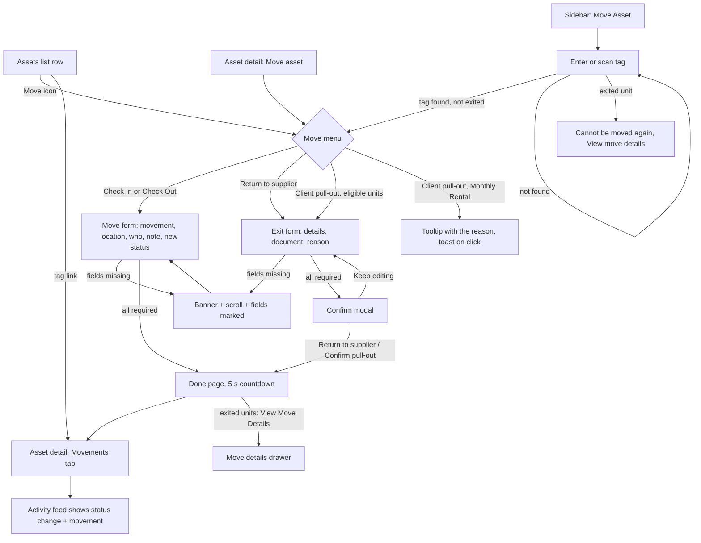

# Dev Doc: Supplier Return and Client Pull-Out

**Audience:** developers porting the Move Asset work into the R24 code base (`it/app/pages/app/move-asset`, and the status, movement and custody code in `it/app/pages/app/assets`).
**Source:** branch `wt-assets`. Front end only, mock data. Nuxt 4, Nuxt UI 4, Tailwind 4, Vue 3.
**Verified:** 3 Nov 2026 (see Verification status).
**Scope:** every kind of move on the Move Asset page: a Check In or Check Out to any status (with the Legacy statuses and the Charged Deduction documents), and the two exits, Supplier Return and Client Pull-Out (the two Terminal-lane statuses added for this work). The kind of move is chosen in a menu before the form opens, so the form never changes shape. This also covers the Move details drawer and the replacement unit. The UI/UX work on the Assets list and the asset detail view (filters, metric cards, detail layout, right rail, tabs, custody history rebuild, database seed) is covered in `DEV_DOC_assets-ux-enhancements.md`. The prototype is already signed off; this doc is the build reference, not a request for approval.

**Contents:** Verification status · What changed · Modules · Flow diagram · Known Traps · Out of Scope · Edge Cases & Solutions · Responsive Spec · Simulator Scaffolding · Porting map · Behaviour sections 1, 3, 5 · 6 Exit rules and what a save changes · 7 Move Asset screens, field by field (exact copy) · 8 Persistence, documents and simulator · 9 Easy to miss (small behaviours) · 10 Prototype quirks to decide on · 11 New components and data (MoveMenu, the generic move, MoveDetailsDrawer, ReplacementPicker, the file store, the scroll fade) · Implementation checklist · Still open · Feature coverage matrix

**How to use this doc.** Sections 1, 3 and 5 are the summary. Sections 6 to 11 are the detail a port usually misses: every rule, exact string and small behaviour. Section 11 is the newest and covers what the earlier rounds did not: the move menu, the generic Check In or Check Out form, the details drawer, the replacement picker and the file store. Where an older section describes a flow that section 11 changed, section 11 wins. The Feature coverage matrix at the end maps each feature to its code, its section, its checklist item and its QA case (`QA_DOC_supplier-return-client-pull-out.md`). A feature without a ticked checklist item is not done.

---

## Verification status (Step 6.0), 3 Nov 2026 pass

| Check | Result |
|---|---|
| Typecheck | The same 10 errors as `main` (tiptap, DatePicker, ticket tracker), none in the Assets files. Command: `node node_modules/vue-tsc/bin/vue-tsc.js --noEmit -p .nuxt/tsconfig.app.json` (plain `vue-tsc -p .` checks nothing here). |
| Production build | Passes (`node node_modules/nuxt/bin/nuxt.mjs build`). |
| Cleanup and code review | An independent read-only code review (10 findings) and a security review (no findings) of the whole feature, including the move menu, the generic move, the details drawer, the replacement picker and the file store. All findings were fixed. Earlier rounds fixed: `exitAsset` ignores a unit that already left (a double click on Confirm adds one record, not two); hydration validates every history field and the ids; Reset sample data restores the database units because the seed is cloned; exited assets could be moved again from a direct URL; a Supplier Return erased earlier check outs; the replacement link showed as a fake status change; a Client Pull-Out created a phantom open custody row. |
| Security | No `v-html`, no `console.*`. Document name escaped in the generated sample SVG and PDF; the QR print page escapes the tag; `window.open` uses blob URLs with `noopener`, and a document tab opened from the file store has its `opener` cleared; done page only redirects to a known asset; stored data is validated and copied by allow-list; the storage key is namespaced and is now `ams:assets:v5`; the CSV export has a formula guard. |
| Accessibility | WCAG 2.2 AA work on the new components: selected toggle text, selected card label (the dark mode label uses the primary colour), grey address previews, the "All required" badge (dark amber text), the Activity and Movements filter count badge (dark count on the active chip, a darker fill in light), an opaque dark row hover (nothing shows through the pinned columns, also in Custody history), and the date half of the status badge now has a 1 px inset outline in its status colour (3:1 or better against the row; the status colours and fills themselves are unchanged). axe-core over 26 light states: only library or inherited items remain (reka combobox and listbox roles, `aria-hidden-focus` while a modal opens, the design system placeholder colour at 3.5:1, the existing All filters drawer headings at 4.34:1, the simulator bar). Lighthouse, desktop, on the Move form: accessibility 97, best practices 96, SEO 100. Lighthouse, mobile, on `/assets`: 96, 100, 100. |
| Timezones | Five zones (Pacific/Pago_Pago UTC-11, America/Los_Angeles, UTC, Asia/Manila, Pacific/Kiritimati UTC+14) render every stored date, day pill and badge date identically, and the Move form default date equals the local date in each zone. Dates are `YYYY-MM-DD` strings parsed at local midnight. |
| End-to-end smoke | Playwright, 16 of 16 tests pass (`tests/e2e/assets-smoke.spec.ts`): the 10 earlier tests plus 6 in "Every kind of move" (the row menu with the three kinds and the explained Client pull-out; a Check In with a legacy status; a Check Out to a team member found by employee number or email; the Charged Deduction documents; the Move details drawer and adding a replacement later; the Legacy statuses in the list's Status filter). The exit tests now start from `?kind=supplier` and `?kind=client`. Run: `PLAYWRIGHT_BASE_URL=http://localhost:3200 npx playwright test tests/e2e/assets-smoke.spec.ts`. |
| Widths | No sideways page overflow at 320, 375, 768 and 1440 px. |
| Performance | Production preview, not compressed. Desktop: LCP about 260 to 360 ms, CLS 0, about 2.7 to 2.9 MB. Slow phone profile: LCP 4 to 5 s with 1 to 3.5 s of blocking time. The list and detail numbers are in `DEV_DOC_assets-ux-enhancements.md`. |

## What changed since last round

**Round 1:** First handoff for the exit work: the two new Terminal-lane statuses (Supplier Return, teal; Client Pull-Out, pink), the Move Asset flow with the exit details, the confirm step and the done page, and how an exit shows in Movements, Custody and the list status. Removed and must not come back: the standalone "left us" wording, "Assets Accounted For", a new lane for exits, sub-status as its own badge colour, Supplier on the details card, the bottom action bar on Move Asset.

**Since then (2 Nov 2026):**
- The Note field on Move Asset has a placeholder: "Add context for this move, such as a ticket number or the reason".
- Move Asset values are clickable and copyable like the asset detail page: the model is a blue link (toast for the existing model page) with a copy button; the serial and the tag (in the page title) have copy buttons; the location is a blue link only when it is an office from the Locations page. A team member's address, a supplier and a client are plain text.
- `exitAsset` ignores a unit that has already left.

**Round 2 (3 Nov 2026): every kind of move.** Move Asset is no longer only the two exits.
- **The kind of move is chosen before the form opens** (`MoveMenu.vue`, a `UDropdownMenu`): "Check In or Check Out", "Return to supplier", "Client pull-out". The list row action, the asset detail header button "Move asset" and the Move Asset page button "Move Asset" all open it. The form has a "Change move type" menu. URL: `/move-asset/{tag}/move?kind=supplier|client`, no `kind` for a generic move. The form never rearranges itself after the officer starts. See sections 11.1 and 11.2.
- **A generic Check In or Check Out** follows the live R24 form order: movement type, location type, the location, supplier or team member, who did it, the note, and the new status last. Team member search is two lines (name; employee number and email) and finds by employee number or email. No field was invented. See 11.2.
- **The status list** (`StatusPicker.vue`) has the lane sections and a new Legacy group after them. Supplier Return and Client Pull-Out are not in it (they come from the menu). No status is disabled any more.
- **Legacy statuses** (`LEGACY_STATUSES`, from the live R24 status table, `is_legacy`): Defective (red), For Inspection (yellow), In Transit (purple), Pending Disposal (orange), Under Repair (yellow). They appear in the Move form status list and in the list's Status filter. No existing badge colour changed. No sample unit is on a legacy status yet (their filter counts are 0).
- **Supplier Return is now a Check Out to the supplier address** (movement "Check Out", location type Supplier), as in R24. Custody ends at a Supplier Return as well as at a Check In or a Client Pull-Out.
- **Charged Deduction** (generic move): the Authority to Deduct (optional) and the IT Clearance (optional) sit in an always present, inert fieldset that is switched on only for that status, so nothing shifts. The IT Clearance opens from the Activity Feed beside the Authority to Deduct.
- **Move details** is a right slide-over drawer on the asset page (`MoveDetailsDrawer.vue`), for exited units only. `/move-asset/{tag}/details` now only forwards to `/assets/{tag}?moveDetails=1`. See 11.3.
- **The replacement unit** (`ReplacementPicker.vue`) is optional and can be added or changed at any time. The earlier lock rule is gone. See 11.4.
- **Attached files are really stored** (IndexedDB, `app/data/assetFiles.ts`), so a document opens as the real file after a reload. See 11.5.
- **Storage key `ams:assets:v5`** (was v4). **43 sample units** (was 40): three new Available units and a new supplier, Orbit Supply Co.
- **Scroll fade** is now edge aware (11.6) and the Accessibility work in the table above was done.

## Modules

| # | Module | Files |
|---|---|---|
| M1 | Foundations for the exits and every move: statuses (with the Legacy group), colours, exit rules, `moveAsset`, `moveKindOptions`, replacement rules, location rule, file store | `app/data/assets.ts`, `assetFiles.ts`, `assetsActivity.ts`, `app/components/assets/StatusPill.vue` |
| M3 | Move Asset flow (entry, move, done, details) | `app/pages/move-asset/index.vue`, `[tag]/move.vue`, `[tag]/done.vue`, `[tag]/details.vue` (forwards only), `components/assets/MoveMenu.vue`, `StatusPicker.vue`, `ReplacementPicker.vue` |
| M3b | Move details drawer | `components/assets/MoveDetailsDrawer.vue`, opened from `pages/assets/[tag].vue` |
| M5 (move parts) | How a move or an exit shows in Movements, Custody history and the Activity Feed | `app/pages/assets/[tag]/movements.vue`, `custody-history.vue`, `activity-feed.vue`, `app/data/assetsActivity.ts`, `assetsDetail.ts` |
| M6 (move parts) | Move Asset sidebar item, breadcrumbs, route rules, scroll fade | `layouts/assets.vue`, `email/AmsSidebar.vue`, `email/TopNavbar.vue`, `nuxt.config.ts`, `assets/SimulatorBar.vue`, `plugins/fadeScroll.client.ts`, `assets/css/main.css` |

M2 (Assets list), M4 (Asset detail) and the rest of M5 and M6 belong to the UI/UX enhancements task.

## Flow diagram

Status rules: Supplier Return = Check Out to the supplier address, Client Pull-Out = Check Out to the client address (Outright Purchase and BYOD only). Both are Terminal lane. Saving removes the unit from the active count and writes history. A generic move writes one history entry with its movement and location, and never ends in one of the two exit statuses.

## Known Traps

1. **(M1, M3) A Supplier Return clears `custodian`.** Earlier "In Use" check outs must keep their team member: `exitAsset` stamps `HistoryEntry.member` before clearing. This broke Movements and Custody History before.
2. **(M1, M5) A Client Pull-Out is not a custody row.** It keeps the custodian, so it looks like a check out with a member. `custodyOf` must skip a record whose status is Client Pull-Out, or the custody history shows a second open, still counting row marked "Current".
3. **(M1, M3) `exitAsset` must be idempotent.** A double click on Confirm while the modal closes used to add two history entries and two movements. It now returns nothing for a unit that has already left.
4. **(M1) The status badge date half is a light tint of the status colour** (`STATUS_LIGHT`), not gray-600. Do not change the status fills: they are the live `StatusBadge.vue` colours.
5. **(M3) Links are `blue-700` (blue-400 in dark), no underline, pointer cursor.** The cursor and underline rule is scoped to `.assets-shell`, so it cannot leak into other layouts. On Move Asset only an office location is a link; an address, supplier or client is text.
6. **(M1) Lookups must use own-property checks.** `findAsset('constructor')` once resolved to the prototype chain.
7. **(M3) Move Asset opens for exited units from a direct URL.** The page shows "can't be moved again". Keep that guard on the server too.
8. **(M1) Reset sample data must restore every unit and clear the file store.** The seed is cloned (`structuredClone`) each time; sharing the objects made an exited unit stay exited after a reset. `resetAssets` also calls `clearFiles()`.
9. **(M3) The kind of move is decided before the form opens, never inside it.** Do not put a Supplier Return or Client Pull-Out back in the status list, and do not let the form reshape itself when a status is picked. The Charged Deduction documents are always on screen and only switched on (an inert `fieldset`) for that status.
10. **(M3) A Check In always goes to an asset location.** In the generic form the Supplier and User Address cards are disabled on Check In, and `moveAsset` re-checks it (`where = check_in ? asset_location : locationType`), so the function never relies on the form.
11. **(M1, M3b) The replacement has no lock.** It is optional and can be added, changed or cleared at any time (`setReplacement`). The only rules are in `replacementGroups`: Available, not the unit itself, not already the replacement of another unit. There is no `replacementLock` in the code, so do not add one.
12. **(M1) A later "replacement changed" entry has the same status as the exit but no `movement`.** `supplierExitEntry` therefore picks the exit record by status and `movement`, and the drawer finds the exit entry the same way (`exitKindOf(h.status) && h.movement`). Reading the last entry with an exit status would find the wrong one.
13. **(M1) Real files live in IndexedDB, keyed by the history entry id** (`${id}` for the document, `${id}-clearance` for the IT Clearance). The history keeps only name, type and size. Renaming or regenerating ids orphans the files.

## Out of Scope

**Deferred / boundary**
- Backend, API, auth and role permissions (the prototype's "Viewing as" control stands in). *(all)*
- Reversing an exit. *(M3)*
- Camera QR scanner on Move Asset. *(M3)*
- The existing pages the prototype only links to from Move Asset: asset model and location. Each shows a toast. *(M3)*

**Anticipated, not wanted**
- A new lane for the two statuses. They sit in the existing Terminal lane. *(M1)*
- A colour for the sub-status (Competitor, Direct Hire). It is the live grey chip. *(M1)*
- A permanent bottom action bar on Move Asset. *(M3)*
- "Left us" or "Assets Accounted For" wording. *(M1)*
- Invented fields on the generic move form. Only the fields of the live R24 page are used. *(M3)*
- Supplier Return or Client Pull-Out in the Move form status list. They come from the move menu. *(M3)*
- A lock on the replacement unit. *(M3b)*

## Edge Cases & Solutions

| Edge case | Expected behaviour |
|---|---|
| Unknown tag on Move Asset entry | Inline error and a toast; no navigation |
| Unknown tag in the URL (`/assets/foo`, `/assets/constructor`) | "We couldn't find that asset" with a link back |
| Exited unit opened on `/move-asset/<tag>/move` | "can't be moved again" with buttons "View move details" (opens the drawer) and "View asset" |
| Move Asset clicked with a generic move and no status | The banner lists "the new status" among what is still needed, the status picker is marked, page scrolls to the banner |
| Exit or move fields missing | Banner lists them, each field marked red with a one line reason, banner pulses |
| Document over 10 MB or wrong type | Inline error under the attach button; nothing is stored |
| Client pull-out on a Monthly Rental unit, from the menu | The menu item looks off but can be pointed at: hover shows the reason in a tooltip, click raises a toast "Client pull-out isn't available for this unit" with the reason |
| `?kind=client` opened by URL on a Monthly Rental unit | The form shows a warning "This unit can't be pulled out by the client" with the reason, and Move Asset is disabled |
| Client Pull-Out on an Outright Purchase or BYOD unit | Allowed; the sub-status (Competitor or Direct Hire) is required |
| Check In picked on the generic form | Location type is forced to Asset Location; Supplier and User Address cards are disabled |
| Double click on Confirm | One history entry, one movement, one toast |
| Sample document with no stored file | Opens a one page stand-in reading "The file itself is not stored in this browser. Attach the document again to see it here." Replace with a signed URL |
| A document attached before the file store existed | Cannot be recovered; it opens the stand-in. Attach it again |
| `/move-asset/<tag>/details` (old link) | Forwards to `/assets/<tag>?moveDetails=1` |
| Move details opened for a unit that has not exited | The drawer says "{tag} has no move to show" with a "Move this asset" button |
| Replacement picker with no Available match | Trigger reads "No available units to link yet"; the list explains that the replacement is optional |
| Tampered or old stored data (`ams:assets:v5`) | Invalid entries ignored, valid ones applied, nothing thrown |
| Phone width on Move Asset | One column; the Status history card sits under the form; no page overflow |

## Responsive Spec

| Surface | Below `md` (768) | `md` to `xl` (1280) | `xl` and up |
|---|---|---|---|
| Move Asset layout | One column; Status history below the form | One column | Form plus a 360 px sticky Status history column |
| Asset summary card | Two columns of fields | Four columns | Four columns |
| Movement card fields | One column | Two columns | Two columns |
| Exit details panel | One column | Two columns | Two columns |
| Movement card fields (generic move) | One column | Two columns | Two columns |
| Location type cards (generic move) | One column | Three across (`sm`) | Three across |
| Move menu | 20 rem wide (`w-80`), opens aligned to the button's end | Same | Same |
| Move details drawer | Full width minus 24 px | 440 px floating card on the right | 440 px |

Decision reason: the Move form is a short form with one confirm step, so a single column on a phone keeps every required field and its error in reading order.

## Simulator Scaffolding

The dark strip at the top (State, Viewing as, Scenario, Reset sample data) is **verification scaffolding, not a production feature**. Use it to check each state (for example "Viewing as" the read only role hides the Move action), then leave it out: delete `components/assets/SimulatorBar.vue` and its line in `layouts/assets.vue`, and replace the `assetsSim*` refs in `data/assets.ts`.

## Porting map: what stands in for the backend

| Prototype | Replace with |
|---|---|
| `ASSETS`, `allAssets()`, `findAsset()` | `GET /assets`, `GET /assets/{tag}` |
| `exitAsset()` | The Move Asset save for the two exits (`POST /assets/move-asset/{tag}`): status, movement, location, document, replacement link |
| `moveAsset()` | The same save for a Check In or Check Out to any other status: movement, location type and place, team member, note, status, and the two Charged Deduction documents |
| `moveKindOptions()`, `moveKindOf()`, `moveHref()` | The move menu (which kinds a unit offers, and why one is off) and the `?kind=` route |
| `replacementGroups()`, `replacementCandidates()`, `setReplacement()` | The replacement candidate query and the add, change or clear call |
| `supplierOptions()`, `assetLocationOptions()`, `teamMemberOptions()`, `supplierAddress()`, `memberAddress()` | Supplier, location and team member lookups (the prototype derives them from the sample data) |
| `movementsOf()`, `custodyOf()`, `custodyRowsFor()` | Asset movements and custody summary endpoints |
| `openDoc()`, `sampleDocBlob()`, `saveFile()`, `loadFile()`, `clearFiles()` (`assetFiles.ts`) | Signed document URLs from the API; the file upload itself |
| `watchAssetsToStorage()`, `plugins/assetsStorage.client.ts`, `resetAssets()`, `assetFiles.ts` | Remove (mock persistence and mock file storage) |
| `CURRENT_OFFICER`, `CURRENT_USER`, `assetsSimRole` | The signed-in user and real permissions |

Generic export names to rename or namespace when porting: `initialsOf`, `openDoc`, `fileSize`, `localToday`, `locationView`. Bare `catch` blocks in `assets.ts` and `assetFiles.ts` swallow storage errors on purpose; log them in real code. The file store keeps attached files in the browser (IndexedDB) only so the prototype can open them again; the real build stores them on the server.

---

## 1. Foundations (M1)

- **Statuses.** Supplier Return and Client Pull-Out are two new rows in the existing **Terminal** lane. Competitor and Direct Hire are sub-statuses of Client Pull-Out, stored like Sold's. In pickers Client Pull-Out is one entry; the sub-status is a separate required field.
- **Colours.** Existing statuses keep the live fills (`StatusBadge.vue` map). New: Supplier Return `bg-teal-700`, Client Pull-Out `bg-pink-700` (proposals: no existing status uses them; backend to confirm). The badge has no hover state in the prototype (it is not interactive), so no hover shade exists. The date half is `STATUS_LIGHT[color]`. Full colour table is in `AMS_DESIGN_SYSTEM.md` section 5.3.
- **Sub-status** shows as the live neutral chip beside the badge (`bg-gray-200 text-gray-700`), never in the list table.
- **Legacy statuses.** Five retired statuses from the live status table (`is_legacy`), in `LEGACY_STATUSES`, lane `legacy`: Defective (red), For Inspection (yellow), In Transit (purple), Pending Disposal (orange), Under Repair (yellow). They are not in `STATUSES`, so the list's lane filters and counts are unchanged, but `statusDef` finds them. They are listed in a "Legacy" group after the lanes in the Move form status list and in the list's Status filter. No sample unit is on one yet.
- **Rules to save an exit:** date, done by (signed in officer), reason, supporting document (PDF, JPG or PNG, up to 10 MB). Client Pull-Out also needs the sub-status. Supplier Return may link a replacement unit (optional).
- **Derived values.** Supplier Return gives a Check Out to the supplier address (location type Supplier). Client Pull-Out gives a Check Out to the client address. Both are real addresses, not labels. Sample unit `GT-CE-LTP-0826-0005` is a Supplier Return and its movement status is "Checked Out".
- **Location rule** (`locationView`): In Use by a team member shows that member's address (house icon); at a supplier shows the supplier (truck); pulled out shows the client; otherwise the GoTeam location name (building). Only an office location is a link; the other three are plain text.
- **Empty values** use `EmptyMark` (muted minus, announced "None"). Never a typed dash.

## 3. Move Asset flow (M3)

- **Move menu** (`MoveMenu.vue`): the list row action, the asset detail header button and the entry page button each open it. Three kinds: "Check In or Check Out", "Return to supplier", "Client pull-out". A kind that does not apply (Client pull-out on a Monthly Rental) is shown off, with a tooltip of the reason; clicking it raises a toast. The kind goes in the URL: `/move-asset/{tag}/move?kind=supplier|client`, none for a generic move.
- **Entry** (`/move-asset`, sidebar item): tag input and sample tag chips. Not found shows an inline error and a toast. Exited units show "already been returned or pulled out" with a "View move details" link. The "Move Asset" button is the move menu; Enter in the tag field opens a Check In or Check Out.
- **Form** (`/move-asset/{tag}/move`): Asset card, Movement card, Status history timeline. The header has a "Change move type" menu.
  - The title carries a copy tag button. The Asset card shows the model (blue link plus copy), serial (copy), type, tech pack, current status and location (a link only for an office). Links and copy buttons follow the asset detail page.
  - **Generic move** (no `kind`): movement type, location type, the location, supplier or team member, who did it, the note, and the new status last (11.2). The new status is a searchable, grouped picker with a Legacy group; every status in it can be picked.
  - **Exit** (`kind=supplier` or `client`): the status, movement and location are shown, not asked, and the exit details follow inline with an "All required" badge.
  - The Note field is optional and has the placeholder "Add context for this move, such as a ticket number or the reason".
  - Cancel and Move Asset sit at the end of the Movement card.
  - Blocked save: banner, scroll to it, pulse (`flashElement`), every missing field marked, one line reason under each.
  - An exit has a confirm modal that names the action ("Return to supplier" or "Confirm pull-out") before saving; a generic move saves at once.
- **Done** (`/move-asset/{tag}/done`): success, 5 second countdown, Move Another Asset, View Move Details (exited units only) and View Asset. Redirects to the asset's Movements tab, or to the entry page for an unknown tag.
- **Move details** (`MoveDetailsDrawer.vue`, 11.3): a drawer on the asset page, for exited units. `/move-asset/{tag}/details` only forwards to it.
- Attached document: file chip with Open (new tab), Replace, Remove.

## 5. How an exit shows elsewhere (M5 exit parts, M6 exit parts)

- **Movements:** the exit is one movement card: Supplier Return is a Check Out to the supplier address, Client Pull-Out is a Check Out to the client address. A generic move is one card with its own movement and location. The card shows the status, the reason, and the supporting document chip, which opens in a new tab (`openDoc`). Earlier check outs to team members stay.
- **Custody history:** a Supplier Return closes the open custody row on its date (`custodyOf` also ends a row at a check in or a Client Pull-Out). A Client Pull-Out is not a custody row (Known Trap 2), but it also closes the open row on the pull-out date, so "Currently with" reads "Not currently deployed" and no row is marked "Current". Earlier custodians keep their rows. A generic Check Out to a team member opens a row for that member.
- **Activity Feed:** a move gives a status change and a movement event. A replacement link gives its own "link" event with a verb ("linked this unit as the replacement for", "set the replacement unit to", "changed the replacement unit to", "cleared the replacement unit", "is no longer the replacement for"). A Charged Deduction shows the IT Clearance beside the Authority to Deduct, and both open the real file.
- **List and detail status:** the two statuses appear as badges with the live status fills (teal, pink), in the status filter (which also lists the Legacy group), and the holder text on the detail header reads "At the supplier" or "Pulled out by". The Move icon is hidden for exited units; on the detail page the header shows "Move details" for an exited unit instead. The rest of those screens is described in `DEV_DOC_assets-ux-enhancements.md`.
- **Shell:** Move Asset is its own active sidebar item on `/move-asset/**`; Assets on `/assets/**`. Breadcrumbs: Home > Move Asset > tag > Done. `nuxt.config.ts` turns SSR off for `/assets`, `/assets/**`, `/move-asset` and `/move-asset/**` (localStorage store); with a real API this can go back to SSR.

---

## 6. Exit rules and what a save changes (M1)

Code: `app/data/assets.ts`. Everything here must also be enforced by the backend; the prototype checks most of it only in the form.

**Which units may exit**
- **From which status:** any status except the two exit statuses. The prototype has no "from status" rule: an Available, In Use, Decommissioned or Missing unit can go to either exit. Which statuses each exit should start from is an open product question. Do not invent a rule.
- **Supplier Return:** any tech pack, including Monthly Rental.
- **Client Pull-Out:** Outright Purchase and BYOD only (`canPullOut`). A Monthly Rental unit is blocked with this exact reason: "Only Outright Purchase and BYOD units can be pulled out by the client. This unit is Monthly Rental." (the tech pack name is filled in). The reason comes from `pullOutReason`, and `moveKindOptions(asset)` carries it on the disabled "Client pull-out" menu item (`reason`) with the description "Not available for this unit".
- **A unit that has already left** (`isExited`: status Supplier Return or Client Pull-Out) cannot exit again. Blocked on the entry page, on the form page, in `exitAsset` (it returns nothing) and in the Move icons.
- **Not checked at all:** whether the unit has a client, a supplier address or a custodian (see section 10).

**Fields and validation** (`missingForExit`, `missingKeys`; the banner and the field marks use the same checks, in this order)

| Field | Supplier Return | Client Pull-Out | Under-field message | Word in the banner list |
|---|---|---|---|---|
| New status | fixed by the move menu | fixed by the move menu | "Choose the new status." (generic move only) | "the new status" (generic move only) |
| Why the client pulled it out | not shown | required: Competitor or Direct Hire | "Choose why the client pulled it out." | "why the client pulled it out" |
| Date | required, default today (local) | same | "Pick the date." | "the date" |
| Document | required | required | "Attach the supplier return agreement." / "Attach the client instruction." | "the supplier return agreement" / "the client instruction" |
| Reason | required, trimmed (spaces only counts as empty) | same | "Say why the unit is leaving." | "the reason" |
| Replacement unit from the supplier | optional | not shown | none | none |
| Note | optional | optional | none | none |

The exit fields are checked by `missingForExit` and `missingKeys`. The movement fields of a generic move (movement type, location type, asset location, supplier, who it is checked out to, new status) are checked in `move.vue` (`moveMissing`) and listed in the banner before the exit fields; see 11.2. Banner order for an exit is date, why the client pulled it out, document, reason. The date has no minimum or maximum: past and future dates are accepted. An empty date (the field returns an empty string) counts as "missing".

**Document rules** (`docProblem`, `DOC_ACCEPT`, `MAX_DOC_BYTES`)
- Type is decided from the browser's MIME type, not the extension: `application/pdf`, `image/jpeg`, `image/png`. The file picker `accept` is `.pdf,.jpg,.jpeg,.png,application/pdf,image/jpeg,image/png`.
- Size limit is 10 MB (10 x 1024 x 1024 bytes). Exactly 10 MB is accepted; one byte more is refused.
- Type is checked first, then size. Messages (the file name is filled in):
  - "{name} can't be attached. Use a PDF or an image (JPG or PNG), for example a printed email or a photo of it."
  - "{name} is over 10 MB. Attach a smaller PDF or image."
- A refused file also clears any file already attached (replacing a good file with a bad one leaves none). The picker value is reset after every pick, so the same file can be chosen again. While an error shows, the "Attach the ..." message is not shown.
- Size label (`fileSize`): at or above 1 MB one decimal and "MB" (for example "1.5 MB"); below that whole "KB", never less than "1 KB".
- Only name, type and size are saved with the history entry. The file itself goes to the file store (`saveFile`, section 11.5), under the entry id.

**Derived movement and location** (`exitMovement`)
- Supplier Return: movement Check Out, location type Supplier, location = the supplier's registered address.
- Client Pull-Out: movement Check Out, location = the client's registered address.
- Prototype address tables: suppliers Northline IT Supply, Metro Peripherals and Orbit Supply Co; clients Fabrikam Logistics, Northwind Health and Contoso Realty. Any other supplier or client falls back to the bare name (an empty client gives an empty location, section 10). Real build: read the address from the supplier and client records.

**What a save writes** (`exitAsset`)
1. Adds one history entry: new id, status, sub-status (Client Pull-Out only), the chosen date, "by" = the signed in officer, note (trimmed), reason (trimmed), the document (name, type, size), the replacement tag (Supplier Return only), the movement, the location and the location kind (`supplier` or `client`). The file is also saved to the file store under the entry id.
2. Stamps `member` on every earlier "In Use" history entry that has none, using the current custodian, so Movements and Custody history still know who held the unit (Known Trap 1).
3. Updates the asset: status, sub-status, status date = the chosen date, location = the derived address (the previous office location is overwritten), location kind, movement status = Checked Out (both exits).
4. **Supplier Return only:** clears the custodian and the client. **Client Pull-Out** keeps both.
5. If a replacement was chosen: adds an entry to the replacement unit (see below).
6. Returns the asset. When it returns nothing (unit missing, no file, or already exited) the form closes the confirm modal and does nothing else: no toast, no redirect.
7. The save does **not** re-check date, reason, sub-status or the file type and size. The backend must.

**Replacement unit rules** (`replacementGroups`, `replacementCandidates`, `setReplacement`; Supplier Return only; the picker is in 11.4)
- Candidates: every unit whose status is exactly Available, that is not the unit being returned, and that is not already the replacement of another unit (`replacementOf` of every other unit). Anything else is excluded.
- Two groups (`replacementGroups(forTag)`): "supplier" is the same supplier or the same purchase order, same purchase order first; "similar" is a different supplier but the same model, tech pack or client (the unit's own client, or the company of the last team member it was with, `unitClient`), sorted by how many of the three they share, then by tag. Either group can be empty, and both can be. `replacementCandidates` is the two lists joined.
- Each option reads "{tag} · {model}" with the supplier and purchase order under it; the stored value is the tag.
- It is optional and has no lock: it can be left empty on the form and added, changed or cleared later from the Move details drawer with `setReplacement(tag, next, by)`. It refuses (with a reason) a unit that is not a Supplier Return, or a replacement that is not in the candidate list.
- Linking at the time of the return (`exitAsset`) adds a history entry on the replacement unit with its own current status, the chosen date, the officer, the note "Linked as the replacement for {tag}" and `replacementFor`. The replacement's status, status date and location do not change. In the Activity feed it is a separate "Replacement" event, not a status change (a past bug).
- `setReplacement` writes history on both units, today's date, by the signed in officer: on the returned unit an entry with `replacementEdit`, `replacementFrom` and `replacementTo`; on the unit that stops being the replacement an entry "No longer the replacement for {tag}" with `replacementUnlinked`; on the new replacement an entry "Linked as the replacement for {tag}" with `replacementFor`. The record kept on the returned unit's exit entry is `replacement`.
- The replaced unit's own record keeps `replacement` = the replacement's tag. It shows in the confirm modal ("Replacement unit"), the Move details drawer, and the Activity feed detail ("Replacement Unit").

**Location display rule** (`locationView`, used by the Asset card here and by the list and detail)

| Condition (checked in this order) | Text | Icon | Tooltip |
|---|---|---|---|
| `locationKind` supplier set by a generic move (status is not Supplier Return) | the stored location (the supplier address) | truck | "Asset is located at the supplier facility" |
| `locationKind` member set by a generic move (status is not Client Pull-Out) | the stored location (the team member's address) | house | "Asset is based on the team member's current address" |
| Status Supplier Return | the supplier's name (not the address) | truck | "Asset is located at the supplier facility" |
| Status Client Pull-Out | the client's name (not the address) | building-2 | "Asset was pulled out by the client" |
| In Use with a custodian | that team member's address (falls back to the stored location) | house | "Asset is based on the team member's current address" |
| anything else | the stored location | building | "Asset is based on the asset location" |

Only the last row is a link (an office from the Locations page). The Movements card shows the full exit address, not the name. `locationKind` (`member`, `location`, `supplier` or `client`) is set by every save so the list and the detail show the right icon after a move.

## 7. Move Asset screens, field by field (M3)

Exact strings are in quotes. Keep them unless the product owner changes them.

### 7.1 Entry page (`app/pages/move-asset/index.vue`, route `/move-asset`)
- Page title "Move Asset - GoTeam Assets". Heading "Move Asset", subtitle "Scan the asset tag or manually enter the tag."
- A dashed placeholder panel "Camera scanner" with "The live app scans the QR code on the asset here. Type the tag below in this prototype." (prototype only; the real page has the camera).
- Label "Manual Asset Tag Input", placeholder "e.g. GT-CE-LTP-1233-0926-0013", focused on load. Enter submits the form as a Check In or Check Out. The button is "Move Asset" with a chevron; it opens the move menu (11.1), and its loading state shows during the lookup.
- Submit (Enter, or a kind chosen in the menu): the tag is trimmed, then a fixed 250 ms fake lookup (loading button), then an exact, case sensitive match (`findAsset`).
  - Empty: red field and "Asset tag not found. Please check the tag and try again." No toast, no wait.
  - Unknown tag: the same red message plus an error toast: title "Error", description "Asset not found".
  - Exited unit: "This unit has already been returned or pulled out, so it can't be moved again." followed by a "View move details" link to `/assets/{tag}?moveDetails=1`. No toast and the field is not red.
  - Client pull-out chosen for a unit that cannot have one: an info toast "Client Pull-Out isn't available for this unit" with the reason; no navigation.
  - Found and not exited: goes to `/move-asset/{tag}/move` (no `kind`) or `/move-asset/{tag}/move?kind=supplier|client` (`moveHref`).
  - Typing, or picking a sample chip, clears both messages.
- "Try:" followed by chips of the first four units that have not exited. Clicking a chip fills the field only; it does not submit. Hidden when there are none. (Prototype helper.)
- Read only role (prototype "Viewing as"): the form is replaced by a warning banner "You can't move assets" with "Only an asset officer can move an asset. Switch the role in the prototype controls to try this page." The role is checked only here, on the Move icons, "Move asset" and the Movements empty state. The form page does not check it, so the backend must.

### 7.2 Form page frame (`app/pages/move-asset/[tag]/move.vue`, route `/move-asset/{tag}/move`)
- Title "Move {tag} - GoTeam Assets". The page is keyed on the tag, so going from one tag to another remounts it with a clean form.
- The page is keyed on the tag and the kind (`${tag}:${kind ?? 'move'}`), so changing the move type remounts it with a clean form.
- Guards, in this order: unknown tag, or the simulator state "Not found" → "We couldn't find that asset", "The tag may be wrong or the unit may have been removed.", button "Back to Assets" (`/assets`). Exited unit → "{tag} can't be moved again", "It has already been returned to the supplier or pulled out by the client. Its history is on the asset page.", buttons "View move details" (outline, `/assets/{tag}?moveDetails=1`) and "View asset". The "Loading" simulator state is not handled on this page.
- Header (fixed, only the body scrolls): icon-only back arrow with the tooltip and label "Back to Assets" (goes to `/assets`, not to the previous page); title "Moving asset {tag}" with a copy-tag button; a subtitle that follows the kind: "Check this unit in or out and set its status." (generic), "Return this unit to its supplier." (supplier), "Record the client pulling this unit out." (client). On the right, the outline button "Change move type" with a chevron opens the same move menu; choosing a kind replaces the URL (`navigateTo(moveHref(...), { replace: true })`), so the form starts again with the chosen kind.
- Body: one column; from 1280 px (`xl`) a 360 px sticky column with Status history. The body scrolls inside the page, not the window.

### 7.3 Asset card (read only)
Header "ASSET" (small caps). Fields: Model (cpu icon, blue link and copy button), Serial (hash icon, copy button), Type (monitor-speaker icon, shown only for Computer Equipment), Tech Pack (icon: Monthly Rental repeat, Outright Purchase badge-check, BYOD laptop; plain text, not a badge), Current status (status badge with its date and sub-status chip), Location (icon, tooltip and, for an office, a blue link; see the table in section 6).
- The model link shows an info toast: title = the model, description "This opens the asset model detail page. It is an existing view in the system and out of scope for this task." The location link shows an info toast "Location" with "This opens the location page. It is an existing view in the system and out of scope for this task."
- Copy buttons (tag, model, serial): tooltip "Copy tag" / "Copy model" / "Copy serial", on click the icon becomes a green check and the tooltip "Copied" for 1.5 s, with a small pop. No toast. If the clipboard is blocked the flash still shows.
- Layout: two columns below `md`, four from `md`; Current status and Location span two columns.

### 7.4 Movement card
The card has two shapes, set by the move menu. The fields of a generic move are in 11.2.

- **Exit** (`kind=supplier|client`): a read only block, not a form. New status (the status badge), Movement type "Check Out", Location type ("Supplier" or "User Address"), then "Supplier" (the unit's supplier) or "Checked out to" (the unit's custodian, or "No team member has this unit"), and Location (the derived address, full width). A Client Pull-Out on a unit that cannot have one shows a warning "This unit can't be pulled out by the client" with the reason, and the Move Asset button is disabled.
- **Generic move** (no `kind`): see 11.2. The new status picker is the last field (7.4.1).
- **Checked in by** (Check In), **Checked out by** (Check Out) or **Moved by** (nothing chosen yet): the signed in officer (blue initials circle "KB", name "Karl Bustillo", a small "You" badge). An exit is always a Check Out, so it reads "Checked out by".
- **Exit details panel** (amber panel), shown for the two exits: heading "Supplier Return details" or "Client Pull-Out details" with an amber badge "All required". Fields, in order:
  1. Client Pull-Out only: "Why the client pulled it out" with a select, placeholder "Select a reason", options "Competitor", "Direct Hire".
  2. "Date": a date field (typed segments plus a calendar), default today, accessible name "Exit date".
  3. Supplier Return only: "Replacement unit from the supplier" with an "Optional" badge, the grouped, searchable `ReplacementPicker` (11.4), trigger placeholder "Select a replacement unit", and the hint "You can add it later from the move details."
  4. Document, label "Supplier return agreement" or "Client instruction" plus "· PDF or image (JPG, PNG), up to 10 MB". Button "Attach document" (paperclip). After attaching: the file chip (7.4.2).
  5. "Reason": two row textarea, not resizable, placeholder "For example: the client moved this team member to their own payroll on 20 Oct." (the same text for both exits).
  Panel grid: one column below `md`, two from `md`; document and reason span both.
- **Note** (always visible, "Optional" badge): two rows, placeholder "Add context for this move, such as a ticket number or the reason". Saved on the history entry, but nothing in the prototype displays it when a reason exists (section 10).
- Banner slot, then the buttons "Cancel" (outline, goes to `/assets`, no confirmation) and "Move Asset" (primary), both right aligned at the end of the card.

**7.4.1 Status picker** (`app/components/assets/StatusPicker.vue`, generic move only)
- A full width button (placeholder "Select status", or the chosen name) opens a popover as wide as the button (at least 18 rem). A search box "Search status" is focused on open; it filters by name, case insensitive, anywhere in the name.
- Groups in lane order with small caps headings: Intake & Ready Pool, Active Use, Return & Triage, Review & Investigation, Decommissioning, Terminal, then Legacy (Defective, For Inspection, In Transit, Pending Disposal, Under Repair). Empty groups are hidden. With no match: "No status matches." The list scrolls inside (max height 20 rem) with the fade edge. Each group's heading is a tinted strip that stays at the top while its statuses scroll past.
- The options come from `statusPickerOptions()`: every status that is not Supplier Return or Client Pull-Out, then the Legacy ones. Supplier Return and Client Pull-Out are not in the list; they are chosen from the move menu, where a Client Pull-Out that does not apply is explained (11.1).
- **No status is disabled.** Every option can be picked.
- The chosen option is blue with a check. Choosing closes the popover and clears the search; closing without choosing keeps the typed search. There is no way to un-pick a status.

**7.4.2 Document chip** (`app/components/FileAttachChip.vue`)
- A pill with a file icon (PDF text icon, otherwise an image icon), the file name (truncated), and the size as the subtitle.
- Three icon buttons: Open (eye, tooltip "Open file in a new tab"), Replace (tooltip "Replace", opens the file picker), Remove (red x, tooltip "Remove", clears the file and any error).
- Open uses a temporary object URL, `window.open(url, '_blank', 'noopener')`, and revokes the URL after 60 s.

### 7.5 Blocked save
- "Move Asset" with something missing sets the "tried to save" flag. The button is never disabled for missing fields (it is disabled only for a Client Pull-Out the unit cannot have, 7.4).
- A danger banner (role alert, compact) titled "Something is still needed" appears above the buttons: "Can't move the asset yet. Still needed: {list}." with the list joined by ", ". The list holds the movement fields of a generic move first (11.2), then the exit fields, for example "the date, why the client pulled it out, the client instruction, the reason" or "the movement type, the new status". The old text "Choose the new status first..." no longer exists: a missing status is one more item in the list.
- The page scrolls the banner to the centre of the view (smooth, `scroll-mt-6`) and pulses it (`flashElement`, 3.5 s ring).
- Fields are marked: the movement toggle, the location type cards, the status picker, date and file button get a red ring or red outline; the selects, the sub-status select and the reason get the error colour; each shows the one line message from section 6 or 11.2 under it.
- The marks and the banner are live: each disappears as soon as its field is fixed. The flag stays on, so a field cleared again is marked again at once.
- When nothing is missing the same click opens the confirm modal (an exit) or saves the move at once (a generic move, 11.2).

### 7.6 Confirm modal and save
- This is the exit save. A generic move has no confirm step and saves from "Move Asset" (11.2).
- Title "Return this unit to the supplier?" or "Confirm the client pull-out?". Description "This is a terminal status. The unit leaves the active count, and the change is recorded in its history." (modal at most `max-w-md`.)
- Summary rows, in order: Asset ("{tag} · {model}"), New status ("Supplier Return" or "Client Pull-Out · {sub}"), Movement ("Check In · {address}" or "Check Out · {address}"), Date (`badgeDate`, for example "2026, Oct 20"), Document (file name), Replacement unit (only when chosen, the tag), Reason (trimmed). The Note is not listed.
- Buttons: "Keep editing" (closes; the form keeps its data) and the primary "Return to supplier" or "Confirm pull-out". Esc or the overlay also close it without saving.
- On confirm: success toast, title "{tag} is now Supplier Return" or "{tag} is now Client Pull-Out · {sub}", description "The unit is out of the active count. Its history has the change and the document." Then the page goes to `/move-asset/{tag}/done`.
- A second click on the confirm button after the first save finds the unit already exited, so nothing more happens (Known Trap 3).
- Changing the status (generic move) resets the exit form and the Charged Deduction documents: date back to today, sub-status, replacement, file, reason, both documents, the file errors and the error flag. The **Note** is kept. Changing the move type starts a fresh form (the page is keyed on the kind). There is no unsaved-changes warning on Cancel, the back arrow, the sidebar or a reload; nothing is saved as a draft.

### 7.7 Status history panel
- Card "STATUS HISTORY" listing the unit's history newest first, as a timeline. The newest entry has a blue dot and a blue connector; earlier ones grey. The dot is centred on the badge row.
- Each entry: status badge with date and sub-status chip, "by {name}", the text (reason if there is one, otherwise the note, otherwise "No note recorded" in placeholder colour), the document as a small blue paperclip link with an arrow (opens the file in a new tab), and "Replacement: {tag}" when set.
- A replacement unit's link entry reads as a normal row with its note "Linked as the replacement for {tag}".
- The document link and the "Replacement: {tag}" line can only come from an exit entry, and the form never opens for an exited unit, so in the prototype these two lines are never on screen. Keep them if the panel is ever shown for an exited unit.

### 7.8 Done page (`app/pages/move-asset/[tag]/done.vue`)
- Title "Asset moved - GoTeam Assets". Green check icon, heading "Asset Moved Successfully", the line "{tag} has been moved. You will be redirected in {n} seconds." (announced as a status).
- The count starts at 5 and drops each second. It goes to the asset's Movements tab (`/assets/{tag}/movements`) when it reaches 0, so the screen shows 5, 4, 3, 2, 1. The timer is cleared on any button press and on leaving the page. The text does not switch to "second" at 1.
- Buttons: "Move Another Asset" (ghost, goes to `/move-asset`), "View Move Details" (outline, shown only when the unit has exited, goes to `/assets/{tag}?moveDetails=1`, which opens the drawer) and "View Asset" (primary, goes to the Movements tab now).
- A generic move reaches this page with the toast "{tag} is now {status}" and the description "The move is in the asset's Movements and Activity Feed."
- An unknown tag in the URL goes to `/move-asset` instead, both for the countdown and for "View Asset" (the page still shows the success text until then). The page does not check that a move just happened: any known tag shows the success page.

## 8. Persistence, documents and simulator (M1, M6)

- **Store:** `ASSETS` (reactive) in `app/data/assets.ts`; saved to `localStorage` key `ams:assets:v5` (bump the version when the shape changes; it was v4 before the move kinds, the legacy statuses and the three new sample units). `plugins/assetsStorage.client.ts` loads it once after the app has mounted (`app:mounted`), then watches deeply and saves on every change. Remove all of this with the real API. The sample data is 43 units.
- **Read back with an allow-list:** only these asset fields are restored: serial, model, statusDate, currency, custodian, client, owner, location, locationKind, po, supplier, status, sub, cost, techPack, movementStatus and history. Only tags that exist in the seed are applied. An entry is skipped when the status is unknown (a Legacy status is known), the history is invalid or the cost is not a number. A history entry must have a safe id (`^[\w-]+$`, not `__proto__`), a known status, a `YYYY-MM-DD` date, string by and note, string optional fields (reason, sub, member, location, replacement, replacementFor, replacementUnlinked, replacementFrom, replacementTo), `replacementEdit` true or absent, a valid location kind, a valid movement and a valid document shape for `doc` and `clearanceDoc`. Bad JSON is ignored.
- **What is not saved to localStorage:** the attached files (only name, type and size; the files themselves are in the file store below), the object URLs, movement comments and legacy tags, and the simulator settings.
- **File store** (`app/data/assetFiles.ts`, IndexedDB database `ams-assets-files`, object store `files`, version 1): `saveFile(id, file)` is called by `exitAsset` and `moveAsset` under the history entry id (`{id}-clearance` for the IT Clearance), `loadFile(id)` returns the blob, `clearFiles()` empties it. Every call is wrapped so unavailable storage (a private window, blocked site data) quietly does nothing and the file then opens only in the session that attached it. Records made before the file store existed cannot be recovered (attach the document again).
- **Opening a document** (`openDoc`): uses the object URL made in this session; otherwise the tab is opened at once (a browser only allows that inside the click), its `opener` is cleared, and it is pointed at the real file from the file store once it is read. The sample units' paperwork has no stored file, so it opens a generated one page stand-in (a PDF, or an SVG for images, with the document name escaped) reading "The file itself is not stored in this browser. Attach the document again to see it here." Production: a signed URL for the stored file.
- **Reset sample data** (simulator button): removes the saved key, rebuilds every unit from a fresh clone of the seed, clears the file store, revokes the object URLs, resets the three detail simulator controls and the comments and legacy tags, and shows an info toast "Sample data reset" with "The asset list and its history are back to the starting data." It does not change State, Viewing as or Scenario.
- **Simulator strip** (`SimulatorBar.vue`, layout row above the app, "Hide" button; remove in production): State (Populated, Loading, Not found), Viewing as (Asset officer, Read only), Scenario (Standard data, Empty list), Reset sample data. On asset detail it adds Custody history, Warranty and Transit controls, which belong to the other task. For this feature: "Not found" makes the Move form show "We couldn't find that asset"; "Read only" blocks the entry page and hides the Move icons.
- **Shell:** the `assets` layout has a skip link, the simulator row, the sidebar (hidden below 1024 px), the top bar and the main area (`#main-content`, focusable, no outline). Inside it every button, link, `label[for]` and `select` that is not disabled shows a pointer cursor, and links and buttons are never underlined (scoped to `.assets-shell #main-content`).
- **Test hooks:** the Playwright tests rely on these ids and names: `#reason`, `input[type=file]`, `#asset-location`, `#member-to`, `#rep-edit`, `label[for=new-status] + div button` (the status picker), the radios "Check In" and "Check Out", the buttons "Move {tag}" (the row menu), "Move Asset", "Return to supplier", "Add replacement", "Save", the menu items "Check In or Check Out", "Return to supplier" and "Client pull-out", the "Filter by Status" control, the alert banner, and the texts "can't be moved again" and "What was recorded when this unit left". Keep them or update the tests.

## 9. Easy to miss (small behaviours)

1. The Move form status list has every status except the two exits, plus the Legacy group, and none is disabled; the two exits come from the move menu (`StatusPicker.vue`, `assets.ts` `statusPickerOptions`, `moveKindOptions`).
2. Any non-exited status can start either exit; only Client Pull-Out on Monthly Rental is blocked, and the block is shown in the move menu (`assets.ts` `moveKindOptions`, `canPullOut`).
3. A Supplier Return clears both the custodian and the client; a Client Pull-Out keeps both (`assets.ts` `exitAsset`).
4. A save overwrites the unit's office location with the supplier or client address (`assets.ts` `exitAsset`).
5. The status date shown on the badge is the date chosen in the form, not today (`assets.ts` `exitAsset`).
6. The Note is saved but never shown next to a reason; the confirm modal omits it too (`move.vue`, `assetsActivity.ts`, `assetsDetail.ts`).
7. Changing the status resets the exit form, the Charged Deduction documents and the date (back to today), but keeps the Note (`move.vue` watch on `chosenStatus`).
8. The "Move Asset" button is never disabled for missing fields; a blocked click shows the banner instead. It is disabled only for a Client Pull-Out opened by URL on a unit that cannot have one (`move.vue` `trySave`, `pullOutBlockedReason`).
9. The banner lists the movement fields of a generic move first, then the exit fields in a fixed order: date, why the client pulled it out, document, reason (`move.vue` `moveMissing`, `assets.ts` `missingForExit`).
10. A refused file also removes a file that was already attached (`move.vue` `onFile`).
11. The same file can be picked twice in a row because the input value is cleared (`move.vue` `onFile`).
12. Type is judged by MIME, so a `.pdf` with no MIME type is refused (`assets.ts` `docProblem`).
13. Exactly 10 MB is accepted; the limit is "greater than" (`assets.ts` `docProblem`).
14. The attached file opens through a temporary object URL revoked after 60 s (`move.vue` `openAttached`).
15. The replacement list is only units that are exactly Available, not the returned unit and not already the replacement of another unit, in two sections (`assets.ts` `replacementGroups`).
16. The replacement can be cleared: the picker shows a "Clear. Not linked yet" row once one is picked, and the drawer can clear it later (`ReplacementPicker.vue`, `assets.ts` `setReplacement`).
17. Linking a replacement does not change the replacement's status; it adds a history entry with `replacementFor` (`assets.ts` `exitAsset`, `setReplacement`).
18. The Done page counts 5 to 1 and redirects at 0 to the Movements tab; any button press cancels the timer (`done.vue`).
19. The Done page for an unknown tag redirects to the entry page, but only after the countdown (`done.vue`).
20. The Done breadcrumb "tag" links back to the Move form, which for the now exited unit says "can't be moved again" (`TopNavbar.vue`).
21. The entry page waits a fake 250 ms and a blank submit shows the not found message without a toast (`move-asset/index.vue`).
22. The entry page lookup is exact and case sensitive after trimming (`move-asset/index.vue`, `assets.ts` `findAsset`).
23. The exited message on the entry page has no toast and does not turn the field red (`move-asset/index.vue`).
24. The role is checked on the entry page, the Move icons and the Movements empty state, but not on the Move form page (`move-asset/index.vue`, `move.vue`).
25. The search typed in the status picker is kept when the popover is closed without choosing (`StatusPicker.vue`).
26. The disabled "Client pull-out" menu item can still be pointed at and clicked: hover shows the reason in a tooltip, click raises a toast with the same reason (`MoveMenu.vue`).
27. The "by" label reads "Checked in by" for a Check In, "Checked out by" for a Check Out and both exits, and "Moved by" before a movement is chosen (`move.vue` `byLabel`).
28. The Reason placeholder is the same client example for both exits (`move.vue`).
29. "All required" shows on the Supplier Return panel although the replacement is optional (`move.vue`).
30. Cancel and the back arrow go to `/assets`, never to the page the user came from, and never ask to confirm (`move.vue`).
31. Both the blocked-save scroll and the pulse run after the DOM updates (`nextTick`), so the banner exists first (`move.vue` `revealProblem`).
32. The Done page's countdown line has `role="status"`, so screen readers announce it (`done.vue`).
33. Dates are `YYYY-MM-DD` strings parsed at local midnight; the badge format is "2026, Oct 20", Custody history uses "20 Oct 2026", the activity stamp "20 Oct 2026, 1:34 PM" (`assets.ts`, `custody-history.vue`, `assetsDetail.ts`).
34. Times of day in Movements and the feed are made up from the record id (8 AM to 5 PM); the real build must show the true time (`assetsDetail.ts` `timeLabel`).
35. The movement number `#1000` to `#9999` is a hash of the id, not a counter (`assetsDetail.ts` `movementNum`).
36. In Movements the status badge on an exit card shows only the status name, not the sub-status or date (`movements.vue`).
37. A Client Pull-Out Movements card says "Checked out to {member}" plus "Recorded by {officer}", and the "Currently" summary shows the member as "Checked out" (`movements.vue`, `assetsActivity.ts`).
38. The Custody row for a Client Pull-Out unit closes on the pull-out date; for a Supplier Return it closes on the return date (`assetsActivity.ts` `custodyOf`).
39. Used Age counts 30 day months, rounded down, "< 1 mo" below one (`assetsActivity.ts`, `custody-history.vue`).
40. The list's Location Type filter has no value for a Client Pull-Out unit (`pages/assets/index.vue` `locationTypeOf`).
41. The list and detail "Move" icon is hidden for exited units and for the read only role (`pages/assets/index.vue`, `pages/assets/[tag].vue`).
42. The Movements empty state offers "Move this asset" only to an officer for a unit that has not exited (`movements.vue`).
43. The model, serial and tag copy keys are separate, so two flashes can show at once (`move.vue`, `useCopyFlash.ts`).
44. The `label for="new-status"` has no matching element id, so the label does not focus the picker (`move.vue`, `StatusPicker.vue`).45. The page title changes per route ("Move {tag} - GoTeam Assets") (`move.vue`).
46. SSR is off for these routes because the store lives in `localStorage` (`nuxt.config.ts`).
47. A Check In forces the location type to Asset Location and disables the other two cards; switching the movement type clears the location, supplier and team member (`move.vue` watchers).
48. The generic move opens with the movement the unit does not have: a unit that is Checked Out opens on Check In, anything else on Check Out (`move.vue` `defaultMovement`).
49. The Charged Deduction documents are on screen for every generic move, dimmed and inert (`fieldset disabled`) until that status is picked (`move.vue`).
50. The Move details drawer ends any edit in progress when it closes, and `?moveDetails` is removed from the URL when it closes (`MoveDetailsDrawer.vue`, `pages/assets/[tag].vue`).
51. The scroll fade shows on an edge only while there is content past it (11.6).
52. The team member search finds by name, employee number or email; the email is built from the name as `first.last@go.team` in the prototype (`assetsActivity.ts` `teamMemberOptions`, `emailOf`).

## 10. Prototype quirks to decide on (do not copy blindly)

| Quirk | Where | What to do |
|---|---|---|
| The optional Note is saved but displayed nowhere while a reason exists (Movements, Activity feed and Status history show the reason first). | `assetsActivity.ts`, `assetsDetail.ts`, `move.vue` | Ask the product owner whether to show both. |
| A Client Pull-Out on a unit with no client (for example an Available Outright Purchase unit) gets an empty location and a movement "Check Out · " with nothing after it. | `assets.ts` `exitMovement` | Block it, or require a client, in the real rules. |
| A Supplier Return unit whose supplier has no address on file gets the bare supplier name as its location. | `assets.ts` `exitMovement` | Read the address from the supplier record. |
| The list and detail location of an exited unit is the supplier or client name; Movements shows the full address. | `assets.ts` `locationView` | Confirm which one the product owner wants. |
| Supplier Return also empties the client, so the "Checked out to (Client)" column goes blank. | `assets.ts` `exitAsset` | Confirm; the history keeps the earlier check out. |
| Reason placeholder is client flavoured on a Supplier Return; "All required" sits over an optional replacement. | `move.vue` | Copy fix: confirm wording. |
| A generic move to the Charged Deduction status does not require the Authority to Deduct; both documents are optional in the prototype. | `move.vue`, `assets.ts` `moveAsset` | Confirm with the product owner whether the Authority to Deduct is required (the live app may). |
| A generic move has no confirm step and no "from status" rule: any non-exited unit can go to any status. | `move.vue`, `assets.ts` `moveAsset` | Real rules decide which moves are allowed. |
| A generic Check Out to a supplier or a team member does not ask for a date; the date is today. | `assets.ts` `moveAsset` | Confirm whether the live page lets the officer set it. |
| "Currently" in the Movements summary names the team member for a Client Pull-Out unit. | `movements.vue` | Confirm the wanted wording. |
| The Done page shows success for any known tag, even one that was not moved. | `done.vue` | Real build: only after a save, or read the move result. |
| The date has no minimum or maximum (future and old dates are accepted). | `move.vue`, `components/shared/DatePicker.vue` | Ask for a rule. |
| `exitAsset` does not re-validate anything but the file. | `assets.ts` | Backend validates everything in section 6. |

## 11. New components and data (round 2)

Code: `app/components/assets/MoveMenu.vue`, `MoveDetailsDrawer.vue`, `ReplacementPicker.vue`, `app/pages/move-asset/[tag]/move.vue`, `details.vue`, `app/data/assets.ts`, `assetFiles.ts`, `app/plugins/fadeScroll.client.ts`.

### 11.1 Move menu (`MoveMenu.vue`, `moveKindOptions`)

- A `UDropdownMenu` (content `w-80`, aligned to the end) wrapped around whatever button the page passes in its slot. It takes an optional `asset` (only `techPack` is read) and emits `select` with the chosen `MoveKind` (`'move'`, `'supplier'` or `'client'`).
- Used by: the list row action (truck icon button, tooltip "Move asset", label "Move {tag}"; the minus for an exited unit or the read only role), the asset detail header (outline button "Move asset" with a truck icon and a chevron; for an exited unit the header shows "Move details" instead), the Move Asset page (primary button "Move Asset" with a chevron, no `asset` until a tag is found; the tag is read on submit) and the form header ("Change move type").
- The three items, from `moveKindOptions(asset)`:

| Kind | Label | Icon | Description |
|---|---|---|---|
| `move` | Check In or Check Out | arrows left and right | "Move the unit to any other status" |
| `supplier` | Return to supplier | truck | "Send the unit back to its supplier" |
| `client` | Client pull-out | building-2 | "The client takes the unit back", or "Not available for this unit" when `pullOutReason` is set |

- A kind that does not apply (Client pull-out on Monthly Rental) is the `blocked` slot: shown at half opacity with a not allowed cursor, a tooltip with the reason (`side: left`) and, on click, an info toast "{label} isn't available for this unit" with the reason as the description. It is not a real `disabled` item, so it can still be pointed at and clicked.
- `moveHref(tag, kind)` builds `/move-asset/{tag}/move` (generic) or `/move-asset/{tag}/move?kind=supplier|client`. `moveKindOf(v)` reads the query value and falls back to `'move'` for anything else.
- The menu is hidden for the read only role and for exited units.

### 11.2 The generic Check In or Check Out form (`move.vue`, no `kind`; `moveAsset`)

Field order follows the live R24 Move Asset page. Nothing is invented. Everything is in one Movement card; the fields that depend on the movement are always in place, so the form keeps its height.

1. **Movement type** (red asterisk): a radio group of two buttons, "Check In" and "Check Out" (the retrieval ticket's Mode toggle style). The unit starts on the movement it does not have: Checked Out opens on Check In, anything else on Check Out. Error: "Choose Check In or Check Out."
2. **Location type** (red asterisk): three icon cards in a radio group (the retrieval workspace's card style, 3 across from `sm`): Asset Location ("A physical location where the asset is stored"), User Address ("The asset goes to a team member's address"), Supplier ("The asset is at a supplier's facility"). Always visible. On a Check In, Supplier and User Address are disabled and the help line reads "A Check In always goes to an asset location."; on a Check Out the line reads "Where the unit goes when it leaves." Error: "Choose where the unit goes." Changing the movement type resets the location type (Check In gives Asset Location, Check Out gives User Address) and clears the place.
3. **The place**, by location type, beside a read only "Location" showing where the unit will be:
   - Asset Location: "Asset location" select (`#asset-location`, placeholder "Search asset location", from `assetLocationOptions()`, the places of units that are not In Use and not exited). Location shows "The asset location you choose" until picked. Error "Choose the asset location."
   - Supplier: "Supplier" select (`#supplier`, placeholder "Search supplier", from `supplierOptions()`). Location shows the supplier's address (`supplierAddress`) or "The supplier's address will be used". Error "Choose the supplier."
   - User Address: "Checked out to" (`#member-to`, `UInputMenu`, placeholder "Type a name or employee ID..."). Two lines per option like the retrieval ticket: the name, then the employee number and the email ("4127 · mara.lim@go.team"); searchable by name, employee number or email (`teamMemberOptions`). Location shows the member's address (`memberAddress`) or "The team member's address will be used". Error "Choose who the unit is checked out to."
4. **Checked in by / Checked out by / Moved by**: the signed in officer.
5. **Note** (optional).
6. **New status** (red asterisk), last: the grouped `StatusPicker` with the Legacy group (7.4.1). Error "Choose the new status."
7. **Supporting documents** (Charged Deduction), an always present `fieldset` that is `disabled` and dimmed (`opacity-40`) unless the status is Charged Deduction: an amber alert "Supporting documents" ("For Charged Deduction only, and optional: the signed Authority to Deduct and the IT Clearance. PDF, PNG or JPG, up to 10 MB each."), then "Authority to Deduct" and "IT Clearance", each with an "Optional" badge and the same attach button and file chip as the exits. Both go through `docProblem` and share one error line. Switching to another status clears both files.
8. The banner and the buttons (7.5).

Banner words, in order, for what is missing: "the movement type", "the location type", "the asset location", "the supplier", "who it is checked out to", "the new status".

**Save** (`moveAsset(tag, payload)`, `MovePayload`): returns nothing when the unit is missing, the status is unknown or one of the two exits, the unit has already exited, or the place for the movement is empty (it re-checks what the form checks). Otherwise:
- One history entry: new id, the status, today's date, "by" the officer, the trimmed note, the movement ("Check In" or "Check Out"), the location and its `locationKind`; `member` for a Check Out to a User Address; for Charged Deduction `doc` (Authority to Deduct) and `clearanceDoc` (IT Clearance), each saved to the file store (`{id}` and `{id}-clearance`).
- The unit: status, sub-status cleared, status date today, location, location kind, movement status (Checked In or Checked Out), custodian = the member for a Check Out to a User Address and empty otherwise, client = the member's company for a Check Out to a User Address (otherwise unchanged).
- Where the unit goes (`moveTarget`): a Check In, or a Check Out to Asset Location, gives that location (kind `location`); a Check Out to a Supplier gives the supplier address (kind `supplier`); a Check Out to User Address gives the member's address (kind `member`).
- Toast "{tag} is now {status}" ("The move is in the asset's Movements and Activity Feed.") and the Done page. There is no confirm step.

### 11.3 Move details drawer (`MoveDetailsDrawer.vue`)

- A `USlideover` (right, `inset`, max 440 px wide, `w-[calc(100%-1.5rem)]`) mounted in `pages/assets/[tag].vue` (`v-model:open`). It opens from the header button "Move details" (exited units), from `?moveDetails=1` on the asset URL (the Done page "View Move Details", the entry page link, the "can't be moved again" page and the old `/move-asset/{tag}/details` route all use it) and clears `?moveDetails` when it closes. Header: a round close button, "Move details" and "{tag} · What was recorded when this unit left. The move itself is final." The body scrolls with the fade edge.
- It reads the latest history entry that has an exit status and a movement. For a unit that has not exited (or an unknown tag) it shows "{tag} has no move to show", "Move details appear once a unit has been returned to its supplier or pulled out by its client." and a "Move this asset" button (or "No asset with the tag {tag}").
- **Move** section, read only: New status (the status badge with sub-status and date), Date, Done by, Movement, Location (full width), Reason, Note, and "Supplier return agreement" or "Client instruction" with the same `FileAttachChip` as the form in read only mode (Open only, tooltip "Open file in a new tab", opens the real stored file through `openDoc`). Empty states: "No date recorded", "No name recorded", "No movement recorded", "No location recorded", "No reason recorded", "No note recorded", "No document attached".
- **Replacement unit from the supplier** section (Supplier Return only, "Optional" badge): the current replacement as a blue link with an external icon (opens its asset page in a new tab) and its status badge, or "Not linked yet". The officer sees "Add replacement" or "Edit replacement" (pencil). Editing shows the `ReplacementPicker` (`#rep-edit`) and the line "Both units show the change in their history. The replacement unit's own status does not change.", with "Save" (disabled until the value changes) and "Cancel". Save calls `setReplacement` (11.4 and section 6); on success a toast "{tag} is the replacement for {unit}" or "The replacement for {unit} was cleared" ("Both units show the change in their history."); on refusal an error toast "The replacement wasn't changed" with the reason. The read only role sees no buttons. Closing the drawer ends an edit.

### 11.4 Replacement picker (`ReplacementPicker.vue`)

- Props: `modelValue` (the tag), `groups` (`ReplacementGroups` from `replacementGroups(tag)`), `placeholder`, `disabled`, `id`. Used on the exit form (`#rep`) and in the drawer (`#rep-edit`).
- Trigger: a full width button reading "{tag} · {model}" once chosen, the placeholder "Select a replacement unit" otherwise, or "No available units to link yet" when both groups are empty. The list opens in a modal popover (36 rem wide at most, the page behind does not scroll) with a search box ("Search tag, model, serial, supplier or PO") that matches tag, model, serial, supplier, PO and client.
- Two sections: "Same supplier" (same supplier or purchase order, purchase order matches first) and "Other suggestions" (another supplier but the same model, tech pack or client; the more shared, the higher). Each heading has a "?" help button: the help shows as a tooltip on hover or focus, and a click pins it open under the heading (`aria-expanded`). Each option shows "{tag} · {model}" and "{supplier} · {PO}", a check when chosen, and an open-in-new-tab icon button ("Open {tag} in a new tab", also Ctrl or Cmd plus click on the option). Opening uses `router.resolve` and `window.open(..., 'noopener')`.
- When a unit is chosen, a first row "Clear. Not linked yet" empties it.
- Empty states: "No Available unit matches this one yet. Units from the same supplier or purchase order, or with the same model, tech pack or client, show up here. The replacement is optional, so you can leave it empty." and, for a search with no result, `No unit matches "{query}".` A footer line "Ctrl+click (Cmd+click on a Mac) an option, or use its icon, to open the unit in a new tab." shows while there are options.

### 11.5 File store (`assetFiles.ts`)

See section 8. In short: IndexedDB `ams-assets-files`, store `files`, three functions (`saveFile`, `loadFile`, `clearFiles`), keyed by history entry id, failures swallowed. `exitAsset` and `moveAsset` save; `openDoc` reads; `resetAssets` clears. Replace with real uploads and signed URLs.

### 11.6 Scroll fade (`plugins/fadeScroll.client.ts`, `assets/css/main.css`)

- App wide. Any element with the class `fade-scroll-y` or `fade-scroll-x` is a marker. One client plugin watches them (a `MutationObserver` for elements that appear or go, a `ResizeObserver` for size changes, and a passive scroll listener per element) because many are teleported (menus, drawers). It batches the work on a 16 ms timer (not `requestAnimationFrame`, which pauses in background tabs): it first reads every dirty element, then toggles classes.
- The classes it sets: `is-overflowing` (content is larger than the box by more than 1 px), `is-at-start` (scrolled to the very top or left, 1 px tolerance) and `is-at-end` (scrolled to the very bottom or right). The CSS fades an edge only while `is-overflowing` is on and that edge is not the one the element is scrolled to. So there is no fade at the very top or very bottom, and none on a list that fits.
- The fade size is `--fade-scroll-size` (20 px). The plugin is client only; keep the class names if the real app has its own fade.

---

## Implementation checklist

Each item names the Feature coverage matrix rows it closes (matrix at the end). Tick an item only when every behaviour in its section is done.

**M1 Foundations** (sections 1, 6, 8)
- [ ] **C01** Two new Terminal statuses, teal and pink, sub-statuses Competitor and Direct Hire, backend values added
- [ ] **C02** Status badge: live fills, light date half, date format "2026, Oct 20", variant without a date, grey sub-status chip with its `Sub-status: {name}` title, chip never in the list table
- [ ] **C03** Location display rule with its four kinds, icons and tooltips; only an office is a link
- [ ] **C04** Eligibility: Client Pull-Out blocked for Monthly Rental with the exact reason; any non-exited status may start an exit; an exited unit is blocked everywhere
- [ ] **C05** Server rules: status, sub-status, date, reason (trimmed), document type (PDF, JPG, PNG) and size (10 MB), with the exact messages
- [ ] **C06** Derived movement and location from the supplier or client address (both exits are a Check Out), with a defined fallback
- [ ] **C07** Save writes: history entry, member stamping, status, sub-status, status date, location, movement status; Supplier Return clears custodian and client; Client Pull-Out keeps both
- [ ] **C08** Save is idempotent (second call on an exited unit does nothing)
- [ ] **C09** Replacement candidates (Available, not itself, not already a replacement) in two sections, optional, no lock, set or changed later with history on both units; the link record does not change the replacement's status
- [ ] **C10** Persistence and hydration rules, key `ams:assets:v5` (prototype only), own-property lookups, Reset sample data restores every unit
- [ ] **C11** Document storage: real file kept and opened from a signed URL (the prototype keeps it in IndexedDB, `assetFiles.ts`); the stand-in for the sample units' paperwork is prototype only

**M3 Move Asset flow** (sections 3, 7)
- [ ] **C12** Entry page: copy, label, placeholder, autofocus, Enter, loading, trim, exact match, three message cases and the toast, sample chips (prototype), read only banner
- [ ] **C13** Form guards: unknown tag, exited unit (server too)
- [ ] **C14** Header: back arrow with tooltip, title, copy tag, subtitle, fixed header with a scrolling body
- [ ] **C15** Asset card: all fields, icons, tooltips, model link and copy, serial copy, office-only location link, status badge
- [ ] **C16** Status picker: lane groups then the Legacy group, search, empty text, check, close behaviour, no status disabled, the two exits absent
- [ ] **C17** Exit Movement fields shown, not asked: status, movement type, location type, supplier or team member, location, by
- [ ] **C18** Exit details panel: reveal, headings, "All required", sub-status select, date, replacement, reason, note, labels and placeholders
- [ ] **C19** Document chip: attach, open in a new tab, replace, remove, file errors, size label
- [ ] **C20** Blocked save: banner copy, centred smooth scroll, pulse, field marks, one line messages, live clearing
- [ ] **C21** Form reset on status change (the Note is kept); Cancel and Move Asset at the end of the card; no draft, no unsaved warning
- [ ] **C22** Confirm modal: titles, description, summary rows, buttons, Esc
- [ ] **C23** Save: toast text, redirect to done, silent no-op when nothing was saved
- [ ] **C24** Status history panel: order, dots, text rules, document link, replacement line
- [ ] **C25** Done page: copy, countdown 5 to 1, redirect to Movements, buttons (including View Move Details for exited units), unknown tag redirect
- [ ] **C26** Responsive layout and the scroll container (sticky column from 1280 px)

**Exit parts of M5 and M6** (sections 5, 8)
- [ ] **C27** Movements: exit card (type, status badge, address, reason, document chip), earlier check outs kept
- [ ] **C28** Custody rows: Supplier Return closes the row; Client Pull-Out has no row and closes the open one
- [ ] **C29** Activity feed: status change, movement and replacement (link) events with their verbs, the IT Clearance beside the Authority to Deduct
- [ ] **C30** List and detail: exit badges, status filter, holder text, Move icon hidden for exited units and the read only role
- [ ] **C31** Shell: Move Asset sidebar item and active state, breadcrumbs, page titles, route rules, pointer cursor and no underline rule
- [ ] **C32** Simulator bar removed from production; Playwright smoke tests ported (16 tests); test hooks kept

**Every kind of move, details and files** (sections 1, 8, 11)
- [ ] **C33** Move menu on the list row, the asset detail header and the Move Asset page, plus "Change move type" on the form: three kinds, the disabled Client pull-out with its tooltip and toast, `?kind=` in the URL, hidden for exited units and the read only role
- [ ] **C34** Generic move form in the live order: movement type, location type cards (Supplier and User Address off on a Check In), place, who did it, note, new status last; team member search by name, employee number or email; no invented fields
- [ ] **C35** `moveAsset` save: one history entry with movement, location and location kind; custodian and client rules; today's date; refuses exited units, exit statuses and an empty place
- [ ] **C36** Legacy statuses (Defective, For Inspection, In Transit, Pending Disposal, Under Repair) in the Move form status list and the list's Status filter, existing colours unchanged
- [ ] **C37** Charged Deduction documents always on screen, switched on only for that status, optional, both opened from the Activity Feed
- [ ] **C38** Move details drawer for exited units: fields and empty states, read only document chip, `?moveDetails=1`, forwarding route, header and Done page buttons
- [ ] **C39** Replacement unit: grouped picker with help, search, open in a new tab and empty states; optional; added, changed or cleared at any time with history on both units and Activity Feed link events; no lock
- [ ] **C40** Real files kept so documents open after a reload (prototype: IndexedDB); the stand-in for sample paperwork; Reset clears the file store
- [ ] **C41** Scroll fade shows only on an edge that still has content past it

## Still open for the dev or the next pass

| Item | Cost of leaving it |
|---|---|
| Whether the Authority to Deduct is required for Charged Deduction (the prototype treats both documents as optional) | A rule change in `moveAsset` and the form |
| No sample unit is on a Legacy status, so the Legacy filter counts read 0 | Add a unit if the reviewers want to see a count |
| Teal and pink colours need backend confirmation | A colour change is one map entry |
| Store hydrates after mount (brief flash of seed data) | Cosmetic; vanishes with a real API |
| Yellow and orange live badges have white text below 4.5:1 (orange 2.88:1) | Inherited from the live app; not changed here |
| Open questions for the product owner: reversing an exit, which statuses each exit may start from, supplier location source, document size limit, permissions, replacement unit rules, IAM ticket key and sprint | Listed in the PRD Open Questions |
| The quirks in section 10 | Each is a small copy or rule decision |

## Feature coverage matrix

One row per feature in the Move Asset and exit scope. "Code" paths are under `app/` unless stated. QA case ids are in `QA_DOC_supplier-return-client-pull-out.md` ("Trap n" = the "Test first" list).

| # | Feature | Where in the code | Dev Doc section | Checklist item | QA case |
|---|---|---|---|---|---|
| 1 | Two exit statuses in the Terminal lane | `data/assets.ts` STATUSES | 1, 6 | C01 | A2 |
| 2 | Teal and pink fills, light date half | `data/assets.ts` STATUS_BG, STATUS_LIGHT; `components/assets/StatusPill.vue` | 1 | C02 | A1 |
| 3 | Badge date format and the no-date variant | `data/assets.ts` badgeDate; `StatusPill.vue` | 1 | C02 | A1, K5 |
| 4 | Sub-status chip with title, not in the table | `StatusPill.vue` | 1 | C02 | A1, A7 |
| 5 | Exited unit check | `data/assets.ts` isExited, exitKindOf | 6 | C04 | B3, E3 |
| 6 | Client Pull-Out blocked for Monthly Rental (menu item off, tooltip, toast) | `data/assets.ts` canPullOut, pullOutReason, moveKindOptions; `components/assets/MoveMenu.vue` | 6, 11.1 | C04, C33 | B4, F6 |
| 7 | Any non-exited status may start an exit | `data/assets.ts` moveKindOptions | 6, 11.1 | C04 | K3 |
| 8 | Location rule, icons, tooltips | `data/assets.ts` locationView | 6 | C03 | A5 |
| 9 | Office-only location link, info toast | `pages/move-asset/[tag]/move.vue` | 7.3 | C03, C15 | B12 |
| 10 | Holder text on the asset header | `pages/assets/[tag].vue` | 5 | C30 | A6 |
| 11 | Derived movement and address | `data/assets.ts` exitMovement | 6 | C06 | K1, K2 |
| 12 | Required fields, order, messages | `data/assets.ts` missingForExit, missingKeys | 6, 7.5 | C05 | G5, G6 |
| 13 | Document type, size, messages, accept list | `data/assets.ts` docProblem, DOC_ACCEPT | 6 | C05 | H1, H2, H3, B6 |
| 14 | Save writes the history entry and asset fields | `data/assets.ts` exitAsset | 6 | C07 | K1, K2, K5 |
| 15 | Supplier Return clears custodian and client; Client Pull-Out keeps | `data/assets.ts` exitAsset | 6 | C07 | K1, K2 |
| 16 | Earlier In Use records keep their member | `data/assets.ts` exitAsset | Known Traps 1 | C07 | Trap 1, C1 |
| 17 | Office location overwritten by the exit address | `data/assets.ts` exitAsset | 6 | C07 | K1 |
| 18 | Idempotent save | `data/assets.ts` exitAsset | Known Traps 3 | C08 | B13, Trap 3 |
| 19 | Replacement candidates rule | `data/assets.ts` replacementCandidates | 6 | C09 | J1, J4 |
| 20 | Replacement link record, not a status change | `data/assets.ts` exitAsset; `data/assetsDetail.ts` feedOf | 6 | C09 | B9, J3 |
| 21 | Storage key `ams:assets:v5`, save on change, load after mount | `data/assets.ts`; `plugins/assetsStorage.client.ts` | 8 | C10 | D1 |
| 22 | Hydration allow-list and validation | `data/assets.ts` hydrateAssetsFromStorage, validHistory | 8 | C10 | D4 |
| 23 | Reset sample data restores every unit | `data/assets.ts` resetAssets; `SimulatorBar.vue` | Known Traps 8, 8 | C10 | D2, L6, Trap 8 |
| 24 | Own-property lookups | `data/assets.ts` findAsset | Known Traps 6 | C10 | A4, Trap 6 |
| 25 | Open a document in a new tab: the real stored file, or the stand-in for sample paperwork | `data/assets.ts` openDoc, sampleDocBlob; `data/assetFiles.ts` | 8, 11.5 | C11, C40 | C3, H7 |
| 26 | Entry page copy, label, placeholder, autofocus | `pages/move-asset/index.vue` | 7.1 | C12 | E1 |
| 27 | Entry lookup: trim, exact match, 250 ms loading, Enter | `pages/move-asset/index.vue` | 7.1 | C12 | E6, E8 |
| 28 | Entry errors: blank, unknown (toast), exited (no toast) | `pages/move-asset/index.vue` | 7.1 | C12 | B1, E2, E3, E4 |
| 29 | Sample tag chips | `pages/move-asset/index.vue` | 7.1 | C12 | E5 |
| 30 | Read only role banner on the entry page | `pages/move-asset/index.vue` | 7.1 | C12 | E7 |
| 31 | Form guard: unknown tag and simulator Not found | `pages/move-asset/[tag]/move.vue` | 7.2 | C13 | L5 |
| 32 | Form guard: exited unit | `pages/move-asset/[tag]/move.vue` | 7.2, Known Traps 7 | C13 | B3, Trap 7 |
| 33 | Header: back arrow, title, subtitle, fixed header | `move.vue` | 7.2 | C14 | L4 |
| 34 | Copy tag, model and serial buttons | `move.vue`; `composables/useCopyFlash.ts` | 7.3 | C14, C15 | B12 |
| 35 | Asset card values, icons, layout | `move.vue`; `data/assets.ts` TYPE_ICON, TECH_PACK_STYLE | 7.3 | C15 | B14 |
| 36 | Model link and info toast | `move.vue` | 7.3 | C15 | B12 |
| 37 | Current status badge in the card | `move.vue`; `StatusPill.vue` | 7.3 | C15 | B14 |
| 38 | Status picker: lane groups, Legacy group, search, empty text | `components/assets/StatusPicker.vue` | 7.4.1 | C16, C36 | F1, F2 |
| 39 | Picker: choose, check mark, close, Esc | `StatusPicker.vue` | 7.4.1 | C16 | F5, F7 |
| 40 | Picker: no status disabled, the two exits absent | `StatusPicker.vue`; `data/assets.ts` statusPickerOptions | 7.4.1 | C16 | F3 |
| 41 | Move menu: three kinds, Client pull-out explained | `components/assets/MoveMenu.vue` | 11.1 | C33 | F6, B4 |
| 42 | Exit Movement block: status, movement type, location type, supplier or team member, location | `move.vue` | 7.4 | C17 | G3 |
| 43 | Exit panel reveal, heading, "All required" | `move.vue` | 7.4 | C18 | G1, G2 |
| 44 | Sub-status select (Client Pull-Out) | `move.vue` | 7.4 | C18 | G2 |
| 45 | Date field, default today, clearable | `move.vue`; `components/shared/DatePicker.vue`; `data/assets.ts` emptyExitForm | 6, 7.4 | C18 | G9 |
| 46 | Replacement picker (Supplier Return): sections, help, search, open in a new tab | `components/assets/ReplacementPicker.vue`; `move.vue` | 6, 11.4 | C18, C39 | J1, J2, J5 |
| 47 | Reason textarea and placeholder | `move.vue` | 7.4 | C18 | G10 |
| 48 | Note field and placeholder | `move.vue` | 7.4 | C18 | B11, G11 |
| 49 | Document chip: open, replace, remove | `components/FileAttachChip.vue`; `move.vue` | 7.4.2 | C19 | H5 |
| 50 | File errors shown inline, replace with a bad file | `move.vue` onFile | 6, 7.4 | C19 | B6, H2, H3, H4 |
| 51 | Blocked save banner text | `move.vue` errorText | 7.5 | C20 | B5, G4, G6 |
| 52 | Field marks and one line messages | `move.vue` invalid | 7.5 | C20 | G5 |
| 53 | Banner scroll to centre and pulse | `move.vue` revealProblem; `utils/flashElement.ts` | 7.5 | C20 | B5 |
| 54 | Marks and banner clear live | `move.vue` | 7.5 | C20 | G7 |
| 55 | Form resets on status change (the Note is kept) | `move.vue` watch | 7.6 | C21 | G8 |
| 56 | Cancel and Move Asset at the end of the card | `move.vue` | 7.4 | C21 | B10, L4 |
| 57 | No draft, no unsaved warning | `move.vue` | 7.6 | C21 | D5 |
| 58 | Confirm modal titles, rows, buttons | `move.vue` | 7.6 | C22 | B7, I1, I2, I3 |
| 59 | Save toast text | `move.vue` confirmSave | 7.6 | C23 | I4 |
| 60 | Redirect to the done page | `move.vue` | 7.6 | C23 | B8 |
| 61 | Silent no-op on a repeated confirm | `move.vue`; `data/assets.ts` | 7.6, Known Traps 3 | C23 | B13 |
| 62 | Status history panel order, dots, text | `move.vue` | 7.7 | C24 | K4 |
| 63 | History panel document link and replacement line | `move.vue` | 7.7 | C24 | K4 |
| 64 | Done page copy | `pages/move-asset/[tag]/done.vue` | 7.8 | C25 | I5 |
| 65 | Countdown 5 to 1 and redirect to Movements | `done.vue` | 7.8 | C25 | I5, B8 |
| 66 | Done buttons (View Move Details for exited units) | `done.vue` | 7.8 | C25 | I6 |
| 67 | Done page unknown tag redirect | `done.vue` | 7.8 | C25 | I7 |
| 68 | Layout, scroll container, sticky history, widths | `move.vue`; `layouts/assets.vue` | 7.2, Responsive Spec | C26 | Responsive block |
| 69 | Movements exit card | `pages/assets/[tag]/movements.vue`; `data/assetsActivity.ts` movementsOf | 5 | C27 | C1, C2 |
| 70 | Movements document chip | `movements.vue` | 5 | C27 | C3 |
| 71 | Earlier check outs stay in Movements | `assetsActivity.ts` movementsOf | Known Traps 1 | C27 | C1, Trap 1 |
| 72 | Custody: Supplier Return closes the row | `assetsActivity.ts` custodyOf; `custody-history.vue` | 5 | C28 | C5 |
| 73 | Custody: Client Pull-Out has no row, closes the open one | `assetsActivity.ts` custodyOf | 5, Known Traps 2 | C28 | C4, Trap 2 |
| 74 | Activity feed events for an exit, replacement link verbs, IT Clearance | `data/assetsDetail.ts` feedOf; `pages/assets/[tag]/activity-feed.vue` | 5 | C29 | K6, B9 |
| 75 | List and detail status, Move icon hidden | `pages/assets/index.vue`; `pages/assets/[tag].vue` | 5 | C30 | A3, A1, A2 |
| 76 | Sidebar item and active state | `components/email/AmsSidebar.vue` | 5 | C31 | B2, L1 |
| 77 | Breadcrumbs | `components/email/TopNavbar.vue` | 5 | C31 | D3, L2 |
| 78 | Page titles | `move.vue`, `index.vue`, `done.vue` | 7 | C31 | L8 |
| 79 | Route rules (SSR off) and hard refresh | `nuxt.config.ts` | 5 | C31 | L10 |
| 80 | Pointer cursor, no underline on links | `layouts/assets.vue` | Known Traps 5 | C31 | L7, Trap 5 |
| 81 | Skip link and main region | `layouts/assets.vue` | 8 | C31 | L9 |
| 82 | Simulator controls | `components/assets/SimulatorBar.vue` | 8, Simulator Scaffolding | C32 | L5, L6 |
| 83 | Playwright smoke tests and test hooks | `tests/e2e/assets-smoke.spec.ts` | 8 | C32 | Smoke flows |
| 84 | Move menu on the list row, detail header and Move Asset page; Change move type | `components/assets/MoveMenu.vue`; `pages/assets/index.vue`; `pages/assets/[tag].vue`; `move-asset/index.vue`; `move.vue` | 11.1 | C33 | "Every kind of move" tests |
| 85 | `?kind=` route and `moveHref`, `moveKindOf` | `data/assets.ts` | 11.1 | C33 | "Every kind of move" tests |
| 86 | Generic move form fields and order, location type cards, Check In rule | `move.vue` | 11.2 | C34 | "Every kind of move" tests |
| 87 | Team member search by name, employee number or email | `move.vue`; `data/assetsActivity.ts` teamMemberOptions | 11.2 | C34 | "Every kind of move" tests |
| 88 | `moveAsset` save, `moveTarget`, supplier and location options | `data/assets.ts` | 11.2 | C35 | "Every kind of move" tests |
| 89 | Legacy statuses in the Move form and the Status filter | `data/assets.ts` LEGACY_STATUSES; `StatusPicker.vue`; `pages/assets/index.vue` | 1, 7.4.1 | C36 | "Every kind of move" tests |
| 90 | Charged Deduction documents (inert fieldset) and IT Clearance in the feed | `move.vue`; `data/assetsDetail.ts` feedOf | 11.2 | C37 | "Every kind of move" tests |
| 91 | Move details drawer and the forwarding `details.vue` route | `components/assets/MoveDetailsDrawer.vue`; `pages/move-asset/[tag]/details.vue`; `pages/assets/[tag].vue` | 11.3 | C38 | "Every kind of move" tests |
| 92 | Replacement add, change, clear after the move (`setReplacement`) | `data/assets.ts`; `MoveDetailsDrawer.vue` | 6, 11.3 | C39 | "Every kind of move" tests |
| 93 | File store in IndexedDB | `data/assetFiles.ts` | 8, 11.5 | C40 | "Every kind of move" tests |
| 94 | Edge aware scroll fade | `plugins/fadeScroll.client.ts`; `assets/css/main.css` | 11.6 | C41 | Visual check |
